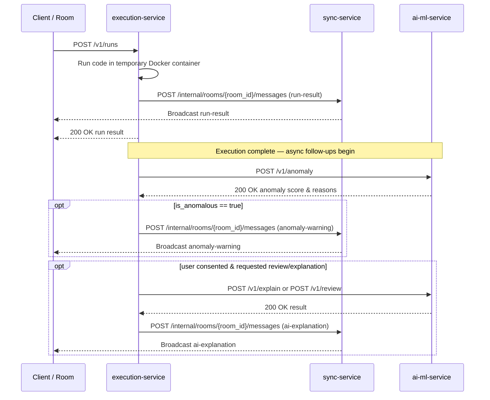

# AI/ML Service — Execution-to-AI/ML Contract

**Version:** v0 (draft)
**Issue:** T-07 · #10
**Branch:** `feature/T-07-ai-contract`
**Author:** Prince Gadara (Category C — PR1: contract specification & alignment)
**Reviewers:** Digvijay Parmar (PR2 — JSON Schemas & model integration)
**Status:** Aligned with `docs/api-contracts.md` (T-06 v0) and `ai-ml-service/docs/anomaly-spec.md` (T-13 draft).

---

> **T-06 & T-13 Alignment Note**
> This document is fully aligned with:
> 1. `docs/api-contracts.md` (T-06 v0, Yash Oza): Port 8000, health path `/health`, `snake_case` JSON fields, common execution metrics, error envelope shape (§7), and strict execution ordering (§6, NFR9).
> 2. `ai-ml-service/docs/anomaly-spec.md` (T-13, Digvijay Parmar): Metric feature list (`execution_time_ms`, `peak_memory_mb`, `stdout_bytes`, `stderr_bytes`, `exit_code`, `timed_out`, `oom_killed`, `language`), reason categories (`reason_category_id`), and threshold deferred to Sprint 3 validation.

---

## Contents

- [AI/ML Service — Execution-to-AI/ML Contract](#aiml-service--execution-to-aiml-contract)
  - [Contents](#contents)
  - [1. Overview](#1-overview)
  - [2. Base URL and Health Check](#2-base-url-and-health-check)
  - [3. Common Request Fields](#3-common-request-fields)
  - [4. Endpoints](#4-endpoints)
    - [4.1 `GET /health`](#41-get-health)
    - [4.2 `POST /v1/review`](#42-post-v1review)
      - [Request body](#request-body)
      - [Response 200](#response-200)
    - [4.3 `POST /v1/explain`](#43-post-v1explain)
      - [Request body](#request-body-1)
      - [Response 200](#response-200-1)
    - [4.4 `POST /v1/anomaly`](#44-post-v1anomaly)
      - [Request body](#request-body-2)
      - [Response 200](#response-200-2)
      - [Reason Categories (`reason_category_id`, from T-13 §2)](#reason-categories-reason_category_id-from-t-13-2)
  - [5. Error Envelope](#5-error-envelope)
    - [Error Codes](#error-codes)
  - [6. Ordering Rule — NFR9 \& T-06 §6](#6-ordering-rule--nfr9--t-06-6)
  - [7. Room Broadcast Follow-ups (Sync Integration)](#7-room-broadcast-follow-ups-sync-integration)
    - [7.1 `anomaly-warning` (FR8.2)](#71-anomaly-warning-fr82)
    - [7.2 `ai-explanation` (FR13.2)](#72-ai-explanation-fr132)
  - [8. Cache Key — NFR5.2](#8-cache-key--nfr52)
  - [9. Logging Fields — NFR8](#9-logging-fields--nfr8)
  - [10. Design Decisions](#10-design-decisions)
  - [11. Examples](#11-examples)
    - [11.1 Review (`POST /v1/review`)](#111-review-post-v1review)
    - [11.2 Explanation (`POST /v1/explain`)](#112-explanation-post-v1explain)
    - [11.3 Anomaly — Normal Execution (`POST /v1/anomaly`)](#113-anomaly--normal-execution-post-v1anomaly)
    - [11.4 Anomaly — Anomalous Execution (`POST /v1/anomaly`)](#114-anomaly--anomalous-execution-post-v1anomaly)
    - [11.5 Error — Consent Missing (`POST /v1/explain`)](#115-error--consent-missing-post-v1explain)
    - [11.6 Java Review Example (`POST /v1/review`)](#116-java-review-example-post-v1review)
    - [11.7 C Explanation Example (`POST /v1/example`)](#117-c-explanation-example-post-v1example)
  - [12. Open Items (v0)](#12-open-items-v0)
- [Part 2: Version 2 Contract (T-18)](#part-2-version-2-contract-t-18)
  - [13. Scope and Replaced v0 Rules](#13-scope-and-replaced-v0-rules)
    - [13.1 v0 Rules Replaced by Version 2](#131-v0-rules-replaced-by-version-2)
  - [14. Backlog v2 Contract Decisions (§6.2)](#14-backlog-v2-contract-decisions-62)
  - [15. Execution-Service Entry Point (`POST /v1/analyses`)](#15-execution-service-entry-point-post-v1analyses)
    - [15.1 Request Body](#151-request-body)
    - [15.2 Response 202 Accepted](#152-response-202-accepted)
  - [16. ai-ml-service Endpoints (Decision 5)](#16-ai-ml-service-endpoints-decision-5)
    - [16.1 Prince's Section: Task 1 — Time Complexity and Verified Optimizations (`POST /v1/analyses/complexity`)](#161-princes-section-task-1--time-complexity-and-verified-optimizations-post-v1analysescomplexity)
      - [Purpose \& Behaviour](#purpose--behaviour)
      - [Request Example (Task 1)](#request-example-task-1)
      - [Response 200 OK Example (Task 1 — Success with Verified Patch)](#response-200-ok-example-task-1--success-with-verified-patch)
      - [Response 200 OK Example (Task 1 — Rules-First Analysis, AI Step Avoided, US-67)](#response-200-ok-example-task-1--rules-first-analysis-ai-step-avoided-us-67)
      - [Response 200 OK Example (Task 1 — Blocked AI Step / Consent Missing)](#response-200-ok-example-task-1--blocked-ai-step--consent-missing)
      - [Response 200 OK Example (Task 1 — Blocked AI Step / AI Disabled by Host)](#response-200-ok-example-task-1--blocked-ai-step--ai-disabled-by-host)
      - [Response 200 OK Example (Task 1 — Blocked AI Step / Cost Cap Reached)](#response-200-ok-example-task-1--blocked-ai-step--cost-cap-reached)
    - [16.2 Prince's Section: Task 2 — Slowdown Detection in Run History (`POST /v1/analyses/slowdown`)](#162-princes-section-task-2--slowdown-detection-in-run-history-post-v1analysesslowdown)
      - [Purpose \& Behaviour](#purpose--behaviour-1)
      - [Request Example (Task 2)](#request-example-task-2)
      - [Response 200 OK Example (Task 2 — Regression Detected)](#response-200-ok-example-task-2--regression-detected)
      - [Response 200 OK Example (Task 2 — Normal Performance)](#response-200-ok-example-task-2--normal-performance)
      - [Response 200 OK Example (Task 2 — Baseline Establishing, Sample Count \< 3)](#response-200-ok-example-task-2--baseline-establishing-sample-count--3)
      - [Response 200 OK Example (Task 2 — Regression Detected, AI Step Skipped / AI Disabled)](#response-200-ok-example-task-2--regression-detected-ai-step-skipped--ai-disabled)
    - [16.3 Chandan's Section: Task 3 — Failing Inputs \& Delta Minimization (`POST /v1/analyses/failing-input`)](#163-chandans-section-task-3--failing-inputs--delta-minimization-post-v1analysesfailing-input)
      - [Purpose \& Behaviour](#purpose--behaviour-2)
      - [Request Fields](#request-fields)
      - [Request Example](#request-example)
      - [Response 200 OK — Failing Input Found](#response-200-ok--failing-input-found)
      - [Response 200 OK — No Failure Found](#response-200-ok--no-failure-found)
      - [Delta-Minimization Status](#delta-minimization-status)
      - [Consent and Host AI Switch (Decisions 8 and 10; FR12, FR35, CR06, CR12)](#consent-and-host-ai-switch-decisions-8-and-10-fr12-fr35-cr06-cr12)
      - [Open Integration Items (must remain visible in the PR)](#open-integration-items-must-remain-visible-in-the-pr)
    - [16.3.1 Consent/Host-Switch Examples](#1631-consenthost-switch-examples)
    - [16.4 Digvijay's Section: Task 4 — C/C++ Crash Explanation (`POST /v1/analyses/crash-explanation`)](#164-digvijays-section-task-4--cc-crash-explanation-post-v1analysescrash-explanation)
      - [Purpose \& Behaviour](#purpose--behaviour-3)
      - [Request Fields](#request-fields-1)
      - [Request Example (Task 4)](#request-example-task-4)
      - [Response 200 OK Example (Task 4 — Success with AI Explanation)](#response-200-ok-example-task-4--success-with-ai-explanation)
      - [Response 200 OK Example (Task 4 — Blocked AI Step / Consent Missing)](#response-200-ok-example-task-4--blocked-ai-step--consent-missing)
      - [Response 200 OK Example (Task 4 — Blocked AI Step / AI Disabled by Host)](#response-200-ok-example-task-4--blocked-ai-step--ai-disabled-by-host)
      - [Response 200 OK Example (Task 4 — Blocked AI Step / Cost Cap Reached)](#response-200-ok-example-task-4--blocked-ai-step--cost-cap-reached)
      - [Response 422 Error Example (Task 4 — Unsupported Language)](#response-422-error-example-task-4--unsupported-language)
      - [Response 422 Error Example (Task 4 — Invalid Request)](#response-422-error-example-task-4--invalid-request)
    - [16.5 Digvijay's Section: Task 5 — Telemetry Counters (`GET /v1/usage`) \& Room Lifecycle (`DELETE /v1/rooms/{room_id}/state`)](#165-digvijays-section-task-5--telemetry-counters-get-v1usage--room-lifecycle-delete-v1roomsroom_idstate)
      - [16.5.1 `GET /v1/usage` (Response 200 OK)](#1651-get-v1usage-response-200-ok)
      - [16.5.2 `DELETE /v1/rooms/{room_id}/state` (Response 200 OK)](#1652-delete-v1roomsroom_idstate-response-200-ok)
  - [17. Delivery \& Client-Facing Messages (`analysis-result`, Decision 6)](#17-delivery--client-facing-messages-analysis-result-decision-6)
    - [17.1 Audience Rules (CR08, T-17 Decision 10)](#171-audience-rules-cr08-t-17-decision-10)
    - [17.2 WebSocket Message Payload Example (Task 1 — Complexity)](#172-websocket-message-payload-example-task-1--complexity)
    - [17.3 WebSocket Message Payload Example (Task 2 — Slowdown)](#173-websocket-message-payload-example-task-2--slowdown)
    - [17.4 WebSocket Message Payload Example (Task 3 — Failing Input)](#174-websocket-message-payload-example-task-3--failing-input)
    - [17.5 WebSocket Message Payload Example (Task 4 — Crash Explanation)](#175-websocket-message-payload-example-task-4--crash-explanation)
    - [17.6 WebSocket Message Payload Example (Task 1 — Fallback / Skipped AI Step)](#176-websocket-message-payload-example-task-1--fallback--skipped-ai-step)
    - [17.7 WebSocket Message Payload Example (Error Outcome)](#177-websocket-message-payload-example-error-outcome)
  - [18. Repeated and Batch Runs (Decision 7)](#18-repeated-and-batch-runs-decision-7)
    - [18.1 Measurement (`purpose: "measurement"`)](#181-measurement-purpose-measurement)
    - [18.2 Test Batch (`purpose: "test_batch"`)](#182-test-batch-purpose-test_batch)
    - [18.3 Sanitizer (`purpose: "sanitizer"`)](#183-sanitizer-purpose-sanitizer)
  - [19. Run History and In-Memory Lifecycle (Decision 9)](#19-run-history-and-in-memory-lifecycle-decision-9)
  - [20. Gating: Consent \& Host AI Switch (Decisions 8 \& 10)](#20-gating-consent--host-ai-switch-decisions-8--10)
    - [20.1 Blocked AI Step Codes \& Fallback Messages](#201-blocked-ai-step-codes--fallback-messages)
    - [20.2 Unprocessable Request Error Envelopes](#202-unprocessable-request-error-envelopes)
  - [21. Normalized Code Caching (Decision 11, NFR5.2)](#21-normalized-code-caching-decision-11-nfr52)
  - [22. Privacy-Compliant Telemetry Logging (Decision 12, NFR8.1, NFR8.2, US-25)](#22-privacy-compliant-telemetry-logging-decision-12-nfr81-nfr82-us-25)
  - [23. Review Confirmations](#23-review-confirmations)
  - [24. Changes](#24-changes)

## 1. Overview

This document defines the HTTP contract between the **execution-service** (caller, Java/Spring Boot) and the **ai-ml-service** (service, Python/FastAPI), operating on port 8000. It covers three operational endpoints — `review`, `explain`, and `anomaly` — plus the container health check.

**Caller:** execution-service
**Service:** ai-ml-service
**Port:** 8000 (`PORT`, fixed in T-06 §1)

Core architectural rules enforced by this contract:

- **Non-blocking execution (NFR9, T-06 §6):** The execution-service calls this service **only after** delivering execution results to room participants. AI/ML processing runs asynchronously (fork/join) and never delays execution output.
- **Privacy & Data minimization (NFR8.2, T-13 §1):**
  - `review` and `explain` requests require user consent (FR12) and include code/stderr.
  - `anomaly` requests include **only numeric metrics and language metadata — no source code, no stderr text, no stdin**.
- **Consent gating (FR12):** `review` and `explain` require `consent: true`. A `consent: false` payload returns `CONSENT_MISSING` (HTTP 403).
- **Metric passthrough:** Field names for execution metrics match `docs/api-contracts.md` §4.2 character-for-character so execution-service forwards them directly without translation.

---

## 2. Base URL and Health Check

```
http://ai-ml-service:8000
```

- Inside Docker Compose network: `http://ai-ml-service:8000` (matches `docker-compose.yml` service name and T-06 §1).
- Host / local development: `http://localhost:8000`.
- All operational endpoints are prefixed with `/v1`.
- Health check is hosted at `/health` (HTTP 200).

---

## 3. Common Request Fields

Every POST endpoint body includes these standard envelope fields:

| Field          | Type                                                            | Required | Notes                                                                                           |
|----------------|-----------------------------------------------------------------|----------|-------------------------------------------------------------------------------------------------|
| `request_id`   | string (UUID v4)                                                | Yes      | Generated by the client for the run (T-06 §2). Echoed unchanged in every response and log line. |
| `room_id`      | string                                                          | Yes      | Identifies the room. Used for correlation and per-room rate limiting (NFR5.3).                 |
| `request_type` | `"review"` \| `"explanation"` \| `"anomaly"`                  | Yes      | Identifies the requested action. Must match the route invoked.                                  |
| `language`     | `"cpp"` \| `"python"` \| `"c"` \| `"java"` \| `"javascript"` | Yes      | Exact DR1 language identifiers (matching T-06 §2 and T-13 §1).                                  |
| `consent`      | boolean                                                         | Yes      | `true` when user has consented to external AI analysis (FR12). Required for `review` & `explain`. |

---

## 4. Endpoints

### 4.1 `GET /health`

Liveness probe for Docker container and T-08 smoke tests. Returns 200 when the FastAPI service is running. Does not probe external LLM APIs.

**Response 200**

```json
{
  "status": "ok",
  "version": "v0"
}
```

---

### 4.2 `POST /v1/review`

On-demand AI code review (FR7). Triggered explicitly by a user with consent (FR12). Never called automatically.

#### Request body

Common fields (§3) plus:

| Field               | Type                                                             | Required | Notes                                                                      |
|---------------------|------------------------------------------------------------------|----------|----------------------------------------------------------------------------|
| `code`              | string                                                           | Yes      | Source code to review (FR4.1).                                             |
| `stderr`            | string                                                           | Yes      | Stderr output from the run, or `""` if successful.                         |
| `exit_code`         | integer                                                          | Yes      | Exit code of the process (T-06 §4.2).                                      |
| `execution_time_ms` | number                                                           | Yes      | Wall-clock execution time in milliseconds (T-06 §4.2).                     |
| `peak_memory_mb`    | number                                                           | Yes      | Peak memory usage in megabytes (T-06 §4.2).                                |
| `timed_out`         | boolean                                                          | Yes      | `true` if killed by wall-time limit (NFR4.1, T-06 §4.2).                    |
| `oom_killed`        | boolean                                                          | Yes      | `true` if killed by memory limit (NFR4.2, T-06 §4.2).                       |
| `failure_kind`      | `"compile_error"` \| `"non_zero_exit"` \| `"timeout"` \| `null` | Yes      | `null` when execution succeeded (T-06 §4.2).                               |

#### Response 200

```json
{
  "request_id": "<uuid echoed from request>",
  "summary": "One-sentence overall code assessment.",
  "comments": [
    {
      "line": 12,
      "severity": "warning",
      "message": "Human-readable description of the issue.",
      "suggestion": "Optional remediation hint or null."
    }
  ]
}
```

| Field                   | Type                                  | Notes                                                           |
|-------------------------|---------------------------------------|-----------------------------------------------------------------|
| `request_id`            | string                                | Echoed from request.                                            |
| `summary`               | string                                | Exactly one sentence. Never empty.                              |
| `comments`              | array                                 | List of comment objects. Empty array `[]` if no issues found.   |
| `comments[].line`       | integer \| null                       | 1-based source line number, or `null` for file-level comments.  |
| `comments[].severity`   | `"info"` \| `"warning"` \| `"error"`  | Severity level.                                                 |
| `comments[].message`    | string                                | Description of the issue.                                       |
| `comments[].suggestion` | string \| null                        | Optional remediation suggestion.                                |

---

### 4.3 `POST /v1/explain`

Short plain-language explanation of a failed execution (FR13.1). Called when an execution fails and the user has consented (FR12).

**Constraint:** The `explanation` string must be **at most 3 sentences**, plain prose, without markdown formatting.

#### Request body

Same fields as `/v1/review` (§4.2): common fields (§3) plus `code`, `stderr`, `exit_code`, `execution_time_ms`, `peak_memory_mb`, `timed_out`, `oom_killed`, `failure_kind`.

#### Response 200

```json
{
  "request_id": "<uuid echoed from request>",
  "explanation": "At most 3 sentences in plain language explaining the failure."
}
```

---

### 4.4 `POST /v1/anomaly`

ML-based anomaly scoring of execution metrics (FR8.1, T-13). Called after **every** execution run (success or failure) by execution-service.

**Privacy guarantee (NFR8.2, T-13 §1):** Anomaly scoring operates **strictly** on execution metrics and metadata. **No `code`, `stderr` text, or `stdin` fields are accepted.**

#### Request body

Common fields (§3) plus the metrics defined in `ai-ml-service/docs/anomaly-spec.md` (T-13 §1):

| Field               | Type     | Required | Notes                                                               |
|---------------------|----------|----------|---------------------------------------------------------------------|
| `execution_time_ms` | number   | Yes      | Wall-clock execution time in milliseconds (T-06 §4.2, T-13 §1).     |
| `peak_memory_mb`    | number   | Yes      | Peak memory usage in megabytes (T-06 §4.2, T-13 §1).                |
| `stdout_bytes`      | integer  | Yes      | Byte length of standard output generated (T-13 §1).                 |
| `stderr_bytes`      | integer  | Yes      | Byte length of standard error output generated (T-13 §1).            |
| `exit_code`         | integer  | Yes      | Process exit code (T-06 §4.2, T-13 §1).                             |
| `timed_out`         | boolean  | Yes      | `true` if killed by configured wall-time limit (default 5s, DR3).   |
| `oom_killed`        | boolean  | Yes      | `true` if killed by configured memory limit (default 128MB, DR3).   |

> **Unit Conventions & Configured Limits (DR3):**
> - Standard binary units apply: **1 KB = 1024 bytes (KiB)** and **1 MB = 1,048,576 bytes (MiB)** for `stdout_bytes` and `stderr_bytes`.
> - Resource constraints (current defaults: 5s wall time NFR4.1, 128 MB memory NFR4.2, 1 MB output cap NFR4.4) are **configuration parameters, not hardcoded into the contract** (DR3, T-06 §2). Warning messages refer to the "configured time limit".

#### Response 200

```json
{
  "request_id": "<uuid echoed from request>",
  "is_anomalous": false,
  "score": 0.21,
  "reasons": [],
  "message_short": ""
}
```

| Field           | Type    | Notes                                                                                                                                           |
|-----------------|---------|-------------------------------------------------------------------------------------------------------------------------------------------------|
| `request_id`    | string  | Echoed from request.                                                                                                                            |
| `is_anomalous`  | boolean | `true` when `score` exceeds threshold. Threshold is chosen during Sprint 3 validation (T-13 §4, FR8.1). Sprint 1 baseline stub returns `false`.|
| `score`         | number  | Continuous anomaly score in `[0.0, 1.0]`. Higher indicates greater anomaly.                                                                     |
| `reasons`       | array   | List of `reason_category_id` strings (see table below). Empty array `[]` when `is_anomalous` is `false`.                                       |
| `message_short` | string  | Short user-facing warning sentence broadcast to the room (FR8.2). Empty string `""` when `is_anomalous` is `false`.                             |

#### Reason Categories (`reason_category_id`, from T-13 §2)

When `is_anomalous: true`, `reasons` contains one or more of the following standard identifiers, and `message_short` provides the human-readable explanation:

| `reason_category_id`      | Description / `message_short` template (T-13 §2)                             |
|---------------------------|-------------------------------------------------------------------------------|
| `EXCESSIVE_EXECUTION_TIME`| "The execution took unusually long, nearing the configured time limit."       |
| `HIGH_MEMORY_USAGE`       | "The code consumed an unexpectedly large amount of memory."                   |
| `OUTPUT_FLOODING`         | "The code generated an unusually massive amount of text output."              |
| `ABNORMAL_TERMINATION`    | "The execution crashed or triggered a system resource kill."                 |

---

## 5. Error Envelope

Error responses across all endpoints adhere to the standard project error envelope (matching `docs/api-contracts.md` §7):

```json
{
  "request_id": "<uuid from request, or null if unparseable>",
  "error": {
    "code": "RATE_LIMITED_PROVIDER",
    "message": "The AI provider returned HTTP 429. Retry after 30 seconds.",
    "retry_after_seconds": 30
  }
}
```

`retry_after_seconds` is an `integer` when a retry window is known, or `null` otherwise.

### Error Codes

| Code                    | HTTP Status | Trigger Condition                                                                                     | Expected Caller Behaviour                                                                     |
|-------------------------|-------------|-------------------------------------------------------------------------------------------------------|-----------------------------------------------------------------------------------------------|
| `RATE_LIMITED_PROVIDER` | **429**     | Upstream AI provider returned HTTP 429. `retry_after_seconds` passed from provider `Retry-After`.    | Caller waits `retry_after_seconds` then retries. Editor & execution continue unaffected.      |
| `COST_CAP_REACHED`      | **402**     | Monthly spend cap reached (NFR7.2).                                                                   | Surface "AI temporarily unavailable" in room. Code execution is unaffected.                   |
| `CONSENT_MISSING`       | **403**     | `consent` is `false` on a `review` or `explain` call (FR12.2).                                        | Do not retry without obtaining explicit user consent.                                         |
| `INVALID_REQUEST`       | **422**     | Missing required fields, unrecognised `language`, invalid types, or malformed JSON payload.          | Inspect and correct request payload; do not retry unchanged.                                  |
| `PROVIDER_ERROR`        | **502**     | Upstream AI provider returned 5xx or unparseable response body.                                       | May retry with exponential backoff.                                                           |
| `PROVIDER_TIMEOUT`      | **504**     | Upstream AI provider timed out.                                                                       | May retry.                                                                                    |

---

## 6. Ordering Rule — NFR9 & T-06 §6

> **The ai-ml-service is NEVER in the critical path of code execution results.**

The execution-service executes the following sequence:



1. Run user code in an isolated container.
2. Deliver the `run-result` to sync-service for broadcast and return HTTP 200 to the caller.
3. **Only after step 2**, invoke `POST /v1/anomaly`.
4. If `is_anomalous: true`, dispatch an `anomaly-warning` follow-up message to the room via sync-service.
5. If requested and consented, invoke `POST /v1/explain` or `POST /v1/review`, and dispatch `ai-explanation` follow-up message to sync-service.

---

## 7. Room Broadcast Follow-ups (Sync Integration)

Messages forwarded to sync-service (`POST /internal/rooms/{room_id}/messages`) use the reserved frame types defined in `docs/api-contracts.md` §3.6:

### 7.1 `anomaly-warning` (FR8.2)

```json
{
  "type": "anomaly-warning",
  "request_id": "0b9d2f3e-7a41-4c58-9e1b-5d3c8a6f2e10",
  "room_id": "room-demo-01",
  "reasons": ["EXCESSIVE_EXECUTION_TIME"],
  "message_short": "The execution took unusually long, nearing the configured time limit."
}
```

### 7.2 `ai-explanation` (FR13.2)

```json
{
  "type": "ai-explanation",
  "request_id": "c9bf9e57-1685-4c89-bafb-ff5af830be8a",
  "room_id": "room-demo-01",
  "explanation": "The program read past the end of a 3-element array using index 10, causing a segmentation fault. Fix the array index or add bounds checking."
}
```

---

## 8. Cache Key — NFR5.2

To limit API spend (NFR7), identical `review` and `explain` requests are cached service-wide by SHA-256 hash:

```
SHA-256( code + "\n" + language + "\n" + request_type + "\n" + stderr_if_relevant )
```

- `stderr_if_relevant` is the literal stderr text for `explain` requests, and `""` for `review` requests.
- **Only the hash is cached** — raw user code is never stored persistently (NFR8.2).
- Anomaly scoring is **not cached** since execution metrics vary between runs.
- Cache implementation is scheduled for Sprint 3.

---

## 9. Logging Fields — NFR8

Every request processed by ai-ml-service is logged with structured JSON containing only these operational fields:

| Field          | Type    | Notes                                                         |
|----------------|---------|---------------------------------------------------------------|
| `request_id`   | string  | Echoed from request.                                          |
| `room_id`      | string  | Echoed from request.                                          |
| `request_type` | string  | `"review"`, `"explanation"`, or `"anomaly"`.                  |
| `language`     | string  | DR1 identifier.                                               |
| `status`       | string  | `"success"` or `"error"`.                                     |
| `error_code`   | string  | Error code from §5, or `null` on success.                     |
| `latency_ms`   | integer | Processing duration in milliseconds.                          |

**Prohibited from logs (NFR8.2):** User code, stderr text, stdin, response text, or any user identifiers beyond `room_id`.

---

## 10. Design Decisions

| Decision | Traceability | Rationale |
|---|---|---|
| Single port 8000 & `/health` endpoint | T-06 §1, T-08 | Consistent integration test surface across all 4 services. |
| Zero metric translation | T-06 §4.2, T-13 §1 | Field names match execution-service run result (`execution_time_ms`, `peak_memory_mb`, `exit_code`, `timed_out`, `oom_killed`) so execution-service forwards them directly without transformation. |
| Anomaly payload has no code | T-13 §1, NFR8.2 | Feature extraction uses purely numeric and metadata metrics. Storing or transferring code for anomaly scoring violates data minimization. |
| Standardized reason categories | T-13 §2 | Enumerating `EXCESSIVE_EXECUTION_TIME`, `HIGH_MEMORY_USAGE`, `OUTPUT_FLOODING`, `ABNORMAL_TERMINATION` ensures consistent UI messaging. |
| Threshold deferred to Sprint 3 | T-13 §4, FR8.1 | Synthetic training in T-12 and baseline model in T-15 precede final statistical calibration. Hard-coding thresholds in v0 contract is prohibited. |
| Configured limits (DR3) | T-06 §2, DR3, NFR4 | Execution limits (5s, 128MB, 1MB output) are host-configurable defaults, not fixed contract constants. Warning messages refer to "configured time limit". |
| Binary byte units | T-13 §3.1, NFR4.4 | Standard binary units (1 KB = 1024 bytes, 1 MB = 1,048,576 bytes) apply to `stdout_bytes` and `stderr_bytes`. |
| Unified error envelope | T-06 §7 | Ensures execution-service handles errors uniformly across all downstream endpoints. |

---

## 11. Examples

### 11.1 Review (`POST /v1/review`)

**Request**

```json
{
  "request_id": "f47ac10b-58cc-4372-a567-0e02b2c3d479",
  "room_id": "room-demo-01",
  "request_type": "review",
  "language": "cpp",
  "consent": true,
  "code": "#include <iostream>\nint main() {\n    int unused_var;\n    std::cout << \"hello\" << std::endl;\n    return 0;\n}",
  "stderr": "",
  "exit_code": 0,
  "execution_time_ms": 312,
  "peak_memory_mb": 4.1,
  "timed_out": false,
  "oom_killed": false,
  "failure_kind": null
}
```

**Response 200**

```json
{
  "request_id": "f47ac10b-58cc-4372-a567-0e02b2c3d479",
  "summary": "The code compiles and runs successfully; one unused variable detected.",
  "comments": [
    {
      "line": 3,
      "severity": "warning",
      "message": "Variable 'unused_var' is declared but never read.",
      "suggestion": "Remove 'unused_var' or initialize it with a used value."
    }
  ]
}
```

---

### 11.2 Explanation (`POST /v1/explain`)

**Request**

```json
{
  "request_id": "c9bf9e57-1685-4c89-bafb-ff5af830be8a",
  "room_id": "room-demo-01",
  "request_type": "explanation",
  "language": "cpp",
  "consent": true,
  "code": "#include <iostream>\nint main() {\n    int arr[3] = {1, 2, 3};\n    std::cout << arr[10] << std::endl;\n    return 0;\n}",
  "stderr": "Segmentation fault (core dumped)",
  "exit_code": 139,
  "execution_time_ms": 88,
  "peak_memory_mb": 3.9,
  "timed_out": false,
  "oom_killed": false,
  "failure_kind": "non_zero_exit"
}
```

**Response 200**

```json
{
  "request_id": "c9bf9e57-1685-4c89-bafb-ff5af830be8a",
  "explanation": "The program read past the bounds of a 3-element array using index 10, which caused a segmentation fault with exit code 139. Ensure the index is within 0 to 2 before accessing the array."
}
```

---

### 11.3 Anomaly — Normal Execution (`POST /v1/anomaly`)

**Request**

```json
{
  "request_id": "3fa85f64-5717-4562-b3fc-2c963f66afa6",
  "room_id": "room-demo-01",
  "request_type": "anomaly",
  "language": "python",
  "consent": true,
  "execution_time_ms": 210,
  "peak_memory_mb": 14.5,
  "stdout_bytes": 14,
  "stderr_bytes": 0,
  "exit_code": 0,
  "timed_out": false,
  "oom_killed": false
}
```

**Response 200**

```json
{
  "request_id": "3fa85f64-5717-4562-b3fc-2c963f66afa6",
  "is_anomalous": false,
  "score": 0.08,
  "reasons": [],
  "message_short": ""
}
```

---

### 11.4 Anomaly — Anomalous Execution (`POST /v1/anomaly`)

**Request**

```json
{
  "request_id": "e72a49b2-32b1-4c12-9c32-11a5b8e90f23",
  "room_id": "room-demo-01",
  "request_type": "anomaly",
  "language": "cpp",
  "consent": true,
  "execution_time_ms": 4890,
  "peak_memory_mb": 121.4,
  "stdout_bytes": 950000,
  "stderr_bytes": 0,
  "exit_code": 0,
  "timed_out": false,
  "oom_killed": false
}
```

**Response 200**

```json
{
  "request_id": "e72a49b2-32b1-4c12-9c32-11a5b8e90f23",
  "is_anomalous": true,
  "score": 0.89,
  "reasons": ["EXCESSIVE_EXECUTION_TIME", "HIGH_MEMORY_USAGE", "OUTPUT_FLOODING"],
  "message_short": "The execution took unusually long, nearing the configured time limit."
}
```

---

### 11.5 Error — Consent Missing (`POST /v1/explain`)

**Response 403**

```json
{
  "request_id": "c9bf9e57-1685-4c89-bafb-ff5af830be8a",
  "error": {
    "code": "CONSENT_MISSING",
    "message": "User consent is required before code or execution context can be sent to external AI.",
    "retry_after_seconds": null
  }
}
```
---
### 11.6 Java Review Example (`POST /v1/review`)

**Request**
```json
{
  "request_id": "a1b2c3d4-5678-90ef-1234-567890abcdef",
  "room_id": "room-demo-02",
  "request_type": "review",
  "language": "java",
  "consent": true,
  "code": "class Main {\n    public static void main(String[] args) {\n        System.out.println(\"Hello\");\n    }\n}",
  "stderr": "",
  "exit_code": 0,
  "execution_time_ms": 120,
  "peak_memory_mb": 45.2,
  "timed_out": false,
  "oom_killed": false,
  "failure_kind": null
}
```
---

### 11.7 C Explanation Example (`POST /v1/example`)

**Request**
```json

{
  "request_id": "b2c3d4e5-6789-01fa-2345-678901bcdefa",
  "room_id": "room-demo-02",
  "request_type": "explanation",
  "language": "c",
  "consent": true,
  "code": "#include <stdio.h>\nint main() {\n    int *ptr = NULL;\n    *ptr = 10;\n    return 0;\n}",
  "stderr": "Segmentation fault (core dumped)",
  "exit_code": 139,
  "execution_time_ms": 12,
  "peak_memory_mb": 1.4,
  "timed_out": false,
  "oom_killed": false,
  "failure_kind": "non_zero_exit"
}
``` 
---

###11.8 JavaScript Anomaly Example(`POST /v1/anomaly`)
**Request**
```json
{
  "request_id": "c3d4e5f6-7890-12ab-3456-789012cdefab",
  "room_id": "room-demo-03",
  "request_type": "anomaly",
  "language": "javascript",
  "consent": true,
  "execution_time_ms": 4800,
  "peak_memory_mb": 110.5,
  "stdout_bytes": 1024000,
  "stderr_bytes": 0,
  "exit_code": 0,
  "timed_out": false,
  "oom_killed": false
}
```
---

## 12. Open Items (v0)

| # | Item | Owner | Target | Status |
|---|---|---|---|---|
| 1 | Execution features for anomaly model | Digvijay (T-13) | T-07 v0 | **Closed** (defined in `anomaly-spec.md`) |
| 2 | `reason_category_id` values & templates | Digvijay (T-13) | T-07 v0 | **Closed** (defined in `anomaly-spec.md` §2) |
| 3 | Base URL and error envelope alignment with T-06 | Prince (T-07) | T-07 v0 | **Closed** (aligned with `api-contracts.md` §1 & §7) |
| 4 | JSON Schema objects for all request & response types | Digvijay (T-07 PR2) | T-07 PR2 | Open for Digvijay's completing PR |
| 5 | Cache implementation (NFR5.2) | Prince | Sprint 3 | Open |
| 6 | Per-room rate limiting (NFR5.3) | Prince | Sprint 3 | Open |
| 7 | Cost-cap budget enforcement (NFR7.2) | Prince | Sprint 3 | Open |
| 8 | Anomaly score threshold validation (FR8.1) | Digvijay + Prince | Sprint 3 | Open |


---

# Part 2: Version 2 Contract (T-18)

**Document:** AI/ML Service Contract, Version 2  
**Issue:** T-18 · Product Backlog v2 §6.2  
**Branch:** `docs/T-18-ai-ml-contract-v2-tasks-1-2` (Prince), with `docs/T-18-ai-ml-contract-v2-task-3-consent` (Chandan) and `docs/T-18-ai-ml-contract-v2-assembly` (Digvijay)  
**Authors:**
- **Prince Gadara:** Task 1 (`/v1/analyses/complexity`), Task 2 (`/v1/analyses/slowdown`), request/result payloads, and `request_type` values
- **Chandan:** Task 3 (`/v1/analyses/failing-input`), consent and Host-switch fields (`consent`, `ai_enabled`, `CONSENT_MISSING`, `AI_DISABLED`)
- **Digvijay Parmar:** Contract assembly, retirement decisions (1–3), execution entry point (4), `analysis-result` message (6), internal runs (7), run history (9), error codes & blocked steps (10), cache key (11), logging (12), Task 4 (`/crash-explanation`), Task 5 (`/usage`, `/rooms/{room_id}/state`)
**Traceability:** FR12, FR29, FR32, FR35, FR36 to FR40, NFR5, NFR7 to NFR9, DR5 · T-18 · EPIC 3 · Sprint 2 (needed by US-22 and US-65 to US-78)  
**Status:** Decided / Proposed (individual statuses listed per decision)  

---

## 13. Scope and Replaced v0 Rules

Version 2 supersedes the initial draft (Part 1, v0) in alignment with **Requirements Specification v2** (`docs/IT314_Group32_Requirements_v2_Final.md`), **Product Backlog v2** (`docs/IT314_Group32_Backlog_v2_Final.md`), **CHG-01 §4.6**, and the **Platform Contract v2** (`docs/api-contracts.md`, T-17).

### 13.1 v0 Rules Replaced by Version 2
1. **Endpoint `POST /v1/review` (v0 §4.2) is Retired:** Code review is removed from the product scope (Requirements v2 §7.5, FR7 removed). Replaced by nothing; git history preserves the prototype (Decision 1).
2. **Endpoint `POST /v1/explain` (v0 §4.3) is Retired as a General Failure Explainer:** General failure explanations are removed (FR13 removed). The T-16 prototype implementation is refactored into Task 4 (`POST /v1/analyses/crash-explanation`), sending only sanitizer summaries and short code snippets (FR39.3, FR40.2, US-74, US-76, Decision 2).
3. **Endpoint `POST /v1/anomaly` (v0 §4.4) is Retired:** Statistical anomaly scoring is replaced by Task 2 slowdown detection against an empirical Median and MAD baseline (`POST /v1/analyses/slowdown`, FR37). The offline `AnomalyScorer` model stays in the repository unwired for mentor demonstration (Decision 3).
4. **Broadcast Messages (v0 §7: `anomaly-warning`, `ai-explanation`) are Retired:** Replaced by a unified `analysis-result` WebSocket message (§17, Decision 6, T-17 Decision 13).
5. **Raw Code Cache Key (v0 §8) is Replaced:** Replaced by SHA-256 of normalized code (comments stripped, whitespace normalized, semantic indentation preserved per NFR5.2, Decision 11).
6. **Logging Rules (v0 §9) are Replaced:** `room_id` is extracted strictly from the validated request body and is never `unknown`. Telemetry logs and counters contain metadata only; no raw source code, stdin, stderr, or prompts are ever logged (NFR8.1, NFR8.2, US-25, Decision 12).
7. **Room ID Format Updated (T-17 V2.1):** All room identifiers across requests, responses, and events are 128-bit secure random strings encoded as 22-character unpadded base64url (`A-Za-z0-9_-`).

---

## 14. Backlog v2 Contract Decisions (§6.2)

The 12 decisions recorded in Backlog v2 §6.2 govern this contract. **Decided** means requirements or an accepted architecture record force the behaviour. **Proposed** means a design choice confirmed across service teams in PR review.

| # | Topic | Decision | Status |
|---|---|---|---|
| 1 | `POST /v1/review` | Retired. The route, its tests and its section in the contract are removed (git history keeps them). | Decided |
| 2 | `POST /v1/explain` | Retired as a general explainer of failed runs. The prototype code (T-16, PR #45) is reused for crash explanation (US-74) after US-76 changes what it sends. | Decided |
| 3 | `POST /v1/anomaly` and the scorer | The endpoint is retired (a placeholder that always answers "not anomalous", not counted as a delivered feature). The scorer (`app/ml/scorer.py`), the dataset generator and their tests stay in the repository, wired to no route and marked outside v2 scope. The team checks with the mentor (S4) whether a model is wanted; the scorer is reused or deleted before US-68 starts. Slowdown detection (FR37) is median and MAD statistics and needs no model. | Decided (endpoint), Open (scorer, mentor check) |
| 4 | Entry point for an analysis | The client calls `POST /v1/analyses` on execution-service with the run or code reference and the `task`. execution-service checks run permission and the room's AI switch (T-17, decision 11), then returns 202 with `analysis_id`. The result arrives later as an `analysis-result` message, so the run result is never delayed. | Proposed |
| 5 | Endpoints of ai-ml-service | Called only by execution-service: `POST /v1/analyses/complexity` (Task 1), `/slowdown` (Task 2), `/failing-input` (Task 3), `/crash-explanation` (Task 4), `GET /v1/usage` (Task 5, counts only) and `DELETE /v1/rooms/{room_id}/state`. Every call carries `request_id`, `room_id`, `analysis_id`, `language`, `consent` and `ai_enabled`. `request_type` is `complexity`, `slowdown`, `failing_input` or `crash_explanation`. A call sends only the relevant code section (FR40.2). | Proposed |
| 6 | Result message | `analysis-result` with `request_id` (of the run), `analysis_id`, `task`, `status` (`ok`, `fallback` or `error`), `ai_step`, `result` (task payload) and `message`. It goes to the same audience as the run it belongs to. | Proposed |
| 7 | Who starts repeated and batch runs | execution-service starts every container. ai-ml-service asks for runs through `POST /internal/runs` on execution-service (`X-Internal-Token`, purpose `measurement`, `test_batch` or `sanitizer`). These runs use the same queue (FR16), budget (NFR14) and isolation rules, and are not broadcast as run results. | Proposed |
| 8 | Consent and the Host switch | The client sends `consent` on each request. execution-service reads `ai_enabled` from sync-service and passes it on. ai-ml-service runs an AI step only when both are true. | Decided (rule), Proposed (fields) |
| 9 | Run history | The run record (FR29, US-52) is held by sync-service, written with the delivery call. ai-ml-service keeps only hash-keyed measurements in room-scoped memory (FR37.4) and deletes them on `DELETE /v1/rooms/{room_id}/state`, which execution-service calls when a room is deleted or closed (US-56). | Proposed |
| 10 | Blocked AI steps | AI-free parts always return (NFR7.5, FR35.3). A blocked AI step is reported in the 200 body as `ai_step` with `status: "skipped"` and an `error_code`: `CONSENT_MISSING`, `AI_DISABLED`, `COST_CAP_REACHED`, `ROOM_RATE_LIMITED`, `RATE_LIMITED_PROVIDER`, `PROVIDER_ERROR` or `PROVIDER_TIMEOUT`. execution-service then shows the short fallback message (FR40.5). The error envelope is used only for calls that cannot be answered: `INVALID_REQUEST` (422), `UNSUPPORTED_LANGUAGE` (422, sanitizer run on a language other than C or C++) and `RUN_BUDGET_EXCEEDED` (429, NFR14). `AI_DISABLED` and `ROOM_RATE_LIMITED` are new. | Decided (codes and behaviour), Proposed (shape) |
| 11 | Cache key | SHA-256 of the normalised code (comments removed, whitespace normalised, meaning preserved), the language, the request type and the error output where it matters. Only the hash is stored. Replaces the raw-code key in section 8 of the v0 contract. | Decided |
| 12 | Logging | The log fields stay as in section 9 of the v0 contract: `request_id`, `room_id`, `request_type`, `language`, `status`, `error_code`, `latency_ms`. The room id comes from the validated request. This is the acceptance rule of US-25. | Decided |

---

## 15. Execution-Service Entry Point (`POST /v1/analyses`)

**Traceability:** FR12, FR35, FR41.4, NFR9, CR08, T-17 V2.8 / V2.11 / V2.12  
**Caller:** Client (browser)  
**Target:** `http://execution-service:8082/v1/analyses`  
**Purpose:** Asynchronous client trigger for an analysis task (Decision 4, NFR9).  
**Caller Identity (T-17 V2.6):** Identified by the header `X-Session-Id: <session_id>`: the caller's private session id (v0 §3.3), sent in a header, never in the URL or body.  
**Schemas:** `docs/schemas/analyses-request.json`, `docs/schemas/analyses-response.json`  
**Examples:** `docs/examples/v2-analysis-entry-request.json`, `docs/examples/v2-analysis-entry-response.json`  

When a user initiates an analysis, the client calls `execution-service`. `execution-service` verifies the caller's role, run permission (`can_run`), and the room's Host AI switch (`ai_enabled`) with `sync-service` (`GET /internal/rooms/{room_id}/sessions/{session_id}` per T-17 Decision 11) using `X-Internal-Token`. If the caller is denied or validation fails, `execution-service` returns T-17 V2.12 platform errors (`403 RUN_NOT_ALLOWED` with optional `error.reason`, `404 ROOM_NOT_FOUND` / `SESSION_NOT_FOUND` / `MODULE_NOT_FOUND`, `422 MODULE_NOT_RUNNABLE` / `NO_ENTRY_FILE`, or `503 ROOM_SERVICE_UNAVAILABLE`). If permitted, `execution-service` responds immediately with HTTP `202 Accepted` carrying an `analysis_id`, and dispatches the resolved code/run payload asynchronously to `ai-ml-service`. The analysis result arrives later as an `analysis-result` message on the control WebSocket, ensuring normal run execution is never delayed (NFR9, CR08).

#### Request Fields

| Field | Type | Required | Description |
|---|---|---|---|
| `request_id` | string (UUID v4) | Yes | Client-generated correlation ID for this analysis request. |
| `room_id` | string (22-char base64url) | Yes | Room identifier matching T-17 V2.1. |
| `task` | string | Yes | One of: `"complexity"`, `"slowdown"`, `"failing_input"`, `"crash_explanation"`. |
| `language` | string | Yes | One of DR1 languages: `"cpp"`, `"python"`, `"c"`, `"java"`, `"javascript"`. |
| `consent` | boolean | Yes | Caller AI consent status (FR12). |
| `source` | object | Conditional* | Workspace code reference matching T-17 V2.8: Pair mode sends `{"kind": "inline", "files": [...], "entry": "..."}`; Open mode sends `{"kind": "saved", "target": "module", "module_id": "..."}` or `{"kind": "saved", "target": "entry", "module_ids": [...]}`. |
| `run_request_id` | string (UUID v4) | Conditional* | Reference to a prior `POST /v1/runs` request ID (used when launching post-run `slowdown` or `crash_explanation` from run output). |
| `stdin` | string | No | Optional standard input supplied when reproducing a crash during `crash_explanation`. |
| `code` | string | Conditional* | Optional single-snippet inline convenience field when a standalone snippet is sent directly instead of `source`. |

*At least one of `source`, `run_request_id`, or `code` must be present so `execution-service` has a code or run reference (Decision 4).*

### 15.1 Request Body

**Pair mode (`source.kind = "inline"`, matching `docs/examples/v2-analysis-entry-request.json`):**
```json
{
  "request_id": "7a3e2b10-6c5d-4f8a-9e12-3456789abcde",
  "room_id": "Zq8-Lw2Ef6Th0Yx4Rn7JbA",
  "task": "complexity",
  "language": "python",
  "consent": true,
  "source": {
    "kind": "inline",
    "files": [
      {
        "name": "main.py",
        "content": "def find_duplicates(arr):\n    dups = []\n    for i in range(len(arr)):\n        for j in range(i + 1, len(arr)):\n            if arr[i] == arr[j]:\n                dups.append(arr[i])\n    return dups"
      }
    ],
    "entry": "main.py"
  }
}
```

**Open mode (`source.kind = "saved"`) with prior run reference (`run_request_id`):**
```json
{
  "request_id": "5a6b7c8d-9e0f-1a2b-3c4d-5e6f7a8b9c0d",
  "room_id": "k3Yc1t9Qx7mBvA2nR0sLpQ",
  "task": "crash_explanation",
  "language": "cpp",
  "consent": true,
  "source": {
    "kind": "saved",
    "target": "module",
    "module_id": "mod_9Qx7mBvA2nR0"
  },
  "run_request_id": "0b9d2f3e-7a41-4c58-9e1b-5d3c8a6f2e10"
}
```

### 15.2 Response 202 Accepted
```json
{
  "request_id": "7a3e2b10-6c5d-4f8a-9e12-3456789abcde",
  "analysis_id": "8b4f3c21-7d6e-4a9b-0f23-456789abcdef",
  "status": "accepted",
  "message": "Analysis started in background. Results will arrive via WebSocket."
}
```

---

## 16. ai-ml-service Endpoints (Decision 5)

**Caller:** `execution-service`  
**Target:** `http://ai-ml-service:8000`  
**Network:** Internal Docker network (not reachable directly from browser).

Every POST analysis request carries common envelope fields:

| Field | Type | Required | Description |
|---|---|---|---|
| `request_id` | string (UUID v4) | Yes | Correlation ID matching the original run or client analysis request. |
| `room_id` | string (22-char base64url) | Yes | Room identifier matching T-17 V2.1. Used for rate-limiting, history, and telemetry. |
| `analysis_id` | string (UUID v4) | Yes | Unique ID generated by `execution-service` for this analysis. |
| `request_type` | string | Yes | One of: `"complexity"`, `"slowdown"`, `"failing_input"`, `"crash_explanation"`. |
| `language` | string | Yes | One of DR1 languages: `"cpp"`, `"python"`, `"c"`, `"java"`, `"javascript"`. |
| `consent` | boolean | Yes | Caller AI consent status (FR12). |
| `ai_enabled` | boolean | Yes | Room Host AI switch status (FR35). |

Data minimization rule: Every call sends only the relevant code section or function snippet, never the entire repository or irrelevant modules (FR40.2).

---

### 16.1 Prince's Section: Task 1 — Time Complexity and Verified Optimizations (`POST /v1/analyses/complexity`)

**Traceability:** FR36.1 to FR36.4, NFR4.1, NFR14, CR02, CR06, CR10, US-65 to US-67  
**Endpoint:** `POST /v1/analyses/complexity`  
**`request_type`:** `"complexity"`  
**Schema & Examples:** Schema: `docs/schemas/complexity-request.json`, `docs/schemas/complexity-response.json`. Examples: `docs/examples/v2-analysis-complexity-request.json`, `docs/examples/v2-analysis-complexity-response.json`.

#### Purpose & Behaviour

1. **Empirical Measurements ($n, 2n, 4n$) (FR36.1, US-65):**
   - Programs are executed under comparable sandbox conditions at three geometrically spaced input sizes: $n$, $2n$, and $4n$.
   - Each input size is executed several times (e.g. 3 repeats), and the **median runtime** is computed to eliminate OS scheduling noise and thermal throttling jitter.
   - All sandbox runs are executed by `execution-service` through `POST /internal/runs` (`purpose: "measurement"`), subject to the individual 5 s wall-clock limit (NFR4.1), container queue limits (FR16), and the aggregate time budget and run cap (NFR14, CR10).
   - The measurement array is provided in the request as `{ "input_size": int, "runtimes_ms": [float, ...] }`.

2. **Log-Log Regression & Big-O Estimation (FR36.2, US-65):**
   - Fits a linear regression line to $\log(\text{input\_size})$ versus $\log(\text{median\_runtime})$ using NumPy:
     $$\log(T) = m \cdot \log(N) + c$$
   - Reports the computed parameters:
     - `growth_rate`: Slope $m$ of the linear fit.
     - `r2_score`: Coefficient of determination ($R^2 \in [0.0, 1.0]$) indicating regression confidence.
     - `estimated_complexity`: Standard Big-O complexity label mapped from slope $m$:
       - $m < 0.2 \implies O(1)$
       - $0.2 \le m < 0.8 \implies O(\log n)$
       - $0.8 \le m < 1.3 \implies O(n)$
       - $1.3 \le m < 1.8 \implies O(n \log n)$
       - $1.8 \le m < 2.5 \implies O(n^2)$
       - $2.5 \le m < 3.5 \implies O(n^3)$
       - $m \ge 3.5 \implies O(2^n)$
     - `projected_timeout_input_size`: Extrapolated input size $N_{\text{timeout}}$ where execution runtime would hit the 5 s sandbox limit (5000 ms, NFR4.1):
       $$N_{\text{timeout}} = \text{round}\left(\exp\left(\frac{\log(5000) - c}{m}\right)\right)$$

3. **Rules First Static Analysis (FR36.4, US-67):**
   - Before invoking any paid AI model, code is inspected using AST analysis (Python) or deterministic regular expressions (C/C++, Java, JS) for known performance pitfalls:
     - `nested_loops`: Deeply nested loop constructs ($O(n^2)$ or worse).
     - `string_concat_in_loop`: Repeated string concatenation in loops causing continuous memory reallocation.
     - `linear_search_in_loop`: Linear membership testing (`item in list`) within iterative loops.
   - Identified rules findings are returned in the `slow_patterns` array. If rule checks find clear structural issues, an external AI call is avoided unless explicitly needed for synthesis (US-67).

4. **Optimization Sandbox Verification (FR36.3, US-66):**
   - When an optimization patch is suggested (`suggested_patch`), it is executed in the sandbox under identical input conditions and its runtimes are recorded in `suggested_patch_runtimes_ms`.
   - The patch is marked `verified: true` **only if** its median measured runtime is strictly lower than the original code's median runtime under comparable inputs.
   - The speedup is quantified in `verified_speedup_pct`:
     $$\text{speedup} = \frac{T_{\text{orig}} - T_{\text{patch}}}{T_{\text{orig}}} \times 100$$
   - A suggested patch that fails to compile, produces incorrect results, or runs slower is marked `verified: false` with `verified_speedup_pct: null`.

5. **AI Gating & Blocked Steps (FR12, FR35, NFR7.5, CR02, CR06):**
   - If `consent == false`, `ai_enabled == false`, or budget limits are reached (`COST_CAP_REACHED`, `ROOM_RATE_LIMITED`), the empirical complexity metrics (`growth_rate`, `estimated_complexity`, `r2_score`, `projected_timeout_input_size`, and `slow_patterns`) **are still returned in full**.
   - Only `ai_step` is marked `status: "skipped"` with the corresponding `error_code`.

#### Request Example (Task 1)
```json
{
  "request_id": "7a3e2b10-6c5d-4f8a-9e12-3456789abcde",
  "room_id": "Zq8-Lw2Ef6Th0Yx4Rn7JbA",
  "analysis_id": "8b4f3c21-7d6e-4a9b-0f23-456789abcdef",
  "request_type": "complexity",
  "language": "python",
  "consent": true,
  "ai_enabled": true,
  "code": "def find_duplicates(arr):\n    dups = []\n    for i in range(len(arr)):\n        for j in range(i + 1, len(arr)):\n            if arr[i] == arr[j]:\n                dups.append(arr[i])\n    return dups",
  "measurements": [
    {
      "input_size": 100,
      "runtimes_ms": [1.12, 1.15, 1.14]
    },
    {
      "input_size": 200,
      "runtimes_ms": [4.45, 4.52, 4.48]
    },
    {
      "input_size": 400,
      "runtimes_ms": [17.85, 18.02, 17.91]
    }
  ],
  "suggested_patch": "def find_duplicates(arr):\n    seen = set()\n    dups = []\n    for x in arr:\n        if x in seen:\n            dups.append(x)\n        else:\n            seen.add(x)\n    return dups",
  "suggested_patch_runtimes_ms": [1.82, 1.79, 1.85]
}
```

#### Response 200 OK Example (Task 1 — Success with Verified Patch)
```json
{
  "request_id": "7a3e2b10-6c5d-4f8a-9e12-3456789abcde",
  "analysis_id": "8b4f3c21-7d6e-4a9b-0f23-456789abcdef",
  "task": "complexity",
  "growth_rate": 1.99,
  "estimated_complexity": "O(n^2)",
  "r2_score": 0.999,
  "projected_timeout_input_size": 6700,
  "slow_patterns": [
    {
      "pattern": "nested_loops",
      "line": 4,
      "message": "Nested loop detected at line 4: potential polynomial time complexity O(n^2)."
    }
  ],
  "ai_step": {
    "status": "ok",
    "error_code": null,
    "suggested_fix": "Use a hash set to track seen elements in a single pass O(n).",
    "verified": true,
    "verified_speedup_pct": 89.8
  }
}
```

#### Response 200 OK Example (Task 1 — Rules-First Analysis, AI Step Avoided, US-67)
```json
{
  "request_id": "7a3e2b10-6c5d-4f8a-9e12-3456789abcde",
  "analysis_id": "8b4f3c21-7d6e-4a9b-0f23-456789abcdef",
  "task": "complexity",
  "growth_rate": 2.01,
  "estimated_complexity": "O(n^2)",
  "r2_score": 0.998,
  "projected_timeout_input_size": 6650,
  "slow_patterns": [
    {
      "pattern": "nested_loops",
      "line": 4,
      "message": "Nested loop detected at line 4: potential polynomial time complexity O(n^2)."
    }
  ],
  "ai_step": {
    "status": "skipped",
    "error_code": null,
    "suggested_fix": null,
    "verified": false,
    "verified_speedup_pct": null
  }
}
```

#### Response 200 OK Example (Task 1 — Blocked AI Step / Consent Missing)
```json
{
  "request_id": "7a3e2b10-6c5d-4f8a-9e12-3456789abcde",
  "analysis_id": "8b4f3c21-7d6e-4a9b-0f23-456789abcdef",
  "task": "complexity",
  "growth_rate": 1.99,
  "estimated_complexity": "O(n^2)",
  "r2_score": 0.999,
  "projected_timeout_input_size": 6700,
  "slow_patterns": [
    {
      "pattern": "nested_loops",
      "line": 4,
      "message": "Nested loop detected at line 4: potential polynomial time complexity O(n^2)."
    }
  ],
  "ai_step": {
    "status": "skipped",
    "error_code": "CONSENT_MISSING",
    "suggested_fix": null,
    "verified": false,
    "verified_speedup_pct": null
  }
}
```

#### Response 200 OK Example (Task 1 — Blocked AI Step / AI Disabled by Host)
```json
{
  "request_id": "7a3e2b10-6c5d-4f8a-9e12-3456789abcde",
  "analysis_id": "8b4f3c21-7d6e-4a9b-0f23-456789abcdef",
  "task": "complexity",
  "growth_rate": 1.99,
  "estimated_complexity": "O(n^2)",
  "r2_score": 0.999,
  "projected_timeout_input_size": 6700,
  "slow_patterns": [
    {
      "pattern": "nested_loops",
      "line": 4,
      "message": "Nested loop detected at line 4: potential polynomial time complexity O(n^2)."
    }
  ],
  "ai_step": {
    "status": "skipped",
    "error_code": "AI_DISABLED",
    "suggested_fix": null,
    "verified": false,
    "verified_speedup_pct": null
  }
}
```

#### Response 200 OK Example (Task 1 — Blocked AI Step / Cost Cap Reached)
```json
{
  "request_id": "7a3e2b10-6c5d-4f8a-9e12-3456789abcde",
  "analysis_id": "8b4f3c21-7d6e-4a9b-0f23-456789abcdef",
  "task": "complexity",
  "growth_rate": 1.99,
  "estimated_complexity": "O(n^2)",
  "r2_score": 0.999,
  "projected_timeout_input_size": 6700,
  "slow_patterns": [
    {
      "pattern": "nested_loops",
      "line": 4,
      "message": "Nested loop detected at line 4: potential polynomial time complexity O(n^2)."
    }
  ],
  "ai_step": {
    "status": "skipped",
    "error_code": "COST_CAP_REACHED",
    "suggested_fix": null,
    "verified": false,
    "verified_speedup_pct": null
  }
}
```

---

### 16.2 Prince's Section: Task 2 — Slowdown Detection in Run History (`POST /v1/analyses/slowdown`)

**Traceability:** FR29, FR32, FR37.1 to FR37.4, CR11, DR3, US-56, US-68, US-69  
**Endpoint:** `POST /v1/analyses/slowdown`  
**`request_type`:** `"slowdown"`  
**Schema & Examples:** Schema: `docs/schemas/slowdown-request.json`, `docs/schemas/slowdown-response.json`. Examples: `docs/examples/v2-analysis-slowdown-request.json`, `docs/examples/v2-analysis-slowdown-response.json`.

#### Purpose & Behaviour

1. **Comparable Runs by Input Fingerprint (FR37.1, US-68):**
   - Each run execution produces an `input_hash`: the 64-character hexadecimal SHA-256 digest of the program input (stdin).
   - Historical measurements are indexed strictly by `input_hash`. Runs are compared **only** when their input hashes match identically (FR37.1), ensuring that variable inputs do not generate false regression warnings.

2. **Median & MAD Historical Baseline (FR37.1, US-68):**
   - For all previous normal runs sharing the same `input_hash`, `ai-ml-service` calculates:
     - Historical Median: $\tilde{x} = \text{median}(x_1, x_2, \dots, x_k)$
     - Median Absolute Deviation (MAD):
       $$\text{MAD} = \text{median}(|x_i - \tilde{x}|)$$
   - **Baseline sample threshold:** A minimum of 3 historical runs (`sample_count >= 3`) with matching `input_hash` is required to establish a valid statistical baseline. Before reaching this threshold, the service records measurements, returns `is_slowdown: false`, and informs the caller that the baseline is establishing.

3. **Regression Flagging Criteria (FR37.2, US-68, DR3):**
   - A run is flagged as an execution slowdown (`is_slowdown: true`) if and only if **both** of the following conditions are satisfied:
     1. **Statistical Outlier:** The execution runtime exceeds three MAD deviations above the historical median:
        $$T_{\text{curr}} > \tilde{x} + 3 \cdot \text{MAD}$$
     2. **Severe Fold Slowdown:** The execution runtime is at least 8 times slower than the baseline median:
        $$\text{slowdown\_factor} = \frac{T_{\text{curr}}}{\tilde{x}} \ge 8.0$$
   - The factor threshold is configurable via `settings.SLOWDOWN_FACTOR_THRESHOLD` (default 8.0, per FR37.2 and DR3).

4. **Code Diff Highlighting (FR37.3, US-69):**
   - When a regression is detected, the service compares the current code against the source code of the **last normal (non-slowdown) run** for the same `input_hash`.
   - Changed lines are extracted using standard line-by-line diff (`difflib`) and returned in `changed_lines` with 1-based line numbers and line content:
     `[ { "line": 2, "content": "    time.sleep(1.4)" } ]`.

5. **Room-Scoped Memory Lifecycle (FR37.4, FR32, US-56, CR11):**
   - Measurements, baselines, and code snapshots for Task 2 are held in room-scoped in-memory storage (`room_histories[room_id][input_hash]`).
   - Run history persists throughout the active session and is completely freed when the room is deleted or closed via `DELETE /v1/rooms/{room_id}/state` (FR32, US-56).

6. **AI Explanation & Gating (FR13.1, FR40.2, FR12, FR35):**
   - If `consent == true` and `ai_enabled == true`, the service passes only the diff and runtime metrics to the AI provider to generate a short, focused explanation of the regression.
   - The explanation is constrained to plain prose and strictly capped at **3 sentences** (FR13.1).
   - If consent is missing, AI is disabled, or budget caps are reached, `ai_step` is marked `status: "skipped"` with the corresponding `error_code`, while the statistical regression results (`is_slowdown`, `slowdown_factor`, `baseline`, and `changed_lines`) **are returned in full**.

#### Request Example (Task 2)
```json
{
  "request_id": "1c2d3e4f-5a6b-7c8d-9e0f-1a2b3c4d5e6f",
  "room_id": "Zq8-Lw2Ef6Th0Yx4Rn7JbA",
  "analysis_id": "2d3e4f5a-6b7c-8d9e-0f1a-2b3c4d5e6f7a",
  "request_type": "slowdown",
  "language": "python",
  "consent": true,
  "ai_enabled": true,
  "input_hash": "e3b0c44298fc1c149afbf4c8996fb92427ae41e4649b934ca495991b7852b855",
  "current_run": {
    "execution_time_ms": 1420.0,
    "peak_memory_mb": 18.5,
    "code": "def process_data(items):\n    time.sleep(1.4)\n    return sorted(items)"
  }
}
```

#### Response 200 OK Example (Task 2 — Regression Detected)
```json
{
  "request_id": "1c2d3e4f-5a6b-7c8d-9e0f-1a2b3c4d5e6f",
  "analysis_id": "2d3e4f5a-6b7c-8d9e-0f1a-2b3c4d5e6f7a",
  "task": "slowdown",
  "input_hash": "e3b0c44298fc1c149afbf4c8996fb92427ae41e4649b934ca495991b7852b855",
  "is_slowdown": true,
  "slowdown_factor": 14.2,
  "baseline": {
    "median_ms": 100.0,
    "mad_ms": 6.2,
    "sample_count": 7
  },
  "changed_lines": [
    {
      "line": 2,
      "content": "    time.sleep(1.4)"
    }
  ],
  "message": "Execution runtime was 14.2x slower than normal baseline.",
  "ai_step": {
    "status": "ok",
    "error_code": null,
    "explanation": "Runtime regression caused by newly introduced blocking sleep call on line 2."
  }
}
```

#### Response 200 OK Example (Task 2 — Normal Performance)
```json
{
  "request_id": "1c2d3e4f-5a6b-7c8d-9e0f-1a2b3c4d5e6f",
  "analysis_id": "2d3e4f5a-6b7c-8d9e-0f1a-2b3c4d5e6f7a",
  "task": "slowdown",
  "input_hash": "e3b0c44298fc1c149afbf4c8996fb92427ae41e4649b934ca495991b7852b855",
  "is_slowdown": false,
  "slowdown_factor": 1.04,
  "baseline": {
    "median_ms": 100.0,
    "mad_ms": 6.2,
    "sample_count": 8
  },
  "changed_lines": [],
  "message": "Execution runtime is within normal parameters.",
  "ai_step": {
    "status": "ok",
    "error_code": null,
    "explanation": null
  }
}
```

#### Response 200 OK Example (Task 2 — Baseline Establishing, Sample Count < 3)
```json
{
  "request_id": "1c2d3e4f-5a6b-7c8d-9e0f-1a2b3c4d5e6f",
  "analysis_id": "2d3e4f5a-6b7c-8d9e-0f1a-2b3c4d5e6f7a",
  "task": "slowdown",
  "input_hash": "e3b0c44298fc1c149afbf4c8996fb92427ae41e4649b934ca495991b7852b855",
  "is_slowdown": false,
  "slowdown_factor": 1.0,
  "baseline": {
    "median_ms": 102.5,
    "mad_ms": 0.0,
    "sample_count": 2
  },
  "changed_lines": [],
  "message": "Recorded run measurements. Baseline establishing (2 of 3 minimum samples collected).",
  "ai_step": {
    "status": "skipped",
    "error_code": null,
    "explanation": null
  }
}
```

#### Response 200 OK Example (Task 2 — Regression Detected, AI Step Skipped / AI Disabled)
```json
{
  "request_id": "1c2d3e4f-5a6b-7c8d-9e0f-1a2b3c4d5e6f",
  "analysis_id": "2d3e4f5a-6b7c-8d9e-0f1a-2b3c4d5e6f7a",
  "task": "slowdown",
  "input_hash": "e3b0c44298fc1c149afbf4c8996fb92427ae41e4649b934ca495991b7852b855",
  "is_slowdown": true,
  "slowdown_factor": 14.2,
  "baseline": {
    "median_ms": 100.0,
    "mad_ms": 6.2,
    "sample_count": 7
  },
  "changed_lines": [
    {
      "line": 2,
      "content": "    time.sleep(1.4)"
    }
  ],
  "message": "Execution runtime was 14.2x slower than normal baseline.",
  "ai_step": {
    "status": "skipped",
    "error_code": "AI_DISABLED",
    "explanation": null
  }
}
```

---

### 16.3 Chandan's Section: Task 3 — Failing Inputs & Delta Minimization (`POST /v1/analyses/failing-input`)

**Traceability:** FR38.1 to FR38.5, CR15, NFR14, US-70 to US-72
**Endpoint:** `POST /v1/analyses/failing-input`  
**Caller:** `execution-service` only (Decision 5)
**`request_type`:** `"failing_input"`
**Schemas:** `docs/schemas/failing-input-request.json`, `docs/schemas/failing-input-response.json`
**Examples:** `docs/examples/v2-analysis-failing-input-request.json`, `docs/examples/v2-analysis-failing-input-response.json`, `docs/examples/v2-analysis-failing-input-consent-missing.json`, `docs/examples/v2-analysis-failing-input-ai-disabled.json`

#### Purpose & Behaviour

1. **Generate deterministic edge cases first (FR38.3, US-70):** The service starts with deterministic edge cases supported by the problem/input format: empty input, (n=1), maximum bounds, duplicates, and valid negative values. It may use a cached AI-generated test-generation script for additional randomized inputs. The exact input grammar/constraints are not defined by the current common request envelope; see the open integration item below.
2. **Execute as one test batch (FR38.4, CR15):** All generated test inputs are submitted as one `test_batch` request to `execution-service` through the internal-run boundary in Decision 7. The batch uses one new Docker container; each test runs sequentially in a separate process with the normal per-test limits, and the batch is subject to the configured aggregate budget and run cap (NFR14). The container is destroyed after the batch. AI/ML service does not launch containers itself.
3. **Determine whether an input fails (FR38.1):**
   - `wrong_output` is reported only when a trusted brute-force reference solution is available and the candidate output differs from the reference output.
   - Without a trusted reference solution, the service reports only observable `crash` or `timeout` failures. It must not infer wrong output from the candidate output alone.
4. **Minimize the failing input (FR38.5, US-72):** Once a failing input is found, the service repeatedly removes or simplifies parts of it and reruns the candidate while preserving the same failure condition. It returns the smallest failing input found within the configured aggregate budget. If the budget expires, it returns the best known reproducing input with `minimization_status: "budget_exhausted"`; it must not claim that input is minimal.
5. **Return a save-ready test case (FR38.2, US-72):** When a reproducible failing input is available, return a `test_case` object and set `can_save_as_test_case: true`. This means the result is eligible to be saved; it does **not** mean that it has already been saved. Saving occurs only after an explicit user action. The storage endpoint/model is not defined by the current repository contract and must be agreed with the owner of test-case persistence before implementation. No persistence is claimed by this endpoint.

#### Request Fields

The request contains all common fields from §16 plus:

| Field | Type | Required | Description |
|---|---|---|---|
| `code` | string | Yes | Relevant source code under analysis (FR40.2). |
| `reference_solution` | string | No | Optional reference source supplied internally by execution-service only when obtained from an authoritative, server-controlled source. An arbitrary client-provided solution must never be treated as trusted. Availability and ownership of the authoritative source are unresolved. If no trusted source is available, omit this field and perform crash and timeout detection only. Reference source code must never be sent to an external AI provider. |

The `room_id` pattern is intentionally 22 characters for server-created T-17 V2.1 rooms. `RoomIds.generate()` encodes 128 random bits as unpadded Base64URL, and `RoomControllerTest` checks the 22-character format. The older generic T-06 relay validator accepts 1 to 64 characters, but Task 3 receives server-created room IDs; this schema does not redefine the generic relay grammar.

The caller does not send `failing_input`, `failure_type`, `expected_output`, or `actual_output`: these are discovered by the analysis and belong in the result, not in the request. No `param_type` field is defined because the repository has no agreed input-type vocabulary.

#### Request Example

```json
{
  "request_id": "3e4f5a6b-7c8d-9e0f-1a2b-3c4d5e6f7a8b",
  "room_id": "Zq8-Lw2Ef6Th0Yx4Rn7JbA",
  "analysis_id": "4f5a6b7c-8d9e-0f1a-2b3c-4d5e6f7a8b9c",
  "request_type": "failing_input",
  "language": "python",
  "consent": true,
  "ai_enabled": true,
  "code": "values = list(map(int, input().split()))\\nprint(max(values))"
}
```

#### Response 200 OK — Failing Input Found

The endpoint response is the Task 3 payload. The execution-service wraps it in the T-17/T-18 `analysis-result` message (§17); the WebSocket envelope is not duplicated here.

```json
{
  "request_id": "3e4f5a6b-7c8d-9e0f-1a2b-3c4d5e6f7a8b",
  "analysis_id": "4f5a6b7c-8d9e-0f1a-2b3c-4d5e6f7a8b9c",
  "task": "failing_input",
  "failure_found": true,
  "failure_type": "crash",
  "original_input": "",
  "minimized_input": "",
  "expected_output": null,
  "actual_output": null,
  "tests_executed": 5,
  "minimization_status": "completed",
  "test_case": {
    "input": "",
    "expected_output": null,
    "failure_type": "crash",
    "language": "python"
  },
  "can_save_as_test_case": true,
  "ai_step": {
    "status": "ok",
    "error_code": null
  }
}
```

#### Response 200 OK — No Failure Found

```json
{
  "request_id": "3e4f5a6b-7c8d-9e0f-1a2b-3c4d5e6f7a8b",
  "analysis_id": "4f5a6b7c-8d9e-0f1a-2b3c-4d5e6f7a8b9c",
  "task": "failing_input",
  "failure_found": false,
  "failure_type": null,
  "original_input": null,
  "minimized_input": null,
  "expected_output": null,
  "actual_output": null,
  "tests_executed": 5,
  "minimization_status": "not_applicable",
  "test_case": null,
  "can_save_as_test_case": false,
  "ai_step": {
    "status": "skipped",
    "error_code": null
  }
}
```

**Response consistency requirements:**

- When `failure_found` is `true`, `failure_type` must identify the detected failure and `test_case` must contain the corresponding failing test.
- The top-level `failure_type` must match `test_case.failure_type`.
- `test_case.input` must equal `minimized_input`.
- For `wrong_output`, both `expected_output` and `actual_output` must be strings, and `test_case.expected_output` must be a string.
- For `crash` and `timeout`, expected and actual output may be `null` when they are unavailable.
- When `failure_found` is `false`, failure-related fields must follow the no-failure response schema.
- A result must not claim `completed` unless the minimization search finished within its configured budget.

#### Delta-Minimization Status

| Value | Meaning |
|---|---|
| `completed` | The minimization search finished within budget. The best reproducing input found may equal the original input when no smaller candidate preserves the failure. |
| `budget_exhausted` | The aggregate budget expired; the returned input is the best known reproducer, not guaranteed minimal. |
| `not_applicable` | No failing input was found, so minimization did not run. |

The success, consent-missing, and AI-disabled examples use an empty input that already reproduces the crash. No smaller input exists, so `original_input` and `minimized_input` are both `""`. Here, `completed` means the minimization search finished within budget; it does not mean the input must have changed.


#### Consent and Host AI Switch (Decisions 8 and 10; FR12, FR35, CR06, CR12)

- The request must carry both `consent` and `ai_enabled` as booleans on every call. The client supplies session consent; execution-service obtains the Host switch from sync-service and forwards it.
- An external AI step is permitted only when **both** values are `true`. Missing or false values fail closed.
- The deterministic edge-case generation, sandbox test batch, failure classification, and delta minimization are AI-free and continue when either gate is false. Only the optional AI-generated/random test-generation step is skipped.
- A skipped AI step is represented in the HTTP 200 Task 3 response as `ai_step: { "status": "skipped", "error_code": "CONSENT_MISSING" }` or `AI_DISABLED`. Do not return HTTP 403 for these normal blocked-step outcomes. Genuine malformed requests use the shared `INVALID_REQUEST` error envelope (422), as specified by the assembled contract.
- If both gates are false, use `CONSENT_MISSING` as the primary blocked reason; do not expose multiple error codes in a single `ai_step`.

**Blocked response example — consent missing:** `docs/examples/v2-analysis-failing-input-consent-missing.json`.
**Blocked response example — Host AI switch disabled:** `docs/examples/v2-analysis-failing-input-ai-disabled.json`.

**Execution-result contract status:** The existing T-06 execution-result fields (`stdout`, `stderr`, `exit_code`, `execution_time_ms`, `peak_memory_mb`, `timed_out`, `oom_killed`, `failure_kind`, `output_truncated`, and `message`) provide a baseline for individual executions. They are not a confirmed `test_batch` response schema. The eventual batch response must provide an execution outcome for every submitted input, including an input identifier and relevant execution metadata. Candidate-program executions and, when an authoritative trusted reference is available, reference-program executions must be coordinated within the same batch lifecycle using separate processes without shared mutable state. The exact internal request and response structures remain pending agreement with execution-service.

#### Open Integration Items (must remain visible in the PR)

1. **Execution-side test-batch schema:** Jay confirmed the proposed integration architecture: `POST /internal/runs`, authenticated with `X-Internal-Token`, using `purpose: "test_batch"`. execution-service owns Docker/container lifecycle. The batch uses one new container and executes each test sequentially as a separate process. However, the exact internal request and response fields remain unconfirmed. This PR does not invent those fields.
2. **Trusted reference ownership:** Jay confirmed that arbitrary client-provided reference code must not be trusted. The authoritative source, ownership, and execution-service retrieval mechanism remain unresolved. Until an authoritative server-controlled source is confirmed, the Task 3 implementation must support crash and timeout detection without claiming wrong-output detection. Reference source code must never be sent to an external AI provider.
3. **Input grammar and bounds:** The common envelope does not currently describe the stdin grammar or valid bounds needed to construct all deterministic edge cases. Confirm whether this metadata is available from the task/problem or must be supplied by a separate agreed field. Do not infer it from arbitrary source code.
4. **Test-case persistence:** FR38.2 requires an explicit Save as Test Case action that stores the test. No existing test-case persistence API/model was found in the inspected contract. The response here only supplies a save-ready object; the persistence owner must define the save operation and storage location.
5. **Client display confirmation:** Het must confirm the user-facing representation/action and that the result is consumed through the §17 `analysis-result` message.

---

### 16.3.1 Consent/Host-Switch Examples

**Consent missing — deterministic Task 3 work still completes; optional AI step is skipped:**

```json
{
  "request_id": "3e4f5a6b-7c8d-9e0f-1a2b-3c4d5e6f7a8b",
  "analysis_id": "4f5a6b7c-8d9e-0f1a-2b3c-4d5e6f7a8b9c",
  "task": "failing_input",
  "failure_found": true,
  "failure_type": "crash",
  "original_input": "",
  "minimized_input": "",
  "expected_output": null,
  "actual_output": null,
  "tests_executed": 5,
  "minimization_status": "completed",
  "test_case": {
    "input": "",
    "expected_output": null,
    "failure_type": "crash",
    "language": "python"
  },
  "can_save_as_test_case": true,
  "ai_step": {
    "status": "skipped",
    "error_code": "CONSENT_MISSING"
  }
}
```

**Host AI switch disabled — deterministic Task 3 work still completes; optional AI step is skipped:**

```json
{
  "request_id": "3e4f5a6b-7c8d-9e0f-1a2b-3c4d5e6f7a8b",
  "analysis_id": "4f5a6b7c-8d9e-0f1a-2b3c-4d5e6f7a8b9c",
  "task": "failing_input",
  "failure_found": true,
  "failure_type": "crash",
  "original_input": "",
  "minimized_input": "",
  "expected_output": null,
  "actual_output": null,
  "tests_executed": 5,
  "minimization_status": "completed",
  "test_case": {
    "input": "",
    "expected_output": null,
    "failure_type": "crash",
    "language": "python"
  },
  "can_save_as_test_case": true,
  "ai_step": {
    "status": "skipped",
    "error_code": "AI_DISABLED"
  }
}
```

### 16.4 Digvijay's Section: Task 4 — C/C++ Crash Explanation (`POST /v1/analyses/crash-explanation`)

**Traceability:** FR39.1 to FR39.3, DR5, US-73, US-74, US-76  
**Endpoint:** `POST /v1/analyses/crash-explanation`  
**Caller:** `execution-service` only (Decision 5)  
**`request_type`:** `"crash_explanation"`  
**Schemas:** `docs/schemas/crash-explanation-request.json`, `docs/schemas/crash-explanation-response.json`  
**Examples:** `docs/examples/v2-analysis-crash-explanation-request.json`, `docs/examples/v2-analysis-crash-explanation-response.json`, `docs/examples/v2-analysis-crash-explanation-consent-missing.json`, `docs/examples/v2-analysis-crash-explanation-ai-disabled.json`, `docs/examples/v2-analysis-crash-explanation-cost-cap.json`  

#### Purpose & Behaviour

1. **Sanitizers for C/C++ Only (DR5, US-73):** Sanitizer crash analysis is restricted to C and C++ programs. Any request specifying any other language (such as `"python"`, `"java"`, or `"javascript"`) is rejected immediately with HTTP 422 and error code `UNSUPPORTED_LANGUAGE`.
2. **Deterministic Report Parsing (FR39.2, US-73):** AddressSanitizer (ASan) and UndefinedBehaviorSanitizer (UBSan) reports are parsed deterministically without invoking external AI models. The parser extracts:
   - `error_type`: Canonical sanitizer classification (e.g. `heap-buffer-overflow`, `stack-buffer-overflow`, `use-after-free`, `double-free`, `signed-integer-overflow`).
   - `line_number`: 1-based source line number reported in the sanitizer stack trace.
   - `summary`: A concise deterministic summary: `"Detected {error_type} at line {line_number}."`
3. **Data Minimization (FR40.2, US-76):** When calling an external LLM, `ai-ml-service` sends strictly the deterministic error summary and the relevant localized code section (`code_snippet`, such as the target function or lines immediately surrounding the crash site). The full source file or unrelated workspace modules are never transmitted.
4. **Sentence Limit (FR13.1, US-74):** The AI-generated explanation is constrained to plain prose and capped at a maximum of **3 sentences** without verbose preamble.
5. **AI Gating & Blocked Steps (FR12, FR35, NFR7.5, CR02, CR06):**
   - If `consent == false`, `ai_enabled == false`, or budget limits are reached (`COST_CAP_REACHED`, `ROOM_RATE_LIMITED`), the deterministic error summary and line number are still returned in full with HTTP 200.
   - The blocked AI step is reported within the response as `ai_step: { "status": "skipped", "error_code": "..." }`, and `execution-service` renders the corresponding fallback message (FR40.5).

#### Request Fields

The request contains all common fields from §16 plus:

| Field | Type | Required | Description |
|---|---|---|---|
| `sanitizer_output` | string | Yes | Raw stderr/report generated by ASan or UBSan compiler instrumentation (FR39.1). |
| `code_snippet` | string | Yes | Localized source code surrounding the reported crash location (FR40.2). |

#### Request Example (Task 4)
```json
{
  "request_id": "5a6b7c8d-9e0f-1a2b-3c4d-5e6f7a8b9c0d",
  "room_id": "Zq8-Lw2Ef6Th0Yx4Rn7JbA",
  "analysis_id": "6b7c8d9e-0f1a-2b3c-4d5e-6f7a8b9c0d1e",
  "request_type": "crash_explanation",
  "language": "cpp",
  "consent": true,
  "ai_enabled": true,
  "sanitizer_output": "==4210==ERROR: AddressSanitizer: heap-buffer-overflow on address 0x602000000014\nREAD of size 4 at 0x602000000014 thread T0\n    #0 0x401233 in process_buffer /workspace/solution.cpp:14",
  "code_snippet": "int val = buffer[index];\nreturn val * 2;"
}
```

#### Response 200 OK Example (Task 4 — Success with AI Explanation)
```json
{
  "request_id": "5a6b7c8d-9e0f-1a2b-3c4d-5e6f7a8b9c0d",
  "analysis_id": "6b7c8d9e-0f1a-2b3c-4d5e-6f7a8b9c0d1e",
  "task": "crash_explanation",
  "error_type": "heap-buffer-overflow",
  "line_number": 14,
  "summary": "Detected heap-buffer-overflow at line 14.",
  "ai_step": {
    "status": "ok",
    "error_code": null,
    "explanation": "The program attempted to read 4 bytes past the end of the allocated buffer at line 14. Ensure the index variable is strictly less than the allocated buffer size.",
    "suggested_fix": "Add a boundary check: if (index >= buffer_size) return -1;"
  }
}
```

#### Response 200 OK Example (Task 4 — Blocked AI Step / Consent Missing)
```json
{
  "request_id": "5a6b7c8d-9e0f-1a2b-3c4d-5e6f7a8b9c0d",
  "analysis_id": "6b7c8d9e-0f1a-2b3c-4d5e-6f7a8b9c0d1e",
  "task": "crash_explanation",
  "error_type": "heap-buffer-overflow",
  "line_number": 14,
  "summary": "Detected heap-buffer-overflow at line 14.",
  "ai_step": {
    "status": "skipped",
    "error_code": "CONSENT_MISSING",
    "explanation": null,
    "suggested_fix": null
  }
}
```

#### Response 200 OK Example (Task 4 — Blocked AI Step / AI Disabled by Host)
```json
{
  "request_id": "5a6b7c8d-9e0f-1a2b-3c4d-5e6f7a8b9c0d",
  "analysis_id": "6b7c8d9e-0f1a-2b3c-4d5e-6f7a8b9c0d1e",
  "task": "crash_explanation",
  "error_type": "heap-buffer-overflow",
  "line_number": 14,
  "summary": "Detected heap-buffer-overflow at line 14.",
  "ai_step": {
    "status": "skipped",
    "error_code": "AI_DISABLED",
    "explanation": null,
    "suggested_fix": null
  }
}
```

#### Response 200 OK Example (Task 4 — Blocked AI Step / Cost Cap Reached)
```json
{
  "request_id": "5a6b7c8d-9e0f-1a2b-3c4d-5e6f7a8b9c0d",
  "analysis_id": "6b7c8d9e-0f1a-2b3c-4d5e-6f7a8b9c0d1e",
  "task": "crash_explanation",
  "error_type": "heap-buffer-overflow",
  "line_number": 14,
  "summary": "Detected heap-buffer-overflow at line 14.",
  "ai_step": {
    "status": "skipped",
    "error_code": "COST_CAP_REACHED",
    "explanation": null,
    "suggested_fix": null
  }
}
```

#### Response 422 Error Example (Task 4 — Unsupported Language)
```json
{
  "request_id": "7a3e2b10-6c5d-4f8a-9e12-3456789abcde",
  "error": {
    "code": "UNSUPPORTED_LANGUAGE",
    "message": "Sanitizer crash explanation is supported for C and C++ only, received 'python'.",
    "retry_after_seconds": null
  }
}
```

#### Response 422 Error Example (Task 4 — Invalid Request)
```json
{
  "request_id": "7a3e2b10-6c5d-4f8a-9e12-3456789abcde",
  "error": {
    "code": "INVALID_REQUEST",
    "message": "Schema validation error: field 'sanitizer_output' is required and cannot be empty.",
    "retry_after_seconds": null
  }
}
```

---

### 16.5 Digvijay's Section: Task 5 — Telemetry Counters (`GET /v1/usage`) & Room Lifecycle (`DELETE /v1/rooms/{room_id}/state`)

**Traceability:** FR40.1, NFR7.1, NFR7.2, NFR7.4, FR32, US-75, US-56  
**Endpoints:** `GET /v1/usage`, `DELETE /v1/rooms/{room_id}/state`  
**Schemas:** `docs/schemas/usage-response.json`, `docs/schemas/room-state-response.json`  
**Examples:** `docs/examples/v2-analysis-usage-response.json`, `docs/examples/v2-analysis-room-state-response.json`  

#### 16.5.1 `GET /v1/usage` (Response 200 OK)

**Purpose & Behaviour:**
1. **Metadata-Only Tracking (NFR8.2, FR40.1):** Returns aggregate usage statistics. The counters use SQLite or thread-safe in-memory storage and **never** store or return raw source code, stdin, stderr, or prompts.
2. **Spend & Budget Tracking (NFR7.1, NFR7.2, NFR7.4):** Tracks monthly LLM API expenditures. When spend reaches 80% of `monthly_budget_usd`, `alert_80_percent_triggered` becomes `true` (NFR7.4). When spend reaches the cap, `cost_cap_reached` becomes `true` and subsequent external AI calls are rejected with `COST_CAP_REACHED` (NFR7.2).

```json
{
  "total_model_calls": 24,
  "total_tokens_used": 8450,
  "total_cache_hits": 41,
  "total_fallback_activations": 2,
  "monthly_spend_usd": 0.0296,
  "monthly_budget_usd": 10.0,
  "alert_80_percent_triggered": false,
  "cost_cap_reached": false,
  "rooms_tracked": 3
}
```

#### 16.5.2 `DELETE /v1/rooms/{room_id}/state` (Response 200 OK)

**Purpose & Behaviour:**
1. **Room State Cleanup (FR32, FR37.4, US-56, CR11):** Called by `execution-service` when a collaborative room is closed or deleted.
2. **Resource Teardown:** Permanently frees and purges all room-scoped runtime measurements, historical Median/MAD baseline data (`room_histories[room_id]`), and room-level rate-limit buckets.
3. **Idempotence:** Returns HTTP 200 with `status: "cleared"` regardless of whether state was present or previously cleared.

```json
{
  "room_id": "Zq8-Lw2Ef6Th0Yx4Rn7JbA",
  "status": "cleared"
}
```

---

## 17. Delivery & Client-Facing Messages (`analysis-result`, Decision 6)

**Traceability:** NFR9, CR08, T-17 Decision 10 & Decision 13  
**Sender:** `execution-service`  
**Target:** `POST http://sync-service:8081/internal/rooms/{room_id}/messages`  
**Authentication:** Header `X-Internal-Token: ${INTERNAL_API_TOKEN}`  
**Channel:** Relay control WebSocket (`/ws/rooms/{room_id}`)  
**Schema & Examples:** Schema: `docs/schemas/analysis-result.json`. Examples: `docs/examples/v2-analysis-result.json`, `docs/examples/v2-analysis-result-slowdown.json`, `docs/examples/v2-analysis-result-failing-input.json`, `docs/examples/v2-analysis-result-crash-explanation.json`, `docs/examples/v2-analysis-result-fallback.json`.

### 17.1 Audience Rules (CR08, T-17 Decision 10)
- **Pair mode:** `audience: {"kind": "room"}`. Analysis messages go to all participants, strictly matching run visibility.
- **Open mode:** `audience: {"kind": "sessions", "session_ids": [runner_session_id]}`. Results are private to the runner by default. When the runner presses "Share to Room", the execution result and all accumulated analysis messages for that run are rebroadcast to the entire room.
- **Delivery Ordering (NFR9):** The `run-result` event is always delivered first. `analysis-result` messages arrive asynchronously as separate WebSocket frames and never block execution responses.

### 17.2 WebSocket Message Payload Example (Task 1 — Complexity)
```json
{
  "type": "analysis-result",
  "request_id": "7a3e2b10-6c5d-4f8a-9e12-3456789abcde",
  "analysis_id": "8b4f3c21-7d6e-4a9b-0f23-456789abcdef",
  "room_id": "Zq8-Lw2Ef6Th0Yx4Rn7JbA",
  "task": "complexity",
  "status": "ok",
  "ai_step": {
    "status": "ok",
    "error_code": null
  },
  "result": {
    "growth_rate": 1.99,
    "estimated_complexity": "O(n^2)",
    "r2_score": 0.999,
    "projected_timeout_input_size": 6700,
    "slow_patterns": [
      {
        "pattern": "nested_loops",
        "line": 4,
        "message": "Nested loop detected at line 4: potential polynomial time complexity O(n^2)."
      }
    ],
    "suggested_fix": "Use a hash set to track seen elements in a single pass O(n).",
    "verified": true,
    "verified_speedup_pct": 89.8
  },
  "message": "Time complexity estimated as O(n^2) with verified 89.8% optimization."
}
```

### 17.3 WebSocket Message Payload Example (Task 2 — Slowdown)
```json
{
  "type": "analysis-result",
  "request_id": "1c2d3e4f-5a6b-7c8d-9e0f-1a2b3c4d5e6f",
  "analysis_id": "2d3e4f5a-6b7c-8d9e-0f1a-2b3c4d5e6f7a",
  "room_id": "Zq8-Lw2Ef6Th0Yx4Rn7JbA",
  "task": "slowdown",
  "status": "ok",
  "ai_step": {
    "status": "ok",
    "error_code": null
  },
  "result": {
    "input_hash": "e3b0c44298fc1c149afbf4c8996fb92427ae41e4649b934ca495991b7852b855",
    "is_slowdown": true,
    "slowdown_factor": 14.2,
    "baseline": {
      "median_ms": 100.0,
      "mad_ms": 6.2,
      "sample_count": 7
    },
    "changed_lines": [
      {
        "line": 2,
        "content": "    time.sleep(1.4)"
      }
    ],
    "explanation": "Runtime regression caused by newly introduced blocking sleep call on line 2."
  },
  "message": "Execution runtime was 14.2x slower than normal baseline."
}
```

### 17.4 WebSocket Message Payload Example (Task 3 — Failing Input)
```json
{
  "type": "analysis-result",
  "request_id": "3e4f5a6b-7c8d-9e0f-1a2b-3c4d5e6f7a8b",
  "analysis_id": "4f5a6b7c-8d9e-0f1a-2b3c-4d5e6f7a8b9c",
  "room_id": "Zq8-Lw2Ef6Th0Yx4Rn7JbA",
  "task": "failing_input",
  "status": "ok",
  "ai_step": {
    "status": "ok",
    "error_code": null
  },
  "result": {
    "failure_found": true,
    "failure_type": "crash",
    "original_input": "",
    "minimized_input": "",
    "expected_output": null,
    "actual_output": null,
    "tests_executed": 5,
    "minimization_status": "completed",
    "test_case": {
      "input": "",
      "expected_output": null,
      "failure_type": "crash",
      "language": "python"
    },
    "can_save_as_test_case": true
  },
  "message": "Failing input discovered: program crashed on empty input."
}
```

### 17.5 WebSocket Message Payload Example (Task 4 — Crash Explanation)
```json
{
  "type": "analysis-result",
  "request_id": "5a6b7c8d-9e0f-1a2b-3c4d-5e6f7a8b9c0d",
  "analysis_id": "6b7c8d9e-0f1a-2b3c-4d5e-6f7a8b9c0d1e",
  "room_id": "Zq8-Lw2Ef6Th0Yx4Rn7JbA",
  "task": "crash_explanation",
  "status": "ok",
  "ai_step": {
    "status": "ok",
    "error_code": null
  },
  "result": {
    "error_type": "heap-buffer-overflow",
    "line_number": 14,
    "summary": "Detected heap-buffer-overflow at line 14.",
    "explanation": "The program attempted to read 4 bytes past the end of the allocated buffer at line 14. Ensure the index variable is strictly less than the allocated buffer size.",
    "suggested_fix": "Add a boundary check: if (index >= buffer_size) return -1;"
  },
  "message": "Crash explained: heap-buffer-overflow at line 14."
}
```

### 17.6 WebSocket Message Payload Example (Task 1 — Fallback / Skipped AI Step)
```json
{
  "type": "analysis-result",
  "request_id": "7a3e2b10-6c5d-4f8a-9e12-3456789abcde",
  "analysis_id": "8b4f3c21-7d6e-4a9b-0f23-456789abcdef",
  "room_id": "Zq8-Lw2Ef6Th0Yx4Rn7JbA",
  "task": "complexity",
  "status": "fallback",
  "ai_step": {
    "status": "skipped",
    "error_code": "CONSENT_MISSING"
  },
  "result": {
    "growth_rate": 1.99,
    "estimated_complexity": "O(n^2)",
    "r2_score": 0.999,
    "projected_timeout_input_size": 6700,
    "slow_patterns": [
      {
        "pattern": "nested_loops",
        "line": 4,
        "message": "Nested loop detected at line 4: potential polynomial time complexity O(n^2)."
      }
    ],
    "suggested_fix": null,
    "verified": false,
    "verified_speedup_pct": null
  },
  "message": "AI analysis skipped: user consent required. Returning empirical measurements and rule findings."
}
```

> **Fallback Rule (Decision 10, NFR7.5):** Any blocked AI step (`CONSENT_MISSING`, `AI_DISABLED`, `COST_CAP_REACHED`, `ROOM_RATE_LIMITED`, `RATE_LIMITED_PROVIDER`, `PROVIDER_ERROR`, `PROVIDER_TIMEOUT`) **never** produces `status: "error"`. Deterministic task results (such as Task 4's `error_type`, `line_number`, and `summary`, with `explanation: null` and `suggested_fix: null`) still complete and are delivered with `status: "fallback"`.

### 17.7 WebSocket Message Payload Example (Unrecoverable Error Outcome)

Used only when the analysis request itself fails before any deterministic task result can be produced (e.g., `RUN_BUDGET_EXCEEDED` or container execution failure):

```json
{
  "type": "analysis-result",
  "request_id": "7a3e2b10-6c5d-4f8a-9e12-3456789abcde",
  "analysis_id": "8b4f3c21-7d6e-4a9b-0f23-456789abcdef",
  "room_id": "Zq8-Lw2Ef6Th0Yx4Rn7JbA",
  "task": "complexity",
  "status": "error",
  "ai_step": {
    "status": "skipped",
    "error_code": null
  },
  "result": {},
  "message": "Analysis failed: aggregate repeated-run execution budget exceeded (RUN_BUDGET_EXCEEDED)."
}
```

---

## 18. Repeated and Batch Runs (Decision 7)

**Caller:** `ai-ml-service`  
**Target:** `POST http://execution-service:8082/internal/runs`  
**Authentication:** Header `X-Internal-Token: ${INTERNAL_API_TOKEN}`  
**Traceability:** FR5.1, FR16, FR36.1, FR38.4, DR5, NFR4.1, NFR14, CR10, CR15  
**Schemas:** `docs/schemas/internal-run-request.json`, `docs/schemas/internal-run-response.json`  
**Examples:** `docs/examples/v2-internal-run-measurement-request.json`, `docs/examples/v2-internal-run-measurement-response.json`, `docs/examples/v2-internal-run-test-batch-request.json`, `docs/examples/v2-internal-run-test-batch-response.json`, `docs/examples/v2-internal-run-sanitizer-request.json`, `docs/examples/v2-internal-run-sanitizer-response.json`.

### Container Isolation & Execution Rules
1. **Container Management:** `execution-service` starts and manages every Docker container. `ai-ml-service` never launches containers directly.
2. **Queue and Run Limits:** Internal runs share the same container queue (FR16), individual 5 s wall-clock limit (NFR4.1), and aggregate time budget and run cap (NFR14, CR10).
3. **No User Broadcast:** Internal execution runs are never broadcast as user-visible `run-result` WebSocket messages.
4. **Three Purpose Modes:**
   - `purpose: "measurement"`: Repeated runs at geometric input sizes ($n, 2n, 4n$) for Task 1 complexity estimation.
   - `purpose: "test_batch"`: Batch execution of generated edge-case inputs in a single container for Task 3 failing-input detection (CR15). Optional `reference_solution`, `expected_outputs`, and `batch_results[].expected_output` fields remain provisional pending `execution-service` confirmation (§16.3, §23).
   - `purpose: "sanitizer"`: Specialized compilation and execution with AddressSanitizer and UndefinedBehaviorSanitizer instrumentation for Task 4 (C/C++ only, DR5). Optional `stdin` request input and extended `sanitizer_report.status` values (`"ok"`, `"crashed"`, `"compile_error"`, `"timeout"`) remain provisional pending `execution-service` confirmation (§23).

### 18.1 Measurement (`purpose: "measurement"`)

#### Request Example
```json
{
  "request_id": "7a3e2b10-6c5d-4f8a-9e12-3456789abcde",
  "room_id": "Zq8-Lw2Ef6Th0Yx4Rn7JbA",
  "purpose": "measurement",
  "language": "python",
  "code": "def solve(n):\n    pass",
  "inputs": ["100", "200", "400"]
}
```

#### Response 200 OK Example
```json
{
  "request_id": "7a3e2b10-6c5d-4f8a-9e12-3456789abcde",
  "purpose": "measurement",
  "completed_runs": [
    {
      "input": "100",
      "runtimes_ms": [1.12, 1.15, 1.14]
    },
    {
      "input": "200",
      "runtimes_ms": [4.45, 4.52, 4.48]
    },
    {
      "input": "400",
      "runtimes_ms": [17.85, 18.02, 17.91]
    }
  ]
}
```

### 18.2 Test Batch (`purpose: "test_batch"`)

#### Request Example
```json
{
  "request_id": "3e4f5a6b-7c8d-9e0f-1a2b-3c4d5e6f7a8b",
  "room_id": "Zq8-Lw2Ef6Th0Yx4Rn7JbA",
  "purpose": "test_batch",
  "language": "python",
  "code": "values = list(map(int, input().split()))\nprint(max(values))",
  "inputs": [
    "",
    "1",
    "1 2 3",
    "10 -5 20",
    "999999999"
  ]
}
```

#### Response 200 OK Example
```json
{
  "request_id": "3e4f5a6b-7c8d-9e0f-1a2b-3c4d5e6f7a8b",
  "purpose": "test_batch",
  "batch_results": [
    {
      "input": "",
      "status": "crash",
      "stdout": "",
      "stderr": "ValueError: max() arg is an empty sequence",
      "exit_code": 1,
      "execution_time_ms": 35.2
    },
    {
      "input": "1",
      "status": "pass",
      "stdout": "1\n",
      "stderr": "",
      "exit_code": 0,
      "execution_time_ms": 32.1
    },
    {
      "input": "1 2 3",
      "status": "pass",
      "stdout": "3\n",
      "stderr": "",
      "exit_code": 0,
      "execution_time_ms": 33.4
    },
    {
      "input": "10 -5 20",
      "status": "pass",
      "stdout": "20\n",
      "stderr": "",
      "exit_code": 0,
      "execution_time_ms": 34.0
    },
    {
      "input": "999999999",
      "status": "pass",
      "stdout": "999999999\n",
      "stderr": "",
      "exit_code": 0,
      "execution_time_ms": 31.8
    }
  ]
}
```

### 18.3 Sanitizer (`purpose: "sanitizer"`)

#### Request Example
```json
{
  "request_id": "5a6b7c8d-9e0f-1a2b-3c4d-5e6f7a8b9c0d",
  "room_id": "Zq8-Lw2Ef6Th0Yx4Rn7JbA",
  "purpose": "sanitizer",
  "language": "cpp",
  "code": "#include <vector>\nint main() {\n    std::vector<int> v = {1, 2, 3};\n    return v[5];\n}",
  "sanitizers": [
    "address",
    "undefined"
  ]
}
```

#### Response 200 OK Example
```json
{
  "request_id": "5a6b7c8d-9e0f-1a2b-3c4d-5e6f7a8b9c0d",
  "purpose": "sanitizer",
  "sanitizer_report": {
    "status": "crashed",
    "exit_code": 1,
    "sanitizer_output": "==4210==ERROR: AddressSanitizer: heap-buffer-overflow on address 0x602000000014\nREAD of size 4 at 0x602000000014 thread T0\n    #0 0x401233 in process_buffer /workspace/solution.cpp:14",
    "execution_time_ms": 115.4
  }
}
```

---

## 19. Run History and In-Memory Lifecycle (Decision 9)

**Traceability:** FR15, FR29, FR32, FR37.4, US-52, US-56, CR11  

1. **Storage of Canonical Run Records (FR29, US-52):** The persistent run history record is owned and held by `sync-service`. It is written atomically when execution results are delivered to participants.
2. **Room-Scoped In-Memory State in `ai-ml-service` (FR37.4, CR11):** `ai-ml-service` stores **no** permanent run records, source code, or user text. It maintains only compact, hash-keyed execution measurements (`execution_time_ms`, `peak_memory_mb`, and `input_hash`) in room-scoped memory (`room_histories[room_id][input_hash]`) solely to calculate Task 2 Median and MAD baselines.
3. **Room Destruction Lifecycle (FR32, US-56):** When a room is closed or deleted, `execution-service` calls `DELETE /v1/rooms/{room_id}/state` on `ai-ml-service`. This completely purges and frees all room-scoped measurement arrays and per-room rate-limit buckets from memory.

---

## 20. Gating: Consent & Host AI Switch (Decisions 8 & 10)

**Traceability:** FR12, FR35, CR06, CR12, NFR7.2, NFR7.5, FR40.5  
**Schema:** `docs/schemas/error-response.json`  
**Examples:** `docs/examples/v2-error-invalid-request.json`, `docs/examples/v2-error-unsupported-language.json`, `docs/examples/v2-error-run-budget-exceeded.json`.

### 20.1 Blocked AI Step Codes & Fallback Messages

External AI calls require both `consent == true` (user privacy consent, FR12) and `ai_enabled == true` (room Host control, FR35). If either flag is `false`, or if budget/rate limits are exceeded, the deterministic/AI-free parts of the analysis (regression fitting, Median/MAD statistics, AST/regex rules, sanitizer parsing) complete normally and return HTTP 200 OK. Only `ai_step` is marked `status: "skipped"` with an explicit error code:

| Condition | `ai_step.status` | `ai_step.error_code` | Fallback Displayed to User (FR40.5) |
|---|---|---|---|
| `consent == false` | `"skipped"` | `"CONSENT_MISSING"` | "AI analysis skipped: user consent required." |
| `ai_enabled == false` | `"skipped"` | `"AI_DISABLED"` | "AI analysis disabled by room Host." |
| Monthly spend cap reached | `"skipped"` | `"COST_CAP_REACHED"` | "Monthly AI budget reached; returning empirical measurements only." |
| Room hourly limit hit | `"skipped"` | `"ROOM_RATE_LIMITED"` | "Room hourly limit reached; please retry later." |
| Upstream 429 rate limit | `"skipped"` | `"RATE_LIMITED_PROVIDER"` | "AI service busy; retry after brief cooldown." |
| Upstream provider error | `"skipped"` | `"PROVIDER_ERROR"` | "AI provider error; metrics returned." |
| Upstream timeout | `"skipped"` | `"PROVIDER_TIMEOUT"` | "AI provider timed out; metrics returned." |

### 20.2 Unprocessable Request Error Envelopes

The `ai-ml-service` HTTP error envelope (`docs/schemas/error-response.json`) is used **strictly** for requests that cannot be answered or processed (`INVALID_REQUEST`, `UNSUPPORTED_LANGUAGE`, `RUN_BUDGET_EXCEEDED`); blocked AI steps are never returned as HTTP error codes. (`execution-service` `POST /v1/analyses` shares this envelope shape and may also emit T-17 V2.12 permission/lookup codes such as `RUN_NOT_ALLOWED` with optional `error.reason`.)

1. **`INVALID_REQUEST` (HTTP 422):** Malformed request body or missing mandatory fields.
   ```json
   {
     "request_id": "7a3e2b10-6c5d-4f8a-9e12-3456789abcde",
     "error": {
       "code": "INVALID_REQUEST",
       "message": "Schema validation error: field 'sanitizer_output' is required and cannot be empty.",
       "retry_after_seconds": null
     }
   }
   ```

2. **`UNSUPPORTED_LANGUAGE` (HTTP 422):** Sanitizer crash explanation requested on a language other than C or C++ (DR5).
   ```json
   {
     "request_id": "7a3e2b10-6c5d-4f8a-9e12-3456789abcde",
     "error": {
       "code": "UNSUPPORTED_LANGUAGE",
       "message": "Sanitizer crash explanation is supported for C and C++ only, received 'python'.",
       "retry_after_seconds": null
     }
   }
   ```

3. **`RUN_BUDGET_EXCEEDED` (HTTP 429):** Aggregate repeated-run execution budget or container run cap exceeded (NFR14, CR10).
   ```json
   {
     "request_id": "7a3e2b10-6c5d-4f8a-9e12-3456789abcde",
     "error": {
       "code": "RUN_BUDGET_EXCEEDED",
       "message": "Aggregate repeated-run execution budget of 20000ms exceeded (NFR14).",
       "retry_after_seconds": 30
     }
   }
   ```

---

## 21. Normalized Code Caching (Decision 11, NFR5.2)

To prevent redundant LLM invocations for formatting-only changes:
1. Strip line comments (`#`, `//`) and block comments (`/* */`, `""" """`).
2. Collapse extraneous whitespace and blank lines.
3. Preserve Python indentation (semantic whitespace).
4. Compute SHA-256 hash:
   $$\text{cache\_key} = \text{SHA-256}(\text{normalized\_code} + \text{language} + \text{request\_type} + \text{error\_signature})$$
5. Only the 64-character hash string is stored; raw user code is never stored in cache indexes.

---

## 22. Privacy-Compliant Telemetry Logging (Decision 12, NFR8.1, NFR8.2, US-25)

Every request emits a structured single-line log without user-written code or text:
```
request_id=7a3e2b10-6c5d-4f8a-9e12-3456789abcde room_id=Zq8-Lw2Ef6Th0Yx4Rn7JbA request_type=complexity language=python status=200 error_code=none latency_ms=45.2
```
`room_id` is extracted strictly from the validated request body and is never `unknown`. Logs contain only request metadata, status, error code, and execution latency (US-25).

---

## 23. Review Confirmations

Cross-role confirmations for the Version 2 AI/ML contract:

- [ ] **Jay (execution-service):** Confirms execution-side fields for `POST /v1/analyses`, `POST /v1/analyses/complexity`, `POST /v1/analyses/slowdown`, `POST /v1/analyses/failing-input`, `POST /v1/analyses/crash-explanation`, and `POST /internal/runs` purposes (`measurement`, `test_batch`, `sanitizer`).
- [ ] **Het (client-facing):** Confirms `analysis-result` WebSocket message payload formats for Tasks 1 to 4, fallback messaging (FR40.5), and UI task card display.
- [x] **Prince (Tasks 1 & 2 author):** Confirms regression fitting, Big-O mapping, sandbox patch verification, Median/MAD statistics, diff highlighting, and full JSON examples.
- [x] **Chandan (Task 3 & consent):** Confirms failing-input search, delta-minimization bounds, consent and Host AI switch flags, and error codes.
- [x] **Digvijay (Assembly, Tasks 4 & 5):** Confirms retirement decisions (1–3), crash-explanation endpoint (DR5), usage telemetry, room lifecycle teardown, error envelope shapes, cache key hashing, telemetry logging, and overall contract assembly.

---

## 24. Changes

| Version | Date | Change |
|---|---|---|
| v0 | Oct 2026 | Initial AI/ML contract draft (Part 1, lines 1–689): review, explain, and anomaly endpoints. |
| v2 (T-18, Tasks 1 & 2) | 1 Nov 2026 | Added Version 2 specification for Tasks 1 and 2 (Prince, PR #81): `/v1/analyses/complexity` (log-log regression, Big-O mapping, sandbox patch verification, rules first US-67) and `/v1/analyses/slowdown` (input hash grouping, Median/MAD baseline, configurable fold threshold, diff highlighting, room memory lifecycle). Fully aligned with T-17 platform contract (`docs/api-contracts.md`): 22-char base64url room id format, `X-Session-Id` REST caller identity, `analysis-result` message format, and complete valid JSON examples for all endpoints and blocked-step error codes. |
| v2 (T-18, Task 3 & Consent) | 8 Nov 2026 | Added Version 2 specification for Task 3 failing-input and delta minimization (Chandan, PR #96): `/v1/analyses/failing-input` with deterministic edge cases, sandbox test-batch coordination, trusted reference solution boundary, and consent / Host-switch gating fields. |
| v2 (T-18, Full Assembly) | 9 Nov 2026 | Completed Version 2 contract assembly (Digvijay, closes #69): formalized retirement decisions (1–3), execution entry point `POST /v1/analyses` (Decision 4), Task 4 C/C++ crash explanation `POST /v1/analyses/crash-explanation` (FR39, DR5), Task 5 usage counters `GET /v1/usage` and room lifecycle `DELETE /v1/rooms/{room_id}/state` (FR32, FR40.1, NFR7), full client-facing `analysis-result` message schemas for all tasks (Decision 6), internal runs for repeated, test-batch, and sanitizer executions (Decision 7), run history separation (Decision 9), complete error envelopes and blocked-step error codes (Decision 10), normalized SHA-256 code caching (Decision 11), and privacy-compliant telemetry logging (Decision 12). |
