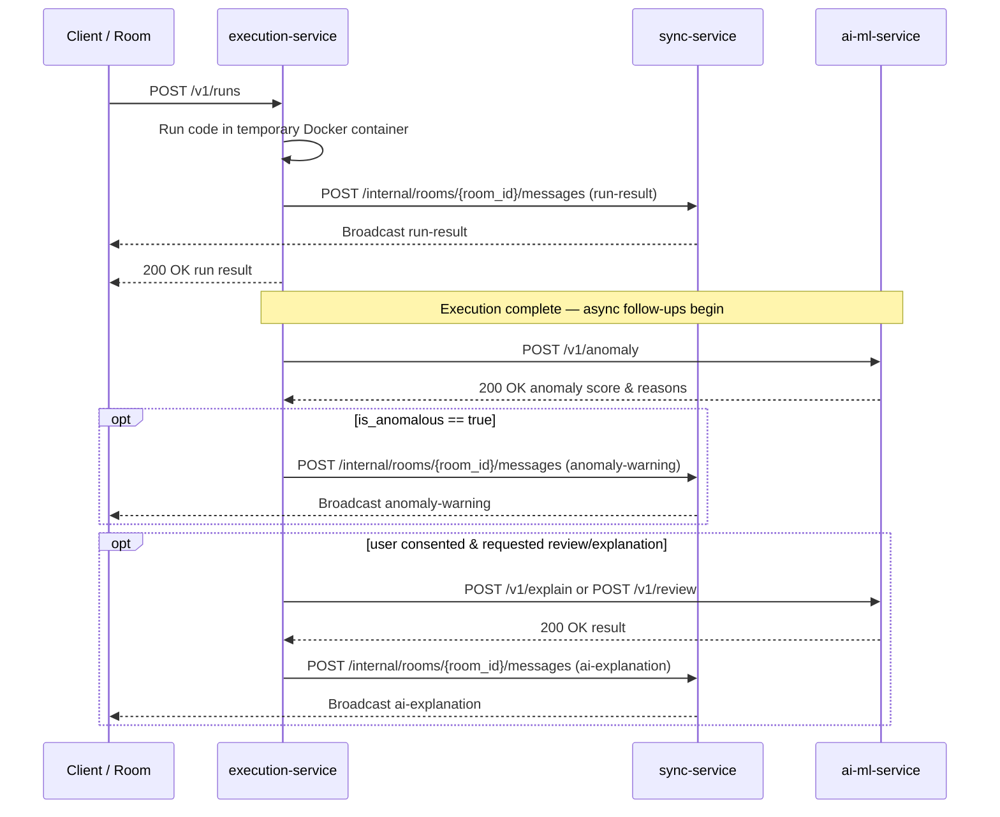

# AI/ML Service — Execution-to-AI/ML Contract

**Version:** v0 (draft)
**Issue:** T-07 · #10
**Branch:** `feature/T-07-ai-contract`
**Author:** Prince Gadara (Category C — PR1: contract specification & alignment)
**Reviewers:** Digvijay Parmar (PR2 — JSON Schemas & model integration)
**Status:** Aligned with `docs/api-contracts.md` (T-06 v0) and `ai-ml-service/docs/anomaly-spec.md` (T-13 draft).

---

> **T-06 & T-13 Alignment Note**
> This document is fully aligned with:
> 1. `docs/api-contracts.md` (T-06 v0, Yash Oza): Port 8000, health path `/health`, `snake_case` JSON fields, common execution metrics, error envelope shape (§7), and strict execution ordering (§6, NFR9).
> 2. `ai-ml-service/docs/anomaly-spec.md` (T-13, Digvijay Parmar): Metric feature list (`execution_time_ms`, `peak_memory_mb`, `stdout_bytes`, `stderr_bytes`, `exit_code`, `timed_out`, `oom_killed`, `language`), reason categories (`reason_category_id`), and threshold deferred to Sprint 3 validation.

---

## Contents

1. [Overview](#1-overview)
2. [Base URL and Health Check](#2-base-url-and-health-check)
3. [Common Request Fields](#3-common-request-fields)
4. [Endpoints](#4-endpoints)
   - 4.1 [GET /health](#41-get-health)
   - 4.2 [POST /v1/review](#42-post-v1review)
   - 4.3 [POST /v1/explain](#43-post-v1explain)
   - 4.4 [POST /v1/anomaly](#44-post-v1anomaly)
5. [Error Envelope](#5-error-envelope)
6. [Ordering Rule — NFR9](#6-ordering-rule--nfr9)
7. [Room Broadcast Follow-ups (Sync Integration)](#7-room-broadcast-follow-ups-sync-integration)
8. [Cache Key — NFR5.2](#8-cache-key--nfr52)
9. [Logging Fields — NFR8](#9-logging-fields--nfr8)
10. [Design Decisions](#10-design-decisions)
11. [Examples](#11-examples)
12. [Open Items (v0)](#12-open-items-v0)

---

## 1. Overview

This document defines the HTTP contract between the **execution-service** (caller, Java/Spring Boot) and the **ai-ml-service** (service, Python/FastAPI), operating on port 8000. It covers three operational endpoints — `review`, `explain`, and `anomaly` — plus the container health check.

**Caller:** execution-service
**Service:** ai-ml-service
**Port:** 8000 (`PORT`, fixed in T-06 §1)

Core architectural rules enforced by this contract:

- **Non-blocking execution (NFR9, T-06 §6):** The execution-service calls this service **only after** delivering execution results to room participants. AI/ML processing runs asynchronously (fork/join) and never delays execution output.
- **Privacy & Data minimization (NFR8.2, T-13 §1):**
  - `review` and `explain` requests require user consent (FR12) and include code/stderr.
  - `anomaly` requests include **only numeric metrics and language metadata — no source code, no stderr text, no stdin**.
- **Consent gating (FR12):** `review` and `explain` require `consent: true`. A `consent: false` payload returns `CONSENT_MISSING` (HTTP 403).
- **Metric passthrough:** Field names for execution metrics match `docs/api-contracts.md` §4.2 character-for-character so execution-service forwards them directly without translation.

---

## 2. Base URL and Health Check

```
http://ai-ml-service:8000
```

- Inside Docker Compose network: `http://ai-ml-service:8000` (matches `docker-compose.yml` service name and T-06 §1).
- Host / local development: `http://localhost:8000`.
- All operational endpoints are prefixed with `/v1`.
- Health check is hosted at `/health` (HTTP 200).

---

## 3. Common Request Fields

Every POST endpoint body includes these standard envelope fields:

| Field          | Type                                                            | Required | Notes                                                                                           |
|----------------|-----------------------------------------------------------------|----------|-------------------------------------------------------------------------------------------------|
| `request_id`   | string (UUID v4)                                                | Yes      | Generated by the client for the run (T-06 §2). Echoed unchanged in every response and log line. |
| `room_id`      | string                                                          | Yes      | Identifies the room. Used for correlation and per-room rate limiting (NFR5.3).                 |
| `request_type` | `"review"` \| `"explanation"` \| `"anomaly"`                  | Yes      | Identifies the requested action. Must match the route invoked.                                  |
| `language`     | `"cpp"` \| `"python"` \| `"c"` \| `"java"` \| `"javascript"` | Yes      | Exact DR1 language identifiers (matching T-06 §2 and T-13 §1).                                  |
| `consent`      | boolean                                                         | Yes      | `true` when user has consented to external AI analysis (FR12). Required for `review` & `explain`. |

---

## 4. Endpoints

### 4.1 `GET /health`

Liveness probe for Docker container and T-08 smoke tests. Returns 200 when the FastAPI service is running. Does not probe external LLM APIs.

**Response 200**

```json
{
  "status": "ok",
  "version": "v0"
}
```

---

### 4.2 `POST /v1/review`

On-demand AI code review (FR7). Triggered explicitly by a user with consent (FR12). Never called automatically.

#### Request body

Common fields (§3) plus:

| Field               | Type                                                             | Required | Notes                                                                      |
|---------------------|------------------------------------------------------------------|----------|----------------------------------------------------------------------------|
| `code`              | string                                                           | Yes      | Source code to review (FR4.1).                                             |
| `stderr`            | string                                                           | Yes      | Stderr output from the run, or `""` if successful.                         |
| `exit_code`         | integer                                                          | Yes      | Exit code of the process (T-06 §4.2).                                      |
| `execution_time_ms` | number                                                           | Yes      | Wall-clock execution time in milliseconds (T-06 §4.2).                     |
| `peak_memory_mb`    | number                                                           | Yes      | Peak memory usage in megabytes (T-06 §4.2).                                |
| `timed_out`         | boolean                                                          | Yes      | `true` if killed by wall-time limit (NFR4.1, T-06 §4.2).                    |
| `oom_killed`        | boolean                                                          | Yes      | `true` if killed by memory limit (NFR4.2, T-06 §4.2).                       |
| `failure_kind`      | `"compile_error"` \| `"non_zero_exit"` \| `"timeout"` \| `null` | Yes      | `null` when execution succeeded (T-06 §4.2).                               |

#### Response 200

```json
{
  "request_id": "<uuid echoed from request>",
  "summary": "One-sentence overall code assessment.",
  "comments": [
    {
      "line": 12,
      "severity": "warning",
      "message": "Human-readable description of the issue.",
      "suggestion": "Optional remediation hint or null."
    }
  ]
}
```

| Field                   | Type                                  | Notes                                                           |
|-------------------------|---------------------------------------|-----------------------------------------------------------------|
| `request_id`            | string                                | Echoed from request.                                            |
| `summary`               | string                                | Exactly one sentence. Never empty.                              |
| `comments`              | array                                 | List of comment objects. Empty array `[]` if no issues found.   |
| `comments[].line`       | integer \| null                       | 1-based source line number, or `null` for file-level comments.  |
| `comments[].severity`   | `"info"` \| `"warning"` \| `"error"`  | Severity level.                                                 |
| `comments[].message`    | string                                | Description of the issue.                                       |
| `comments[].suggestion` | string \| null                        | Optional remediation suggestion.                                |

---

### 4.3 `POST /v1/explain`

Short plain-language explanation of a failed execution (FR13.1). Called when an execution fails and the user has consented (FR12).

**Constraint:** The `explanation` string must be **at most 3 sentences**, plain prose, without markdown formatting.

#### Request body

Same fields as `/v1/review` (§4.2): common fields (§3) plus `code`, `stderr`, `exit_code`, `execution_time_ms`, `peak_memory_mb`, `timed_out`, `oom_killed`, `failure_kind`.

#### Response 200

```json
{
  "request_id": "<uuid echoed from request>",
  "explanation": "At most 3 sentences in plain language explaining the failure."
}
```

---

### 4.4 `POST /v1/anomaly`

ML-based anomaly scoring of execution metrics (FR8.1, T-13). Called after **every** execution run (success or failure) by execution-service.

**Privacy guarantee (NFR8.2, T-13 §1):** Anomaly scoring operates **strictly** on execution metrics and metadata. **No `code`, `stderr` text, or `stdin` fields are accepted.**

#### Request body

Common fields (§3) plus the metrics defined in `ai-ml-service/docs/anomaly-spec.md` (T-13 §1):

| Field               | Type     | Required | Notes                                                               |
|---------------------|----------|----------|---------------------------------------------------------------------|
| `execution_time_ms` | number   | Yes      | Wall-clock execution time in milliseconds (T-06 §4.2, T-13 §1).     |
| `peak_memory_mb`    | number   | Yes      | Peak memory usage in megabytes (T-06 §4.2, T-13 §1).                |
| `stdout_bytes`      | integer  | Yes      | Byte length of standard output generated (T-13 §1).                 |
| `stderr_bytes`      | integer  | Yes      | Byte length of standard error output generated (T-13 §1).            |
| `exit_code`         | integer  | Yes      | Process exit code (T-06 §4.2, T-13 §1).                             |
| `timed_out`         | boolean  | Yes      | `true` if killed by wall-time limit (T-06 §4.2, T-13 §1).           |
| `oom_killed`        | boolean  | Yes      | `true` if killed by memory limit (T-06 §4.2, T-13 §1).              |

#### Response 200

```json
{
  "request_id": "<uuid echoed from request>",
  "is_anomalous": false,
  "score": 0.21,
  "reasons": [],
  "message_short": ""
}
```

| Field           | Type    | Notes                                                                                                                                           |
|-----------------|---------|-------------------------------------------------------------------------------------------------------------------------------------------------|
| `request_id`    | string  | Echoed from request.                                                                                                                            |
| `is_anomalous`  | boolean | `true` when `score` exceeds threshold. Threshold is chosen during Sprint 3 validation (T-13 §4, FR8.1). Sprint 1 baseline stub returns `false`.|
| `score`         | number  | Continuous anomaly score in `[0.0, 1.0]`. Higher indicates greater anomaly.                                                                     |
| `reasons`       | array   | List of `reason_category_id` strings (see table below). Empty array `[]` when `is_anomalous` is `false`.                                       |
| `message_short` | string  | Short user-facing warning sentence broadcast to the room (FR8.2). Empty string `""` when `is_anomalous` is `false`.                             |

#### Reason Categories (`reason_category_id`, from T-13 §2)

When `is_anomalous: true`, `reasons` contains one or more of the following standard identifiers, and `message_short` provides the human-readable explanation:

| `reason_category_id`      | Description / `message_short` template (T-13 §2)                             |
|---------------------------|-------------------------------------------------------------------------------|
| `EXCESSIVE_EXECUTION_TIME`| "The execution took unusually long, nearing the configured time limit."       |
| `HIGH_MEMORY_USAGE`       | "The code consumed an unexpectedly large amount of memory."                   |
| `OUTPUT_FLOODING`         | "The code generated an unusually massive amount of text output."              |
| `ABNORMAL_TERMINATION`    | "The execution crashed or triggered a system resource kill."                 |

---

## 5. Error Envelope

Error responses across all endpoints adhere to the standard project error envelope (matching `docs/api-contracts.md` §7):

```json
{
  "request_id": "<uuid from request, or null if unparseable>",
  "error": {
    "code": "RATE_LIMITED_PROVIDER",
    "message": "The AI provider returned HTTP 429. Retry after 30 seconds.",
    "retry_after_seconds": 30
  }
}
```

`retry_after_seconds` is an `integer` when a retry window is known, or `null` otherwise.

### Error Codes

| Code                    | HTTP Status | Trigger Condition                                                                                     | Expected Caller Behaviour                                                                     |
|-------------------------|-------------|-------------------------------------------------------------------------------------------------------|-----------------------------------------------------------------------------------------------|
| `RATE_LIMITED_PROVIDER` | **429**     | Upstream AI provider returned HTTP 429. `retry_after_seconds` passed from provider `Retry-After`.    | Caller waits `retry_after_seconds` then retries. Editor & execution continue unaffected.      |
| `COST_CAP_REACHED`      | **402**     | Monthly spend cap reached (NFR7.2).                                                                   | Surface "AI temporarily unavailable" in room. Code execution is unaffected.                   |
| `CONSENT_MISSING`       | **403**     | `consent` is `false` on a `review` or `explain` call (FR12.2).                                        | Do not retry without obtaining explicit user consent.                                         |
| `INVALID_REQUEST`       | **422**     | Missing required fields, unrecognised `language`, invalid types, or malformed JSON payload.          | Inspect and correct request payload; do not retry unchanged.                                  |
| `PROVIDER_ERROR`        | **502**     | Upstream AI provider returned 5xx or unparseable response body.                                       | May retry with exponential backoff.                                                           |
| `PROVIDER_TIMEOUT`      | **504**     | Upstream AI provider timed out.                                                                       | May retry.                                                                                    |

---

## 6. Ordering Rule — NFR9 & T-06 §6

> **The ai-ml-service is NEVER in the critical path of code execution results.**

The execution-service executes the following sequence:



1. Run user code in an isolated container.
2. Deliver the `run-result` to sync-service for broadcast and return HTTP 200 to the caller.
3. **Only after step 2**, invoke `POST /v1/anomaly`.
4. If `is_anomalous: true`, dispatch an `anomaly-warning` follow-up message to the room via sync-service.
5. If requested and consented, invoke `POST /v1/explain` or `POST /v1/review`, and dispatch `ai-explanation` follow-up message to sync-service.

---

## 7. Room Broadcast Follow-ups (Sync Integration)

Messages forwarded to sync-service (`POST /internal/rooms/{room_id}/messages`) use the reserved frame types defined in `docs/api-contracts.md` §3.6:

### 7.1 `anomaly-warning` (FR8.2)

```json
{
  "type": "anomaly-warning",
  "request_id": "0b9d2f3e-7a41-4c58-9e1b-5d3c8a6f2e10",
  "room_id": "room-demo-01",
  "reasons": ["EXCESSIVE_EXECUTION_TIME"],
  "message_short": "The execution took unusually long, nearing the configured time limit."
}
```

### 7.2 `ai-explanation` (FR13.2)

```json
{
  "type": "ai-explanation",
  "request_id": "c9bf9e57-1685-4c89-bafb-ff5af830be8a",
  "room_id": "room-demo-01",
  "explanation": "The program read past the end of a 3-element array using index 10, causing a segmentation fault. Fix the array index or add bounds checking."
}
```

---

## 8. Cache Key — NFR5.2

To limit API spend (NFR7), identical `review` and `explain` requests are cached service-wide by SHA-256 hash:

```
SHA-256( code + "\n" + language + "\n" + request_type + "\n" + stderr_if_relevant )
```

- `stderr_if_relevant` is the literal stderr text for `explain` requests, and `""` for `review` requests.
- **Only the hash is cached** — raw user code is never stored persistently (NFR8.2).
- Anomaly scoring is **not cached** since execution metrics vary between runs.
- Cache implementation is scheduled for Sprint 3.

---

## 9. Logging Fields — NFR8

Every request processed by ai-ml-service is logged with structured JSON containing only these operational fields:

| Field          | Type    | Notes                                                         |
|----------------|---------|---------------------------------------------------------------|
| `request_id`   | string  | Echoed from request.                                          |
| `room_id`      | string  | Echoed from request.                                          |
| `request_type` | string  | `"review"`, `"explanation"`, or `"anomaly"`.                  |
| `language`     | string  | DR1 identifier.                                               |
| `status`       | string  | `"success"` or `"error"`.                                     |
| `error_code`   | string  | Error code from §5, or `null` on success.                     |
| `latency_ms`   | integer | Processing duration in milliseconds.                          |

**Prohibited from logs (NFR8.2):** User code, stderr text, stdin, response text, or any user identifiers beyond `room_id`.

---

## 10. Design Decisions

| Decision | Traceability | Rationale |
|---|---|---|
| Single port 8000 & `/health` endpoint | T-06 §1, T-08 | Consistent integration test surface across all 4 services. |
| Zero metric translation | T-06 §4.2, T-13 §1 | Field names match execution-service run result (`execution_time_ms`, `peak_memory_mb`, `exit_code`, `timed_out`, `oom_killed`) so execution-service forwards them directly without transformation. |
| Anomaly payload has no code | T-13 §1, NFR8.2 | Feature extraction uses purely numeric and metadata metrics. Storing or transferring code for anomaly scoring violates data minimization. |
| Standardized reason categories | T-13 §2 | Enumerating `EXCESSIVE_EXECUTION_TIME`, `HIGH_MEMORY_USAGE`, `OUTPUT_FLOODING`, `ABNORMAL_TERMINATION` ensures consistent UI messaging. |
| Threshold deferred to Sprint 3 | T-13 §4, FR8.1 | Synthetic training in T-12 and baseline model in T-15 precede final statistical calibration. Hard-coding thresholds in v0 contract is prohibited. |
| Unified error envelope | T-06 §7 | Ensures execution-service handles errors uniformly across all downstream endpoints. |

---

## 11. Examples

### 11.1 Review (`POST /v1/review`)

**Request**

```json
{
  "request_id": "f47ac10b-58cc-4372-a567-0e02b2c3d479",
  "room_id": "room-demo-01",
  "request_type": "review",
  "language": "cpp",
  "consent": true,
  "code": "#include <iostream>\nint main() {\n    int unused_var;\n    std::cout << \"hello\" << std::endl;\n    return 0;\n}",
  "stderr": "",
  "exit_code": 0,
  "execution_time_ms": 312,
  "peak_memory_mb": 4.1,
  "timed_out": false,
  "oom_killed": false,
  "failure_kind": null
}
```

**Response 200**

```json
{
  "request_id": "f47ac10b-58cc-4372-a567-0e02b2c3d479",
  "summary": "The code compiles and runs successfully; one unused variable detected.",
  "comments": [
    {
      "line": 3,
      "severity": "warning",
      "message": "Variable 'unused_var' is declared but never read.",
      "suggestion": "Remove 'unused_var' or initialize it with a used value."
    }
  ]
}
```

---

### 11.2 Explanation (`POST /v1/explain`)

**Request**

```json
{
  "request_id": "c9bf9e57-1685-4c89-bafb-ff5af830be8a",
  "room_id": "room-demo-01",
  "request_type": "explanation",
  "language": "cpp",
  "consent": true,
  "code": "#include <iostream>\nint main() {\n    int arr[3] = {1, 2, 3};\n    std::cout << arr[10] << std::endl;\n    return 0;\n}",
  "stderr": "Segmentation fault (core dumped)",
  "exit_code": 139,
  "execution_time_ms": 88,
  "peak_memory_mb": 3.9,
  "timed_out": false,
  "oom_killed": false,
  "failure_kind": "non_zero_exit"
}
```

**Response 200**

```json
{
  "request_id": "c9bf9e57-1685-4c89-bafb-ff5af830be8a",
  "explanation": "The program read past the bounds of a 3-element array using index 10, which caused a segmentation fault with exit code 139. Ensure the index is within 0 to 2 before accessing the array."
}
```

---

### 11.3 Anomaly — Normal Execution (`POST /v1/anomaly`)

**Request**

```json
{
  "request_id": "3fa85f64-5717-4562-b3fc-2c963f66afa6",
  "room_id": "room-demo-01",
  "request_type": "anomaly",
  "language": "python",
  "consent": true,
  "execution_time_ms": 210,
  "peak_memory_mb": 14.5,
  "stdout_bytes": 14,
  "stderr_bytes": 0,
  "exit_code": 0,
  "timed_out": false,
  "oom_killed": false
}
```

**Response 200**

```json
{
  "request_id": "3fa85f64-5717-4562-b3fc-2c963f66afa6",
  "is_anomalous": false,
  "score": 0.08,
  "reasons": [],
  "message_short": ""
}
```

---

### 11.4 Anomaly — Anomalous Execution (`POST /v1/anomaly`)

**Request**

```json
{
  "request_id": "e72a49b2-32b1-4c12-9c32-11a5b8e90f23",
  "room_id": "room-demo-01",
  "request_type": "anomaly",
  "language": "cpp",
  "consent": true,
  "execution_time_ms": 4890,
  "peak_memory_mb": 121.4,
  "stdout_bytes": 950000,
  "stderr_bytes": 0,
  "exit_code": 0,
  "timed_out": false,
  "oom_killed": false
}
```

**Response 200**

```json
{
  "request_id": "e72a49b2-32b1-4c12-9c32-11a5b8e90f23",
  "is_anomalous": true,
  "score": 0.89,
  "reasons": ["EXCESSIVE_EXECUTION_TIME", "HIGH_MEMORY_USAGE", "OUTPUT_FLOODING"],
  "message_short": "The execution took unusually long, nearing the configured time limit."
}
```

---

### 11.5 Error — Consent Missing (`POST /v1/explain`)

**Response 403**

```json
{
  "request_id": "c9bf9e57-1685-4c89-bafb-ff5af830be8a",
  "error": {
    "code": "CONSENT_MISSING",
    "message": "User consent is required before code or execution context can be sent to external AI.",
    "retry_after_seconds": null
  }
}
```

---

## 12. Open Items (v0)

| # | Item | Owner | Target | Status |
|---|---|---|---|---|
| 1 | Execution features for anomaly model | Digvijay (T-13) | T-07 v0 | **Closed** (defined in `anomaly-spec.md`) |
| 2 | `reason_category_id` values & templates | Digvijay (T-13) | T-07 v0 | **Closed** (defined in `anomaly-spec.md` §2) |
| 3 | Base URL and error envelope alignment with T-06 | Prince (T-07) | T-07 v0 | **Closed** (aligned with `api-contracts.md` §1 & §7) |
| 4 | JSON Schema objects for all request & response types | Digvijay (T-07 PR2) | T-07 PR2 | Open for Digvijay's completing PR |
| 5 | Cache implementation (NFR5.2) | Prince | Sprint 3 | Open |
| 6 | Per-room rate limiting (NFR5.3) | Prince | Sprint 3 | Open |
| 7 | Cost-cap budget enforcement (NFR7.2) | Prince | Sprint 3 | Open |
| 8 | Anomaly score threshold validation (FR8.1) | Digvijay + Prince | Sprint 3 | Open |
