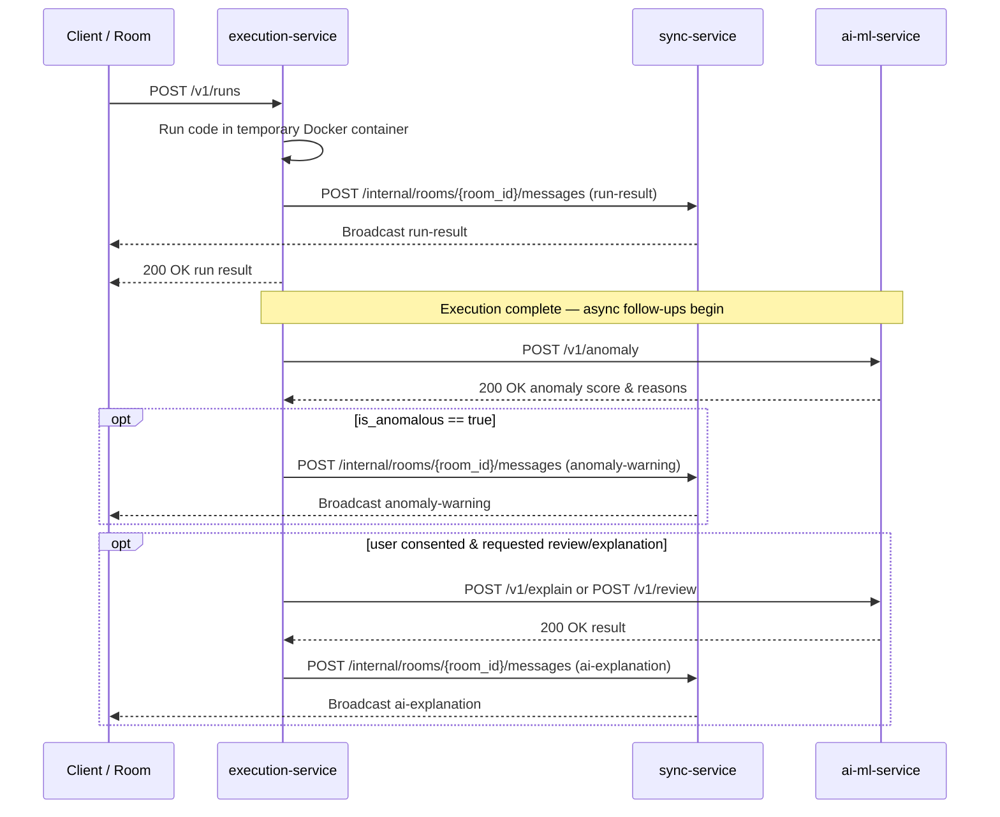

# AI/ML Service — Execution-to-AI/ML Contract

**Version:** v0 (draft)
**Issue:** T-07 · #10
**Branch:** `feature/T-07-ai-contract`
**Author:** Prince Gadara (Category C — PR1: contract specification & alignment)
**Reviewers:** Digvijay Parmar (PR2 — JSON Schemas & model integration)
**Status:** Aligned with `docs/api-contracts.md` (T-06 v0) and `ai-ml-service/docs/anomaly-spec.md` (T-13 draft).

---

> **T-06 & T-13 Alignment Note**
> This document is fully aligned with:
> 1. `docs/api-contracts.md` (T-06 v0, Yash Oza): Port 8000, health path `/health`, `snake_case` JSON fields, common execution metrics, error envelope shape (§7), and strict execution ordering (§6, NFR9).
> 2. `ai-ml-service/docs/anomaly-spec.md` (T-13, Digvijay Parmar): Metric feature list (`execution_time_ms`, `peak_memory_mb`, `stdout_bytes`, `stderr_bytes`, `exit_code`, `timed_out`, `oom_killed`, `language`), reason categories (`reason_category_id`), and threshold deferred to Sprint 3 validation.

---

## Contents

- [AI/ML Service — Execution-to-AI/ML Contract](#aiml-service--execution-to-aiml-contract)
  - [Contents](#contents)
  - [1. Overview](#1-overview)
  - [2. Base URL and Health Check](#2-base-url-and-health-check)
  - [3. Common Request Fields](#3-common-request-fields)
  - [4. Endpoints](#4-endpoints)
    - [4.1 `GET /health`](#41-get-health)
    - [4.2 `POST /v1/review`](#42-post-v1review)
      - [Request body](#request-body)
      - [Response 200](#response-200)
    - [4.3 `POST /v1/explain`](#43-post-v1explain)
      - [Request body](#request-body-1)
      - [Response 200](#response-200-1)
    - [4.4 `POST /v1/anomaly`](#44-post-v1anomaly)
      - [Request body](#request-body-2)
      - [Response 200](#response-200-2)
      - [Reason Categories (`reason_category_id`, from T-13 §2)](#reason-categories-reason_category_id-from-t-13-2)
  - [5. Error Envelope](#5-error-envelope)
    - [Error Codes](#error-codes)
  - [6. Ordering Rule — NFR9 \& T-06 §6](#6-ordering-rule--nfr9--t-06-6)
  - [7. Room Broadcast Follow-ups (Sync Integration)](#7-room-broadcast-follow-ups-sync-integration)
    - [7.1 `anomaly-warning` (FR8.2)](#71-anomaly-warning-fr82)
    - [7.2 `ai-explanation` (FR13.2)](#72-ai-explanation-fr132)
  - [8. Cache Key — NFR5.2](#8-cache-key--nfr52)
  - [9. Logging Fields — NFR8](#9-logging-fields--nfr8)
  - [10. Design Decisions](#10-design-decisions)
  - [11. Examples](#11-examples)
    - [11.1 Review (`POST /v1/review`)](#111-review-post-v1review)
    - [11.2 Explanation (`POST /v1/explain`)](#112-explanation-post-v1explain)
    - [11.3 Anomaly — Normal Execution (`POST /v1/anomaly`)](#113-anomaly--normal-execution-post-v1anomaly)
    - [11.4 Anomaly — Anomalous Execution (`POST /v1/anomaly`)](#114-anomaly--anomalous-execution-post-v1anomaly)
    - [11.5 Error — Consent Missing (`POST /v1/explain`)](#115-error--consent-missing-post-v1explain)
    - [11.6 Java Review Example (`POST /v1/review`)](#116-java-review-example-post-v1review)
    - [11.7 C Explanation Example (`POST /v1/example`)](#117-c-explanation-example-post-v1example)
  - [12. Open Items (v0)](#12-open-items-v0)

---

## 1. Overview

This document defines the HTTP contract between the **execution-service** (caller, Java/Spring Boot) and the **ai-ml-service** (service, Python/FastAPI), operating on port 8000. It covers three operational endpoints — `review`, `explain`, and `anomaly` — plus the container health check.

**Caller:** execution-service
**Service:** ai-ml-service
**Port:** 8000 (`PORT`, fixed in T-06 §1)

Core architectural rules enforced by this contract:

- **Non-blocking execution (NFR9, T-06 §6):** The execution-service calls this service **only after** delivering execution results to room participants. AI/ML processing runs asynchronously (fork/join) and never delays execution output.
- **Privacy & Data minimization (NFR8.2, T-13 §1):**
  - `review` and `explain` requests require user consent (FR12) and include code/stderr.
  - `anomaly` requests include **only numeric metrics and language metadata — no source code, no stderr text, no stdin**.
- **Consent gating (FR12):** `review` and `explain` require `consent: true`. A `consent: false` payload returns `CONSENT_MISSING` (HTTP 403).
- **Metric passthrough:** Field names for execution metrics match `docs/api-contracts.md` §4.2 character-for-character so execution-service forwards them directly without translation.

---

## 2. Base URL and Health Check

```
http://ai-ml-service:8000
```

- Inside Docker Compose network: `http://ai-ml-service:8000` (matches `docker-compose.yml` service name and T-06 §1).
- Host / local development: `http://localhost:8000`.
- All operational endpoints are prefixed with `/v1`.
- Health check is hosted at `/health` (HTTP 200).

---

## 3. Common Request Fields

Every POST endpoint body includes these standard envelope fields:

| Field          | Type                                                            | Required | Notes                                                                                           |
|----------------|-----------------------------------------------------------------|----------|-------------------------------------------------------------------------------------------------|
| `request_id`   | string (UUID v4)                                                | Yes      | Generated by the client for the run (T-06 §2). Echoed unchanged in every response and log line. |
| `room_id`      | string                                                          | Yes      | Identifies the room. Used for correlation and per-room rate limiting (NFR5.3).                 |
| `request_type` | `"review"` \| `"explanation"` \| `"anomaly"`                  | Yes      | Identifies the requested action. Must match the route invoked.                                  |
| `language`     | `"cpp"` \| `"python"` \| `"c"` \| `"java"` \| `"javascript"` | Yes      | Exact DR1 language identifiers (matching T-06 §2 and T-13 §1).                                  |
| `consent`      | boolean                                                         | Yes      | `true` when user has consented to external AI analysis (FR12). Required for `review` & `explain`. |

---

## 4. Endpoints

### 4.1 `GET /health`

Liveness probe for Docker container and T-08 smoke tests. Returns 200 when the FastAPI service is running. Does not probe external LLM APIs.

**Response 200**

```json
{
  "status": "ok",
  "version": "v0"
}
```

---

### 4.2 `POST /v1/review`

On-demand AI code review (FR7). Triggered explicitly by a user with consent (FR12). Never called automatically.

#### Request body

Common fields (§3) plus:

| Field               | Type                                                             | Required | Notes                                                                      |
|---------------------|------------------------------------------------------------------|----------|----------------------------------------------------------------------------|
| `code`              | string                                                           | Yes      | Source code to review (FR4.1).                                             |
| `stderr`            | string                                                           | Yes      | Stderr output from the run, or `""` if successful.                         |
| `exit_code`         | integer                                                          | Yes      | Exit code of the process (T-06 §4.2).                                      |
| `execution_time_ms` | number                                                           | Yes      | Wall-clock execution time in milliseconds (T-06 §4.2).                     |
| `peak_memory_mb`    | number                                                           | Yes      | Peak memory usage in megabytes (T-06 §4.2).                                |
| `timed_out`         | boolean                                                          | Yes      | `true` if killed by wall-time limit (NFR4.1, T-06 §4.2).                    |
| `oom_killed`        | boolean                                                          | Yes      | `true` if killed by memory limit (NFR4.2, T-06 §4.2).                       |
| `failure_kind`      | `"compile_error"` \| `"non_zero_exit"` \| `"timeout"` \| `null` | Yes      | `null` when execution succeeded (T-06 §4.2).                               |

#### Response 200

```json
{
  "request_id": "<uuid echoed from request>",
  "summary": "One-sentence overall code assessment.",
  "comments": [
    {
      "line": 12,
      "severity": "warning",
      "message": "Human-readable description of the issue.",
      "suggestion": "Optional remediation hint or null."
    }
  ]
}
```

| Field                   | Type                                  | Notes                                                           |
|-------------------------|---------------------------------------|-----------------------------------------------------------------|
| `request_id`            | string                                | Echoed from request.                                            |
| `summary`               | string                                | Exactly one sentence. Never empty.                              |
| `comments`              | array                                 | List of comment objects. Empty array `[]` if no issues found.   |
| `comments[].line`       | integer \| null                       | 1-based source line number, or `null` for file-level comments.  |
| `comments[].severity`   | `"info"` \| `"warning"` \| `"error"`  | Severity level.                                                 |
| `comments[].message`    | string                                | Description of the issue.                                       |
| `comments[].suggestion` | string \| null                        | Optional remediation suggestion.                                |

---

### 4.3 `POST /v1/explain`

Short plain-language explanation of a failed execution (FR13.1). Called when an execution fails and the user has consented (FR12).

**Constraint:** The `explanation` string must be **at most 3 sentences**, plain prose, without markdown formatting.

#### Request body

Same fields as `/v1/review` (§4.2): common fields (§3) plus `code`, `stderr`, `exit_code`, `execution_time_ms`, `peak_memory_mb`, `timed_out`, `oom_killed`, `failure_kind`.

#### Response 200

```json
{
  "request_id": "<uuid echoed from request>",
  "explanation": "At most 3 sentences in plain language explaining the failure."
}
```

---

### 4.4 `POST /v1/anomaly`

ML-based anomaly scoring of execution metrics (FR8.1, T-13). Called after **every** execution run (success or failure) by execution-service.

**Privacy guarantee (NFR8.2, T-13 §1):** Anomaly scoring operates **strictly** on execution metrics and metadata. **No `code`, `stderr` text, or `stdin` fields are accepted.**

#### Request body

Common fields (§3) plus the metrics defined in `ai-ml-service/docs/anomaly-spec.md` (T-13 §1):

| Field               | Type     | Required | Notes                                                               |
|---------------------|----------|----------|---------------------------------------------------------------------|
| `execution_time_ms` | number   | Yes      | Wall-clock execution time in milliseconds (T-06 §4.2, T-13 §1).     |
| `peak_memory_mb`    | number   | Yes      | Peak memory usage in megabytes (T-06 §4.2, T-13 §1).                |
| `stdout_bytes`      | integer  | Yes      | Byte length of standard output generated (T-13 §1).                 |
| `stderr_bytes`      | integer  | Yes      | Byte length of standard error output generated (T-13 §1).            |
| `exit_code`         | integer  | Yes      | Process exit code (T-06 §4.2, T-13 §1).                             |
| `timed_out`         | boolean  | Yes      | `true` if killed by configured wall-time limit (default 5s, DR3).   |
| `oom_killed`        | boolean  | Yes      | `true` if killed by configured memory limit (default 128MB, DR3).   |

> **Unit Conventions & Configured Limits (DR3):**
> - Standard binary units apply: **1 KB = 1024 bytes (KiB)** and **1 MB = 1,048,576 bytes (MiB)** for `stdout_bytes` and `stderr_bytes`.
> - Resource constraints (current defaults: 5s wall time NFR4.1, 128 MB memory NFR4.2, 1 MB output cap NFR4.4) are **configuration parameters, not hardcoded into the contract** (DR3, T-06 §2). Warning messages refer to the "configured time limit".

#### Response 200

```json
{
  "request_id": "<uuid echoed from request>",
  "is_anomalous": false,
  "score": 0.21,
  "reasons": [],
  "message_short": ""
}
```

| Field           | Type    | Notes                                                                                                                                           |
|-----------------|---------|-------------------------------------------------------------------------------------------------------------------------------------------------|
| `request_id`    | string  | Echoed from request.                                                                                                                            |
| `is_anomalous`  | boolean | `true` when `score` exceeds threshold. Threshold is chosen during Sprint 3 validation (T-13 §4, FR8.1). Sprint 1 baseline stub returns `false`.|
| `score`         | number  | Continuous anomaly score in `[0.0, 1.0]`. Higher indicates greater anomaly.                                                                     |
| `reasons`       | array   | List of `reason_category_id` strings (see table below). Empty array `[]` when `is_anomalous` is `false`.                                       |
| `message_short` | string  | Short user-facing warning sentence broadcast to the room (FR8.2). Empty string `""` when `is_anomalous` is `false`.                             |

#### Reason Categories (`reason_category_id`, from T-13 §2)

When `is_anomalous: true`, `reasons` contains one or more of the following standard identifiers, and `message_short` provides the human-readable explanation:

| `reason_category_id`      | Description / `message_short` template (T-13 §2)                             |
|---------------------------|-------------------------------------------------------------------------------|
| `EXCESSIVE_EXECUTION_TIME`| "The execution took unusually long, nearing the configured time limit."       |
| `HIGH_MEMORY_USAGE`       | "The code consumed an unexpectedly large amount of memory."                   |
| `OUTPUT_FLOODING`         | "The code generated an unusually massive amount of text output."              |
| `ABNORMAL_TERMINATION`    | "The execution crashed or triggered a system resource kill."                 |

---

## 5. Error Envelope

Error responses across all endpoints adhere to the standard project error envelope (matching `docs/api-contracts.md` §7):

```json
{
  "request_id": "<uuid from request, or null if unparseable>",
  "error": {
    "code": "RATE_LIMITED_PROVIDER",
    "message": "The AI provider returned HTTP 429. Retry after 30 seconds.",
    "retry_after_seconds": 30
  }
}
```

`retry_after_seconds` is an `integer` when a retry window is known, or `null` otherwise.

### Error Codes

| Code                    | HTTP Status | Trigger Condition                                                                                     | Expected Caller Behaviour                                                                     |
|-------------------------|-------------|-------------------------------------------------------------------------------------------------------|-----------------------------------------------------------------------------------------------|
| `RATE_LIMITED_PROVIDER` | **429**     | Upstream AI provider returned HTTP 429. `retry_after_seconds` passed from provider `Retry-After`.    | Caller waits `retry_after_seconds` then retries. Editor & execution continue unaffected.      |
| `COST_CAP_REACHED`      | **402**     | Monthly spend cap reached (NFR7.2).                                                                   | Surface "AI temporarily unavailable" in room. Code execution is unaffected.                   |
| `CONSENT_MISSING`       | **403**     | `consent` is `false` on a `review` or `explain` call (FR12.2).                                        | Do not retry without obtaining explicit user consent.                                         |
| `INVALID_REQUEST`       | **422**     | Missing required fields, unrecognised `language`, invalid types, or malformed JSON payload.          | Inspect and correct request payload; do not retry unchanged.                                  |
| `PROVIDER_ERROR`        | **502**     | Upstream AI provider returned 5xx or unparseable response body.                                       | May retry with exponential backoff.                                                           |
| `PROVIDER_TIMEOUT`      | **504**     | Upstream AI provider timed out.                                                                       | May retry.                                                                                    |

---

## 6. Ordering Rule — NFR9 & T-06 §6

> **The ai-ml-service is NEVER in the critical path of code execution results.**

The execution-service executes the following sequence:



1. Run user code in an isolated container.
2. Deliver the `run-result` to sync-service for broadcast and return HTTP 200 to the caller.
3. **Only after step 2**, invoke `POST /v1/anomaly`.
4. If `is_anomalous: true`, dispatch an `anomaly-warning` follow-up message to the room via sync-service.
5. If requested and consented, invoke `POST /v1/explain` or `POST /v1/review`, and dispatch `ai-explanation` follow-up message to sync-service.

---

## 7. Room Broadcast Follow-ups (Sync Integration)

Messages forwarded to sync-service (`POST /internal/rooms/{room_id}/messages`) use the reserved frame types defined in `docs/api-contracts.md` §3.6:

### 7.1 `anomaly-warning` (FR8.2)

```json
{
  "type": "anomaly-warning",
  "request_id": "0b9d2f3e-7a41-4c58-9e1b-5d3c8a6f2e10",
  "room_id": "room-demo-01",
  "reasons": ["EXCESSIVE_EXECUTION_TIME"],
  "message_short": "The execution took unusually long, nearing the configured time limit."
}
```

### 7.2 `ai-explanation` (FR13.2)

```json
{
  "type": "ai-explanation",
  "request_id": "c9bf9e57-1685-4c89-bafb-ff5af830be8a",
  "room_id": "room-demo-01",
  "explanation": "The program read past the end of a 3-element array using index 10, causing a segmentation fault. Fix the array index or add bounds checking."
}
```

---

## 8. Cache Key — NFR5.2

To limit API spend (NFR7), identical `review` and `explain` requests are cached service-wide by SHA-256 hash:

```
SHA-256( code + "\n" + language + "\n" + request_type + "\n" + stderr_if_relevant )
```

- `stderr_if_relevant` is the literal stderr text for `explain` requests, and `""` for `review` requests.
- **Only the hash is cached** — raw user code is never stored persistently (NFR8.2).
- Anomaly scoring is **not cached** since execution metrics vary between runs.
- Cache implementation is scheduled for Sprint 3.

---

## 9. Logging Fields — NFR8

Every request processed by ai-ml-service is logged with structured JSON containing only these operational fields:

| Field          | Type    | Notes                                                         |
|----------------|---------|---------------------------------------------------------------|
| `request_id`   | string  | Echoed from request.                                          |
| `room_id`      | string  | Echoed from request.                                          |
| `request_type` | string  | `"review"`, `"explanation"`, or `"anomaly"`.                  |
| `language`     | string  | DR1 identifier.                                               |
| `status`       | string  | `"success"` or `"error"`.                                     |
| `error_code`   | string  | Error code from §5, or `null` on success.                     |
| `latency_ms`   | integer | Processing duration in milliseconds.                          |

**Prohibited from logs (NFR8.2):** User code, stderr text, stdin, response text, or any user identifiers beyond `room_id`.

---

## 10. Design Decisions

| Decision | Traceability | Rationale |
|---|---|---|
| Single port 8000 & `/health` endpoint | T-06 §1, T-08 | Consistent integration test surface across all 4 services. |
| Zero metric translation | T-06 §4.2, T-13 §1 | Field names match execution-service run result (`execution_time_ms`, `peak_memory_mb`, `exit_code`, `timed_out`, `oom_killed`) so execution-service forwards them directly without transformation. |
| Anomaly payload has no code | T-13 §1, NFR8.2 | Feature extraction uses purely numeric and metadata metrics. Storing or transferring code for anomaly scoring violates data minimization. |
| Standardized reason categories | T-13 §2 | Enumerating `EXCESSIVE_EXECUTION_TIME`, `HIGH_MEMORY_USAGE`, `OUTPUT_FLOODING`, `ABNORMAL_TERMINATION` ensures consistent UI messaging. |
| Threshold deferred to Sprint 3 | T-13 §4, FR8.1 | Synthetic training in T-12 and baseline model in T-15 precede final statistical calibration. Hard-coding thresholds in v0 contract is prohibited. |
| Configured limits (DR3) | T-06 §2, DR3, NFR4 | Execution limits (5s, 128MB, 1MB output) are host-configurable defaults, not fixed contract constants. Warning messages refer to "configured time limit". |
| Binary byte units | T-13 §3.1, NFR4.4 | Standard binary units (1 KB = 1024 bytes, 1 MB = 1,048,576 bytes) apply to `stdout_bytes` and `stderr_bytes`. |
| Unified error envelope | T-06 §7 | Ensures execution-service handles errors uniformly across all downstream endpoints. |

---

## 11. Examples

### 11.1 Review (`POST /v1/review`)

**Request**

```json
{
  "request_id": "f47ac10b-58cc-4372-a567-0e02b2c3d479",
  "room_id": "room-demo-01",
  "request_type": "review",
  "language": "cpp",
  "consent": true,
  "code": "#include <iostream>\nint main() {\n    int unused_var;\n    std::cout << \"hello\" << std::endl;\n    return 0;\n}",
  "stderr": "",
  "exit_code": 0,
  "execution_time_ms": 312,
  "peak_memory_mb": 4.1,
  "timed_out": false,
  "oom_killed": false,
  "failure_kind": null
}
```

**Response 200**

```json
{
  "request_id": "f47ac10b-58cc-4372-a567-0e02b2c3d479",
  "summary": "The code compiles and runs successfully; one unused variable detected.",
  "comments": [
    {
      "line": 3,
      "severity": "warning",
      "message": "Variable 'unused_var' is declared but never read.",
      "suggestion": "Remove 'unused_var' or initialize it with a used value."
    }
  ]
}
```

---

### 11.2 Explanation (`POST /v1/explain`)

**Request**

```json
{
  "request_id": "c9bf9e57-1685-4c89-bafb-ff5af830be8a",
  "room_id": "room-demo-01",
  "request_type": "explanation",
  "language": "cpp",
  "consent": true,
  "code": "#include <iostream>\nint main() {\n    int arr[3] = {1, 2, 3};\n    std::cout << arr[10] << std::endl;\n    return 0;\n}",
  "stderr": "Segmentation fault (core dumped)",
  "exit_code": 139,
  "execution_time_ms": 88,
  "peak_memory_mb": 3.9,
  "timed_out": false,
  "oom_killed": false,
  "failure_kind": "non_zero_exit"
}
```

**Response 200**

```json
{
  "request_id": "c9bf9e57-1685-4c89-bafb-ff5af830be8a",
  "explanation": "The program read past the bounds of a 3-element array using index 10, which caused a segmentation fault with exit code 139. Ensure the index is within 0 to 2 before accessing the array."
}
```

---

### 11.3 Anomaly — Normal Execution (`POST /v1/anomaly`)

**Request**

```json
{
  "request_id": "3fa85f64-5717-4562-b3fc-2c963f66afa6",
  "room_id": "room-demo-01",
  "request_type": "anomaly",
  "language": "python",
  "consent": true,
  "execution_time_ms": 210,
  "peak_memory_mb": 14.5,
  "stdout_bytes": 14,
  "stderr_bytes": 0,
  "exit_code": 0,
  "timed_out": false,
  "oom_killed": false
}
```

**Response 200**

```json
{
  "request_id": "3fa85f64-5717-4562-b3fc-2c963f66afa6",
  "is_anomalous": false,
  "score": 0.08,
  "reasons": [],
  "message_short": ""
}
```

---

### 11.4 Anomaly — Anomalous Execution (`POST /v1/anomaly`)

**Request**

```json
{
  "request_id": "e72a49b2-32b1-4c12-9c32-11a5b8e90f23",
  "room_id": "room-demo-01",
  "request_type": "anomaly",
  "language": "cpp",
  "consent": true,
  "execution_time_ms": 4890,
  "peak_memory_mb": 121.4,
  "stdout_bytes": 950000,
  "stderr_bytes": 0,
  "exit_code": 0,
  "timed_out": false,
  "oom_killed": false
}
```

**Response 200**

```json
{
  "request_id": "e72a49b2-32b1-4c12-9c32-11a5b8e90f23",
  "is_anomalous": true,
  "score": 0.89,
  "reasons": ["EXCESSIVE_EXECUTION_TIME", "HIGH_MEMORY_USAGE", "OUTPUT_FLOODING"],
  "message_short": "The execution took unusually long, nearing the configured time limit."
}
```

---

### 11.5 Error — Consent Missing (`POST /v1/explain`)

**Response 403**

```json
{
  "request_id": "c9bf9e57-1685-4c89-bafb-ff5af830be8a",
  "error": {
    "code": "CONSENT_MISSING",
    "message": "User consent is required before code or execution context can be sent to external AI.",
    "retry_after_seconds": null
  }
}
```
---
### 11.6 Java Review Example (`POST /v1/review`)

**Request**
```json
{
  "request_id": "a1b2c3d4-5678-90ef-1234-567890abcdef",
  "room_id": "room-demo-02",
  "request_type": "review",
  "language": "java",
  "consent": true,
  "code": "class Main {\n    public static void main(String[] args) {\n        System.out.println(\"Hello\");\n    }\n}",
  "stderr": "",
  "exit_code": 0,
  "execution_time_ms": 120,
  "peak_memory_mb": 45.2,
  "timed_out": false,
  "oom_killed": false,
  "failure_kind": null
}
```
---

### 11.7 C Explanation Example (`POST /v1/example`)

**Request**
```json

{
  "request_id": "b2c3d4e5-6789-01fa-2345-678901bcdefa",
  "room_id": "room-demo-02",
  "request_type": "explanation",
  "language": "c",
  "consent": true,
  "code": "#include <stdio.h>\nint main() {\n    int *ptr = NULL;\n    *ptr = 10;\n    return 0;\n}",
  "stderr": "Segmentation fault (core dumped)",
  "exit_code": 139,
  "execution_time_ms": 12,
  "peak_memory_mb": 1.4,
  "timed_out": false,
  "oom_killed": false,
  "failure_kind": "non_zero_exit"
}
``` 
---

###11.8 JavaScript Anomaly Example(`POST /v1/anomaly`)
**Request**
```json
{
  "request_id": "c3d4e5f6-7890-12ab-3456-789012cdefab",
  "room_id": "room-demo-03",
  "request_type": "anomaly",
  "language": "javascript",
  "consent": true,
  "execution_time_ms": 4800,
  "peak_memory_mb": 110.5,
  "stdout_bytes": 1024000,
  "stderr_bytes": 0,
  "exit_code": 0,
  "timed_out": false,
  "oom_killed": false
}
```
---

## 12. Open Items (v0)

| # | Item | Owner | Target | Status |
|---|---|---|---|---|
| 1 | Execution features for anomaly model | Digvijay (T-13) | T-07 v0 | **Closed** (defined in `anomaly-spec.md`) |
| 2 | `reason_category_id` values & templates | Digvijay (T-13) | T-07 v0 | **Closed** (defined in `anomaly-spec.md` §2) |
| 3 | Base URL and error envelope alignment with T-06 | Prince (T-07) | T-07 v0 | **Closed** (aligned with `api-contracts.md` §1 & §7) |
| 4 | JSON Schema objects for all request & response types | Digvijay (T-07 PR2) | T-07 PR2 | Open for Digvijay's completing PR |
| 5 | Cache implementation (NFR5.2) | Prince | Sprint 3 | Open |
| 6 | Per-room rate limiting (NFR5.3) | Prince | Sprint 3 | Open |
| 7 | Cost-cap budget enforcement (NFR7.2) | Prince | Sprint 3 | Open |
| 8 | Anomaly score threshold validation (FR8.1) | Digvijay + Prince | Sprint 3 | Open |


---

# Part 2: Version 2 Contract (T-18)

**Document:** AI/ML Service Contract, Version 2  
**Issue:** T-18 · Product Backlog v2 §6.2  
**Branch:** `docs/T-18-ai-ml-contract-v2-tasks-1-2` (Prince), with `docs/T-18-ai-ml-contract-v2-task-3-consent` (Chandan) and `docs/T-18-ai-ml-contract-v2-assembly` (Digvijay)  
**Authors:**
- **Prince Gadara:** Task 1 (`/v1/analyses/complexity`), Task 2 (`/v1/analyses/slowdown`), request/result payloads, and `request_type` values
- **Chandan:** Task 3 (`/v1/analyses/failing-input`), consent and Host-switch fields (`consent`, `ai_enabled`, `CONSENT_MISSING`, `AI_DISABLED`)
- **Digvijay Parmar:** Contract assembly, retirement decisions (1–3), execution entry point (4), `analysis-result` message (6), internal runs (7), run history (9), error codes & blocked steps (10), cache key (11), logging (12), Task 4 (`/crash-explanation`), Task 5 (`/usage`, `/rooms/{room_id}/state`)
**Traceability:** FR12, FR29, FR32, FR35, FR36 to FR40, NFR5, NFR7 to NFR9, DR5 · T-18 · EPIC 3 · Sprint 2 (needed by US-22 and US-65 to US-78)  
**Status:** Decided / Proposed (individual statuses listed per decision)  

---

## 13. Scope and Replaced v0 Rules

Version 2 supersedes the initial draft (Part 1, v0) in alignment with **Requirements Specification v2** (`docs/IT314_Group32_Requirements_v2_Final.md`), **Product Backlog v2** (`docs/IT314_Group32_Backlog_v2_Final.md`), and **CHG-01 §4.6**.

### 13.1 v0 Rules Replaced by Version 2
1. **Endpoint `POST /v1/review` (v0 §4.2) is Retired:** Code review is removed from the product scope (Requirements v2 §7.5, FR7 removed). Replaced by nothing; git history preserves the prototype (Decision 1).
2. **Endpoint `POST /v1/explain` (v0 §4.3) is Retired as a General Failure Explainer:** General failure explanations are removed (FR13 removed). The T-16 prototype implementation is refactored into Task 4 (`POST /v1/analyses/crash-explanation`), sending only sanitizer summaries and short code snippets (FR39.3, FR40.2, US-74, US-76, Decision 2).
3. **Endpoint `POST /v1/anomaly` (v0 §4.4) is Retired:** Statistical anomaly scoring is replaced by Task 2 slowdown detection against an empirical Median and MAD baseline (`POST /v1/analyses/slowdown`, FR37). The offline `AnomalyScorer` model stays in the repository unwired for mentor demonstration (Decision 3).
4. **Broadcast Messages (v0 §7: `anomaly-warning`, `ai-explanation`) are Retired:** Replaced by a unified `analysis-result` WebSocket message (§17, Decision 6, T-17 Decision 13).
5. **Raw Code Cache Key (v0 §8) is Replaced:** Replaced by SHA-256 of normalized code (comments stripped, whitespace normalized, semantic indentation preserved per NFR5.2, Decision 11).
6. **Logging Rules (v0 §9) are Replaced:** `room_id` is extracted strictly from the validated request body and is never `unknown`. Telemetry logs and counters contain metadata only; no raw source code, stdin, stderr, or prompts are ever logged (NFR8.1, NFR8.2, US-25, Decision 12).

---

## 14. Backlog v2 Contract Decisions (§6.2)

The 12 decisions recorded in Backlog v2 §6.2 govern this contract. **Decided** means requirements or an accepted architecture record force the behaviour. **Proposed** means a design choice confirmed across service teams in PR review.

| # | Topic | Decision | Status |
|---|---|---|---|
| 1 | `POST /v1/review` | Retired. The route, its tests and its section in the contract are removed (git history keeps them). | Decided |
| 2 | `POST /v1/explain` | Retired as a general explainer of failed runs. The prototype code (T-16, PR #45) is reused for crash explanation (US-74) after US-76 changes what it sends. | Decided |
| 3 | `POST /v1/anomaly` and the scorer | The endpoint is retired (a placeholder that always answers "not anomalous", not counted as a delivered feature). The scorer (`app/ml/scorer.py`), the dataset generator and their tests stay in the repository, wired to no route and marked outside v2 scope. The team checks with the mentor (S4) whether a model is wanted; the scorer is reused or deleted before US-68 starts. Slowdown detection (FR37) is median and MAD statistics and needs no model. | Decided (endpoint), Open (scorer, mentor check) |
| 4 | Entry point for an analysis | The client calls `POST /v1/analyses` on execution-service with the run or code reference and the `task`. execution-service checks run permission and the room's AI switch (T-17, decision 11), then returns 202 with `analysis_id`. The result arrives later as an `analysis-result` message, so the run result is never delayed. | Proposed |
| 5 | Endpoints of ai-ml-service | Called only by execution-service: `POST /v1/analyses/complexity` (Task 1), `/slowdown` (Task 2), `/failing-input` (Task 3), `/crash-explanation` (Task 4), `GET /v1/usage` (Task 5, counts only) and `DELETE /v1/rooms/{room_id}/state`. Every call carries `request_id`, `room_id`, `analysis_id`, `language`, `consent` and `ai_enabled`. `request_type` is `complexity`, `slowdown`, `failing_input` or `crash_explanation`. A call sends only the relevant code section (FR40.2). | Proposed |
| 6 | Result message | `analysis-result` with `request_id` (of the run), `analysis_id`, `task`, `status` (`ok`, `fallback` or `error`), `ai_step`, `result` (task payload) and `message`. It goes to the same audience as the run it belongs to. | Proposed |
| 7 | Who starts repeated and batch runs | execution-service starts every container. ai-ml-service asks for runs through `POST /internal/runs` on execution-service (`X-Internal-Token`, purpose `measurement`, `test_batch` or `sanitizer`). These runs use the same queue (FR16), budget (NFR14) and isolation rules, and are not broadcast as run results. | Proposed |
| 8 | Consent and the Host switch | The client sends `consent` on each request. execution-service reads `ai_enabled` from sync-service and passes it on. ai-ml-service runs an AI step only when both are true. | Decided (rule), Proposed (fields) |
| 9 | Run history | The run record (FR29, US-52) is held by sync-service, written with the delivery call. ai-ml-service keeps only hash-keyed measurements in room-scoped memory (FR37.4) and deletes them on `DELETE /v1/rooms/{room_id}/state`, which execution-service calls when a room is deleted or closed (US-56). | Proposed |
| 10 | Blocked AI steps | AI-free parts always return (NFR7.5, FR35.3). A blocked AI step is reported in the 200 body as `ai_step` with `status: "skipped"` and an `error_code`: `CONSENT_MISSING`, `AI_DISABLED`, `COST_CAP_REACHED`, `ROOM_RATE_LIMITED`, `RATE_LIMITED_PROVIDER`, `PROVIDER_ERROR` or `PROVIDER_TIMEOUT`. execution-service then shows the short fallback message (FR40.5). The error envelope is used only for calls that cannot be answered: `INVALID_REQUEST` (422), `UNSUPPORTED_LANGUAGE` (422, sanitizer run on a language other than C or C++) and `RUN_BUDGET_EXCEEDED` (429, NFR14). `AI_DISABLED` and `ROOM_RATE_LIMITED` are new. | Decided (codes and behaviour), Proposed (shape) |
| 11 | Cache key | SHA-256 of the normalised code (comments removed, whitespace normalised, meaning preserved), the language, the request type and the error output where it matters. Only the hash is stored. Replaces the raw-code key in section 8 of the v0 contract. | Decided |
| 12 | Logging | The log fields stay as in section 9 of the v0 contract: `request_id`, `room_id`, `request_type`, `language`, `status`, `error_code`, `latency_ms`. The room id comes from the validated request. This is the acceptance rule of US-25. | Decided |

---

## 15. Execution-Service Entry Point (`POST /v1/analyses`)

**Caller:** Client (browser)  
**Target:** `http://execution-service:8082/v1/analyses`  
**Purpose:** Asynchronous client trigger for an analysis task (Decision 4, NFR9).

When a user initiates an analysis, the client calls `execution-service`. `execution-service` verifies the caller's run permissions and the room's AI switch with `sync-service` (`GET /internal/rooms/{room_id}/sessions/{session_id}` per T-17 Decision 11), responds immediately with HTTP `202 Accepted`, and dispatches the job to `ai-ml-service`.

### 15.1 Request Body
```json
{
  "request_id": "7a3e2b10-6c5d-4f8a-9e12-3456789abcde",
  "room_id": "room-pair-101",
  "task": "complexity",
  "language": "python",
  "consent": true
}
```

### 15.2 Response 202 Accepted
```json
{
  "request_id": "7a3e2b10-6c5d-4f8a-9e12-3456789abcde",
  "analysis_id": "8b4f3c21-7d6e-4a9b-0f23-456789abcdef",
  "status": "accepted",
  "message": "Analysis started in background. Results will arrive via WebSocket."
}
```

---

## 16. ai-ml-service Endpoints (Decision 5)

**Caller:** `execution-service`  
**Target:** `http://ai-ml-service:8000`  
**Network:** Internal Docker network (not reachable directly from browser).

Every POST analysis request carries common envelope fields:

| Field | Type | Required | Description |
|---|---|---|---|
| `request_id` | string (UUID v4) | Yes | Correlation ID matching the original run or client analysis request. |
| `room_id` | string | Yes | Room identifier. Used for rate-limiting, room-scoped history, and telemetry. |
| `analysis_id` | string (UUID v4) | Yes | Unique ID generated by `execution-service` for this analysis. |
| `request_type` | string | Yes | One of: `"complexity"`, `"slowdown"`, `"failing_input"`, `"crash_explanation"`. |
| `language` | string | Yes | One of DR1 languages: `"cpp"`, `"python"`, `"c"`, `"java"`, `"javascript"`. |
| `consent` | boolean | Yes | Caller AI consent status (FR12). |
| `ai_enabled` | boolean | Yes | Room Host AI switch status (FR35). |

---

### 16.1 Prince's Section: Task 1 — Time Complexity and Verified Optimizations (`POST /v1/analyses/complexity`)

**Traceability:** FR36.1 to FR36.4, NFR14, CR10, US-65 to US-67  
**Endpoint:** `POST /v1/analyses/complexity`  
**`request_type`:** `"complexity"`

#### Purpose & Behaviour
1. **Empirical Measurement (FR36.1, US-65):** `execution-service` runs the user's program in the sandbox at input sizes $n, 2n, 4n$ several times each. The measurement array of `{input_size, runtimes_ms}` is forwarded to `ai-ml-service`.
2. **Log-Log Regression (FR36.2, US-65):** `ai-ml-service` fits a linear regression line to $\log(	ext{input size})$ against $\log(	ext{median runtime})$ using NumPy. It computes:
   - `growth_rate`: Slope $m$ of the line ($\log(T) = m \cdot \log(N) + c$).
   - `estimated_complexity`: Standard Big-O label (e.g. $m pprox 1 \implies O(n)$, $m pprox 2 \implies O(n^2)$).
   - `r2_score`: Coefficient of determination ($R^2 \in [0.0, 1.0]$).
   - `projected_timeout_input_size`: Projected input size $N_{timeout}$ at which runtime would reach 5 s (5000 ms, NFR4.1).
3. **Rules First (FR36.4, US-67):** Scans the code for common slow patterns (nested loops, repeated string concatenation) using AST or regex rules before attempting any AI call.
4. **Optimization Verification (FR36.3, US-66):** If a proposed patch is provided, its runtimes under comparable sandbox conditions are compared against the original median. Marked `verified: true` only if measured runtime is strictly lower.
5. **AI Gating (FR12, FR35, NFR7.5):** If `consent == false` or `ai_enabled == false` or budget limits are reached, the AI step is reported as `skipped`, and all empirical measurements and rule findings are still returned.

#### Request Example (Task 1)
```json
{
  "request_id": "7a3e2b10-6c5d-4f8a-9e12-3456789abcde",
  "room_id": "room-pair-101",
  "analysis_id": "8b4f3c21-7d6e-4a9b-0f23-456789abcdef",
  "request_type": "complexity",
  "language": "python",
  "consent": true,
  "ai_enabled": true,
  "code": "def find_duplicates(arr):\n    dups = []\n    for i in range(len(arr)):\n        for j in range(i + 1, len(arr)):\n            if arr[i] == arr[j]:\n                dups.append(arr[i])\n    return dups",
  "measurements": [
    {
      "input_size": 100,
      "runtimes_ms": [1.12, 1.15, 1.14]
    },
    {
      "input_size": 200,
      "runtimes_ms": [4.45, 4.52, 4.48]
    },
    {
      "input_size": 400,
      "runtimes_ms": [17.85, 18.02, 17.91]
    }
  ],
  "suggested_patch_runtimes_ms": [1.82, 1.79, 1.85]
}
```

#### Response 200 OK Example (Task 1 — Success with Verified Patch)
```json
{
  "request_id": "7a3e2b10-6c5d-4f8a-9e12-3456789abcde",
  "analysis_id": "8b4f3c21-7d6e-4a9b-0f23-456789abcdef",
  "task": "complexity",
  "growth_rate": 1.99,
  "estimated_complexity": "O(n^2)",
  "r2_score": 0.999,
  "projected_timeout_input_size": 6700,
  "slow_patterns": [
    {
      "pattern": "nested_loops",
      "line": 4,
      "message": "Nested loop detected at line 4: potential polynomial time complexity O(n^2)."
    }
  ],
  "ai_step": {
    "status": "ok",
    "suggested_fix": "Use a hash set to track seen elements in a single pass O(n).",
    "verified": true,
    "verified_speedup_pct": 89.8
  }
}
```

#### Response 200 OK Example (Task 1 — AI Step Skipped / Consent Missing)
```json
{
  "request_id": "7a3e2b10-6c5d-4f8a-9e12-3456789abcde",
  "analysis_id": "8b4f3c21-7d6e-4a9b-0f23-456789abcdef",
  "task": "complexity",
  "growth_rate": 1.99,
  "estimated_complexity": "O(n^2)",
  "r2_score": 0.999,
  "projected_timeout_input_size": 6700,
  "slow_patterns": [
    {
      "pattern": "nested_loops",
      "line": 4,
      "message": "Nested loop detected at line 4: potential polynomial time complexity O(n^2)."
    }
  ],
  "ai_step": {
    "status": "skipped",
    "error_code": "CONSENT_MISSING",
    "suggested_fix": null,
    "verified": false,
    "verified_speedup_pct": null
  }
}
```

---

### 16.2 Prince's Section: Task 2 — Slowdown Detection in Run History (`POST /v1/analyses/slowdown`)

**Traceability:** FR37.1 to FR37.4, CR11, US-68, US-69  
**Endpoint:** `POST /v1/analyses/slowdown`  
**`request_type`:** `"slowdown"`

#### Purpose & Behaviour
1. **Comparable Runs (FR37.1, US-68):** Stores execution measurements in room memory, indexed by `input_hash` (SHA-256 fingerprint of program input). Runs are compared only when their input fingerprints match exactly.
2. **Median & MAD Baseline (FR37.1, US-68):** Computes historical median runtime and Median Absolute Deviation ($	ext{MAD} = 	ext{median}(|x_i - 	ext{median}(x)|)$) across runs with the same `input_hash`.
3. **Regression Flagging (FR37.2, US-68):** Flags a slowdown when the run is statistically unusual ($T_{	ext{curr}} > 	ext{median} + 3 \cdot 	ext{MAD}$) and at least 8 times slower than baseline ($	ext{slowdown\_factor} \ge 8.0$, configurable via `settings.SLOWDOWN_FACTOR_THRESHOLD`).
4. **Code Diff Highlighting (FR37.3, US-69):** Compares current submission with the last normal run for the same input and reports lines that changed.
5. **Room Lifecycle (FR37.4, FR32, US-56):** Stored measurements are kept in room-scoped memory and deleted when the room is deleted or closed.

#### Request Example (Task 2)
```json
{
  "request_id": "1c2d3e4f-5a6b-7c8d-9e0f-1a2b3c4d5e6f",
  "room_id": "room-pair-101",
  "analysis_id": "2d3e4f5a-6b7c-8d9e-0f1a-2b3c4d5e6f7a",
  "request_type": "slowdown",
  "language": "python",
  "consent": true,
  "ai_enabled": true,
  "input_hash": "e3b0c44298fc1c149afbf4c8996fb92427ae41e4649b934ca495991b7852b855",
  "current_run": {
    "execution_time_ms": 1420.0,
    "peak_memory_mb": 18.5,
    "code": "def process_data(items):\n    time.sleep(1.4)\n    return sorted(items)"
  }
}
```

#### Response 200 OK Example (Task 2 — Regression Detected)
```json
{
  "request_id": "1c2d3e4f-5a6b-7c8d-9e0f-1a2b3c4d5e6f",
  "analysis_id": "2d3e4f5a-6b7c-8d9e-0f1a-2b3c4d5e6f7a",
  "task": "slowdown",
  "input_hash": "e3b0c44298fc1c149afbf4c8996fb92427ae41e4649b934ca495991b7852b855",
  "is_slowdown": true,
  "slowdown_factor": 14.2,
  "baseline": {
    "median_ms": 100.0,
    "mad_ms": 6.2,
    "sample_count": 7
  },
  "changed_lines": [
    {
      "line": 2,
      "content": "    time.sleep(1.4)"
    }
  ],
  "message": "Execution runtime was 14.2x slower than normal baseline.",
  "ai_step": {
    "status": "ok",
    "explanation": "Runtime regression caused by newly introduced blocking sleep call on line 2."
  }
}
```

#### Response 200 OK Example (Task 2 — Normal Performance)
```json
{
  "request_id": "1c2d3e4f-5a6b-7c8d-9e0f-1a2b3c4d5e6f",
  "analysis_id": "2d3e4f5a-6b7c-8d9e-0f1a-2b3c4d5e6f7a",
  "task": "slowdown",
  "input_hash": "e3b0c44298fc1c149afbf4c8996fb92427ae41e4649b934ca495991b7852b855",
  "is_slowdown": false,
  "slowdown_factor": 1.04,
  "baseline": {
    "median_ms": 100.0,
    "mad_ms": 6.2,
    "sample_count": 8
  },
  "changed_lines": [],
  "message": "Execution runtime is within normal parameters.",
  "ai_step": {
    "status": "ok",
    "explanation": null
  }
}
```

---

### 16.3 Chandan's Section: Task 3 — Failing Inputs & Delta Minimization (`POST /v1/analyses/failing-input`)

**Traceability:** FR38.1 to FR38.5, CR15, NFR14, US-70, US-71, US-72  
**Endpoint:** `POST /v1/analyses/failing-input`  
**`request_type`:** `"failing_input"`

#### Purpose & Behaviour
1. **Edge-Case Generation (FR38.3, US-70):** Tests edge cases: empty input, $n=1$, bounds, duplicates, negative numbers.
2. **Delta Reduction (FR38.5, US-72):** When an input fails, simplifies and removes parts of the input while preserving the failure to find a minimal reproducing example.
3. **Save as Test Case (FR38.2, US-72):** Produces a standardized test case object ready for persistence.

#### Request Example (Task 3)
```json
{
  "request_id": "3e4f5a6b-7c8d-9e0f-1a2b-3c4d5e6f7a8b",
  "room_id": "room-pair-101",
  "analysis_id": "4f5a6b7c-8d9e-0f1a-2b3c-4d5e6f7a8b9c",
  "request_type": "failing_input",
  "language": "python",
  "consent": true,
  "ai_enabled": true,
  "failing_input": "15, 88, 42, -999, 104, 33, 0, 7",
  "failure_type": "wrong_output",
  "expected_output": "88",
  "actual_output": "-999",
  "param_type": "integer_array"
}
```

#### Response 200 OK Example (Task 3)
```json
{
  "request_id": "3e4f5a6b-7c8d-9e0f-1a2b-3c4d5e6f7a8b",
  "analysis_id": "4f5a6b7c-8d9e-0f1a-2b3c-4d5e6f7a8b9c",
  "task": "failing_input",
  "original_input_length": 31,
  "minimized_input": "-999",
  "minimized_input_length": 4,
  "failure_type": "wrong_output",
  "test_case": {
    "input": "-999",
    "expected_output": "88",
    "is_saved_test_case": true,
    "action": "SAVE_AS_TEST_CASE"
  },
  "can_save_as_test_case": true,
  "ai_step": {
    "status": "ok",
    "error_code": null
  }
}
```

---

### 16.4 Digvijay's Section: Task 4 — C/C++ Crash Explanation (`POST /v1/analyses/crash-explanation`)

**Traceability:** FR39.1 to FR39.3, DR5, US-73, US-74, US-76  
**Endpoint:** `POST /v1/analyses/crash-explanation`  
**`request_type`:** `"crash_explanation"`

#### Purpose & Behaviour
1. **Sanitizers for C/C++ Only (DR5, US-73):** Rejects languages other than C and C++ with HTTP 422 `UNSUPPORTED_LANGUAGE`.
2. **Deterministic Report Parsing (FR39.2, US-73):** Extracts error type (`heap-buffer-overflow`, `stack-buffer-overflow`, `use-after-free`, `double-free`, `signed-integer-overflow`) and file/line number without contacting external AI.
3. **Data Minimization (FR40.2, US-76):** External LLM prompt receives only the error summary and relevant function/snippet, never the full source file.
4. **Sentence Limit (FR13.1, US-74):** AI explanation is capped at 3 sentences in plain prose.

#### Request Example (Task 4)
```json
{
  "request_id": "5a6b7c8d-9e0f-1a2b-3c4d-5e6f7a8b9c0d",
  "room_id": "room-pair-101",
  "analysis_id": "6b7c8d9e-0f1a-2b3c-4d5e-6f7a8b9c0d1e",
  "request_type": "crash_explanation",
  "language": "cpp",
  "consent": true,
  "ai_enabled": true,
  "sanitizer_output": "==4210==ERROR: AddressSanitizer: heap-buffer-overflow on address 0x602000000014\nREAD of size 4 at 0x602000000014 thread T0\n    #0 0x401233 in process_buffer /workspace/solution.cpp:14",
  "code_snippet": "int val = buffer[index];\nreturn val * 2;"
}
```

#### Response 200 OK Example (Task 4)
```json
{
  "request_id": "5a6b7c8d-9e0f-1a2b-3c4d-5e6f7a8b9c0d",
  "analysis_id": "6b7c8d9e-0f1a-2b3c-4d5e-6f7a8b9c0d1e",
  "task": "crash_explanation",
  "error_type": "heap-buffer-overflow",
  "line_number": 14,
  "summary": "Detected heap-buffer-overflow at line 14.",
  "ai_step": {
    "status": "ok",
    "error_code": null,
    "explanation": "The program attempted to read 4 bytes past the end of the allocated buffer at line 14. Ensure the index variable is strictly less than the allocated buffer size.",
    "suggested_fix": "Add a boundary check: if (index >= buffer_size) return -1;"
  }
}
```

---

### 16.5 Digvijay's Section: Task 5 — Telemetry Counters (`GET /v1/usage`) & Room Lifecycle (`DELETE /v1/rooms/{room_id}/state`)

**Traceability:** FR40.1, NFR7.1, NFR7.2, NFR7.4, FR32, US-75, US-56  
**Endpoints:** `GET /v1/usage`, `DELETE /v1/rooms/{room_id}/state`

#### `GET /v1/usage` (Response 200 OK)
Returns aggregate counters. Strictly metadata only; never records or returns user code or text (NFR8.2).
```json
{
  "total_model_calls": 24,
  "total_tokens_used": 8450,
  "total_cache_hits": 41,
  "total_fallback_activations": 2,
  "monthly_spend_usd": 0.0296,
  "monthly_budget_usd": 10.0,
  "alert_80_percent_triggered": false,
  "cost_cap_reached": false,
  "rooms_tracked": 3
}
```

#### `DELETE /v1/rooms/{room_id}/state` (Response 200 OK)
Called by `execution-service` when a room is closed or deleted (FR32, US-56). Cleans up room-scoped measurement history and rate-limit counters.
```json
{
  "room_id": "room-pair-101",
  "status": "cleared"
}
```

---

## 17. Delivery & Client-Facing Messages (`analysis-result`, Decision 6)

**Traceability:** NFR9, CR08, T-17 Decision 13  
**Sender:** `execution-service`  
**Endpoint:** `POST http://sync-service:8081/internal/rooms/{room_id}/messages`  
**Channel:** Relay control WebSocket (`/ws/rooms/{room_id}`)

### 17.1 Audience Rules (CR08)
- **Pair mode:** `audience: {"kind": "room"}`. Analysis messages go to all participants, matching run visibility.
- **Open mode:** `audience: {"kind": "sessions", "session_ids": [runner_session_id]}`. Results are private to the runner by default. When the runner presses "Share to Room", the result and analysis messages are rebroadcast to the whole room.

### 17.2 WebSocket Message Payload Example
```json
{
  "type": "analysis-result",
  "request_id": "7a3e2b10-6c5d-4f8a-9e12-3456789abcde",
  "analysis_id": "8b4f3c21-7d6e-4a9b-0f23-456789abcdef",
  "task": "complexity",
  "status": "ok",
  "ai_step": {
    "status": "ok",
    "error_code": null
  },
  "result": {
    "growth_rate": 1.99,
    "estimated_complexity": "O(n^2)",
    "r2_score": 0.999,
    "projected_timeout_input_size": 6700,
    "slow_patterns": [
      {
        "pattern": "nested_loops",
        "line": 4,
        "message": "Nested loop detected at line 4: potential polynomial time complexity O(n^2)."
      }
    ]
  },
  "message": "Time complexity estimated as O(n^2)."
}
```

---

## 18. Repeated and Batch Runs (Decision 7)

**Caller:** `ai-ml-service`  
**Target:** `POST http://execution-service:8082/internal/runs`  
**Authentication:** Header `X-Internal-Token: ${INTERNAL_API_TOKEN}`  
**Traceability:** FR5.1, FR16, FR38.4, NFR14, CR10, CR15

`execution-service` manages and starts all Docker containers. `ai-ml-service` requests sandbox executions for Task 1 measurements and Task 3 test batches via the internal endpoint.

### 18.1 Request Example
```json
{
  "request_id": "7a3e2b10-6c5d-4f8a-9e12-3456789abcde",
  "room_id": "room-pair-101",
  "purpose": "measurement",
  "language": "python",
  "code": "def solve(n):\n    pass",
  "inputs": ["100", "200", "400"]
}
```

### 18.2 Response 200 OK Example
```json
{
  "request_id": "7a3e2b10-6c5d-4f8a-9e12-3456789abcde",
  "purpose": "measurement",
  "completed_runs": [
    {
      "input": "100",
      "runtimes_ms": [1.12, 1.15, 1.14]
    },
    {
      "input": "200",
      "runtimes_ms": [4.45, 4.52, 4.48]
    },
    {
      "input": "400",
      "runtimes_ms": [17.85, 18.02, 17.91]
    }
  ]
}
```

---

## 19. Gating: Consent & Host AI Switch (Decisions 8 & 10)

**Traceability:** FR12, FR35, CR12, NFR7.2, NFR7.5, FR40.5

External AI calls require both `consent == true` and `ai_enabled == true`. If either is false, or if budget limits are exceeded, the AI step is reported as `skipped` with an explicit code inside the 200 OK body:

| Condition | `ai_step.status` | `ai_step.error_code` | Fallback Displayed to User (FR40.5) |
|---|---|---|---|
| `consent == false` | `"skipped"` | `"CONSENT_MISSING"` | "AI analysis skipped: user consent required." |
| `ai_enabled == false` | `"skipped"` | `"AI_DISABLED"` | "AI analysis disabled by room Host." |
| Monthly spend cap reached | `"skipped"` | `"COST_CAP_REACHED"` | "Monthly AI budget reached; returning empirical measurements only." |
| Room hourly limit hit | `"skipped"` | `"ROOM_RATE_LIMITED"` | "Room hourly limit reached; please retry later." |
| Upstream 429 rate limit | `"skipped"` | `"RATE_LIMITED_PROVIDER"` | "AI service busy; retry after brief cooldown." |
| Upstream timeout | `"skipped"` | `"PROVIDER_TIMEOUT"` | "AI provider timed out; metrics returned." |
| Upstream provider error | `"skipped"` | `"PROVIDER_ERROR"` | "AI provider error; metrics returned." |

### 19.1 Unprocessable Request Error Envelope
For structurally invalid requests, `ai-ml-service` returns standard HTTP error envelopes:

```json
{
  "request_id": "7a3e2b10-6c5d-4f8a-9e12-3456789abcde",
  "error": {
    "code": "UNSUPPORTED_LANGUAGE",
    "message": "Sanitizer crash explanation is supported for C and C++ only, received 'python'.",
    "retry_after_seconds": null
  }
}
```

---

## 20. Normalized Code Caching (Decision 11, NFR5.2)

To prevent redundant LLM invocations for formatting-only changes:
1. Strip line comments (`#`, `//`) and block comments (`/* */`, `""" """`).
2. Collapse extraneous whitespace and blank lines.
3. Preserve Python indentation (semantic whitespace).
4. Compute SHA-256 hash:
   $$	ext{cache\_key} = 	ext{SHA-256}(	ext{normalized\_code} + 	ext{language} + 	ext{request\_type} + 	ext{error\_signature})$$
5. Only the 64-character hash string is stored.

---

## 21. Privacy-Compliant Telemetry Logging (Decision 12, NFR8.1, NFR8.2, US-25)

Every request emits a structured single-line log without user-written code or text:
```
request_id=7a3e2b10-6c5d-4f8a-9e12-3456789abcde room_id=room-pair-101 request_type=complexity language=python status=200 error_code=none latency_ms=45.2
```
`room_id` is extracted strictly from the validated request body and is never `unknown`.
