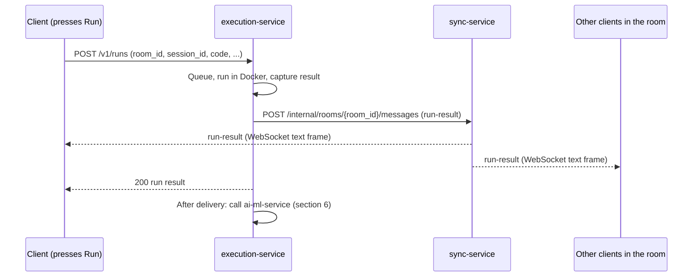

# Service Contracts (T-06)

**Version:** v0 (draft, "expect changes")
**Issue:** T-06 · #9
**Branch:** `feature/T-06-service-contracts`
**Author:** Yash Oza (Category D, PR1: sections 1 to 6)
**PR2:** Femina Rathod (section 7, error shapes and examples) · **Next:** v1 (section 8, owner token)
**Related:** `docs/ai-ml-contract.md` (T-07, execution-service to ai-ml-service)

This document fixes the endpoint paths, ports and field names the four services and the client share, so every category builds against the same shapes. v0 covers what the scaffolds and T-11 need first. Field names are meant to hold from here on. Until v1 is published, a field may still be renamed if every consumer is told in #dev and the change is logged under "Changes". **After v1, never rename a field without telling every consumer and logging it under "Changes".**

| Section | Status in v0 |
|---|---|
| 1. Services, ports, health | Decided |
| 2. Conventions | Decided |
| 3. Client and sync-service | Decided |
| 4. Client and execution-service (run request and result) | Decided |
| 5. Delivering a run result to the whole room (FR4.5) | Decided |
| 6. Ordering rule (NFR9) | Decided |
| 7. Error shapes | Decided (PR2, Femina) |
| 8. Owner token (FR9.5, T-10) | Reserved for v1, after T-05 |
| 9. Open items | Listed |

---

## 1. Services, ports and health

Ports and health paths are adopted from the T-08 integration stack (`docker-compose.yml`, `.env.example`). They were provisional there and are **final from this document on**.

| Service | Folder | Port | Health path | Reached by |
|---|---|---|---|---|
| client | `client/` | 3000 | `/` | the browser |
| sync-service | `sync-service/` | 8081 | `/actuator/health` | browser (WebSocket), execution-service (internal endpoint, section 5) |
| execution-service | `execution-service/` | 8082 | `/actuator/health` | browser (run request), ai-ml-service is called by it |
| ai-ml-service | `ai-ml-service/` | 8000 | `/health` | execution-service only (see T-07) |

- Inside the Docker Compose network, services reach each other by service name (for example `http://sync-service:8081`). From the browser and from local runs, use `localhost`.
- The two Spring Boot services must include Spring Boot Actuator, so `/actuator/health` returns HTTP 200 and the T-08 smoke test can check them.
- The browser talks to sync-service and execution-service **directly**. There is no gateway.
- If the client uses Vite, its dev server defaults to port 5173. T-01 must set `server.port` and `preview.port` to 3000 in the Vite config, ideally with `strictPort: true` so it fails instead of silently picking another port. Otherwise CORS (`CLIENT_ORIGIN`) and the T-08 smoke test, which checks `/` on port 3000, break.

### Shared settings (environment variables)

No secrets are committed (NFR10). Real values live in each person's local, git-ignored `.env`; the names and safe defaults go in `.env.example`.

| Variable | Used by | Default | Purpose |
|---|---|---|---|
| `CLIENT_ORIGIN` | sync-service, execution-service | `http://localhost:3000` | Browser origin allowed by CORS (execution-service) and by the WebSocket origin check (sync-service). |
| `SYNC_SERVICE_INTERNAL_URL` | execution-service | `http://sync-service:8081` | Where execution-service sends results to broadcast (section 5). |
| `INTERNAL_API_TOKEN` | sync-service, execution-service | none (set locally) | Shared secret on the internal endpoint (section 5). Never committed. |

### Client settings (browser build)

| Variable | Default | Purpose |
|---|---|---|
| `VITE_SYNC_WS_URL` | `ws://localhost:8081/ws/rooms` | Base of the sync WebSocket URL. The client appends `/{room_id}?session_id=...` (section 3.1). |
| `VITE_EXECUTION_API_URL` | `http://localhost:8082` | Base URL of execution-service. The client calls `POST {value}/v1/runs` (section 4.1). |

These names assume Vite, where only `VITE_`-prefixed variables reach the browser. If T-01 uses another build tool, the meaning stays the same and this table is updated. Everything in a client build is visible to anyone who opens the site, so **never put `INTERNAL_API_TOKEN`, an API key or any other secret in a client variable.**

---

## 2. Conventions

- All JSON field names are `snake_case`, matching `docs/ai-ml-contract.md` (T-07).
- `request_id`: a UUID v4 generated **by the client** for each run. It is echoed unchanged in the run result, in the broadcast message, and (by execution-service) in the call to ai-ml-service, so one id follows a run end to end.
- `room_id`: see section 3.2. `session_id`: see section 3.3.
- `language`: exactly one of `cpp`, `python`, `c`, `java`, `javascript` (DR1). These are the same identifiers T-07 uses.
- Time is in milliseconds (`*_ms`), memory in megabytes (`*_mb`), both JSON numbers.
- HTTP request bodies and responses are `application/json`, UTF-8. A run request body is limited to 1 MiB.
- execution-service sends CORS headers allowing `CLIENT_ORIGIN`. sync-service rejects a WebSocket handshake whose `Origin` is not `CLIENT_ORIGIN`.
- The limits quoted in this document (5 s wall time, 128 MB, 1 MB output and so on) come from NFR4 and are **configuration**, not part of the contract (DR3). Clients must not hard-code them.

---

## 3. Client and sync-service

sync-service is a WebSocket relay (T-02). It never reads or changes Yjs data.

### 3.1 Connection URL

```
ws://localhost:8081/ws/rooms/{room_id}?session_id={session_id}
```

- The room id is a **path segment**. The session id is a **query parameter**, because browsers cannot set custom headers on a WebSocket.
- The owner token (v1, section 8) will **not** be sent in the URL, so it never lands in logs.
- This shape works with the `y-websocket` client. It opens `serverUrl + '/' + roomName + '?' + params`, so `new WebsocketProvider('ws://localhost:8081/ws/rooms', room_id, ydoc, { params: { session_id } })` produces exactly this URL. Checked against the y-websocket 3.1.0 source and a test relay. Het and Niranjan confirm it in the real client during review.

### 3.2 Room id

- The room id is an opaque string of 1 to 64 characters from `A-Z a-z 0-9 _ -`.
- The shareable join link (US-01) contains exactly this value, in the page route below.
- **Page route:** the link opens the client at `/room/{room_id}`, for example `http://localhost:3000/room/room-demo-01`. T-01 reads the room id from this path and US-01 builds the link. Changing the route needs a T-06 update first.
- In v0 the relay creates a room the first time someone connects to it. No REST call is needed to create a room. If T-05 or T-10 needs server-created rooms, that changes in v1.
- A malformed room id closes the connection with code `4400` (section 3.6).

### 3.3 Session id (stable per browser)

- The **client** generates the session id once (a UUID v4, for example `crypto.randomUUID()`), stores it in the browser (`localStorage`, key `collab_session_id`), and **reuses it on every connection and every reconnect**. The server never generates or replaces it.
- The client sends the same value as `session_id` in the WebSocket URL and in every run request.
- The relay keeps the session id with each connection (T-02). Several tabs of one browser share one session id and may all be connected.
- This is what FR9.6 (Sprint 2) uses to block a removed user. Known limit: a user who clears browser storage gets a new session id. FR9.6 already accepts this and adds "regenerate the link" for the owner.
- `crypto.randomUUID()` exists only in secure contexts (HTTPS or localhost). If the page is opened over plain HTTP on a LAN address, the client falls back to a UUID v4 built from `crypto.getRandomValues`. Either way the value must be a valid UUID v4.
- The session id is **not** the owner token. Ownership (FR9.5) is a separate token, see section 8.

### 3.4 Frames

| Frame type | Direction | Content |
|---|---|---|
| **Binary** | both | Yjs sync and awareness messages in the `y-websocket` framing. The relay only looks at the first byte (section 3.5, rule 1). |
| **Text** | server to client | JSON control messages (section 3.5). |

Display name and colour (FR14, FR3) travel inside the Yjs awareness state. The relay never reads them.

The client sends no text frames in v0. A run goes over HTTP (section 4).

### 3.5 Relay rules

1. A binary frame from one connection is forwarded **unchanged** to every **other** connection in the same room. It is not echoed back to the sender, with one exception: an **awareness frame (first byte `1`) is also sent back to the sender.** The `y-websocket` client closes the connection and reconnects when it receives no message for 30 seconds, and a lone user would otherwise receive none. Tested with y-websocket 3.1.0: without the echo a lone client reconnected after about 30 seconds; with it, it stayed connected.
2. The relay stores nothing: no document, no history.
3. The largest accepted binary frame is **1 MiB**; a larger one closes the connection with code `1009`. Spring's default buffer for WebSocket messages is much smaller (about 8 KB as far as I know), so T-02 must raise it.
4. Text frames from the server may be up to **4 MiB** (a run result carries stdout and stderr).
5. WebSocket ping and pong frames are answered normally. Reconnect with exponential backoff is the client's job (FR11.1).
6. After connecting, the client sends one binary frame containing the single byte `3` (query awareness). The relay forwards it like any other frame, and every peer answers with its full awareness state. Without it, a person who joins late sees existing cursors only after about 16 seconds; with it, after about 100 milliseconds (tested with y-websocket 3.1.0). This supports FR3 (Sprint 2).

### 3.6 Server to client text messages

Every text message is a JSON object with a `type`.

#### `run-result`

Sent to **every** connection in the room when a run finishes (section 5). It carries the run result defined in section 4.2, plus `type`.

```json
{
  "type": "run-result",
  "request_id": "0b9d2f3e-7a41-4c58-9e1b-5d3c8a6f2e10",
  "room_id": "room-demo-01",
  "language": "cpp",
  "stdout": "hello\n",
  "stderr": "",
  "exit_code": 0,
  "execution_time_ms": 312,
  "peak_memory_mb": 4.1,
  "timed_out": false,
  "oom_killed": false,
  "failure_kind": null,
  "output_truncated": false,
  "message": null
}
```

The client that pressed Run receives this message too. A client shows a run only once per `request_id`: it may also receive the same result from its own HTTP response (section 4.2), and whichever arrives first is shown.

#### Reserved for Sprint 3

`anomaly-warning` (FR8.2) and `ai-explanation` (FR13.2) are reserved type names for the separate follow-up messages that arrive **after** the run result (NFR9). Their fields are defined in Sprint 3 from the T-07 responses.

#### Close codes

| Code | Meaning |
|---|---|
| `4400` | Malformed room id, or `session_id` missing or not a UUID. |
| `4403` | Reserved: the session was removed from this room (FR9.6, Sprint 2). |
| `1009` | Binary frame larger than 1 MiB. |

### 3.7 Example

```
ws://localhost:8081/ws/rooms/room-demo-01?session_id=7c1e4a52-3b0d-4f6a-9a2e-8d5f1b6c3e90
```

---

## 4. Client and execution-service

### 4.1 Run request

```
POST http://localhost:8082/v1/runs
Content-Type: application/json
```

| Field | Type | Required | Notes |
|---|---|---|---|
| `request_id` | string (UUID v4) | Yes | Generated by the client. |
| `room_id` | string | Yes | The room the result is delivered to. |
| `session_id` | string (UUID v4) | Yes | The same stable id as in section 3.3. It lets Sprint 2 enforce read-only guests (FR9.4) without renaming anything. |
| `language` | string | Yes | One of the five ids in section 2 (DR1). |
| `code` | string | Yes | Source code to run (FR4.1). |
| `stdin` | string | No | Defaults to `""` (FR4.1). |

```json
{
  "request_id": "0b9d2f3e-7a41-4c58-9e1b-5d3c8a6f2e10",
  "room_id": "room-demo-01",
  "session_id": "7c1e4a52-3b0d-4f6a-9a2e-8d5f1b6c3e90",
  "language": "cpp",
  "code": "#include <iostream>\nint main() {\n    std::cout << \"hello\" << std::endl;\n    return 0;\n}",
  "stdin": ""
}
```

### 4.2 Run result

The call returns **HTTP 200 with the run result** once the run has finished. This includes failed runs: a compile error, a non-zero exit, a timeout and an out-of-memory kill are all **results, not errors**, because FR4.2 requires stdout and stderr to be shown for failed runs, and FR4.5 requires every participant to see them. Real errors (queue full, unsupported language, invalid request) are section 7.

The client should allow at least 30 seconds for this call, because the call waits in the queue (FR16) and for the compile stage (NFR4.5) and run stage (NFR4.1).

| Field | Type | Notes |
|---|---|---|
| `request_id` | string | Echoed from the request. |
| `room_id` | string | Echoed from the request. |
| `language` | string | Echoed from the request. |
| `stdout` | string | Always present, may be `""` (FR4.2). |
| `stderr` | string | Always present, may be `""` (FR4.2). |
| `exit_code` | integer | Exit code of the process (FR4.4). |
| `execution_time_ms` | number | Wall-clock time measured by execution-service (FR4.3, FR6). |
| `peak_memory_mb` | number | Peak memory in megabytes (FR4.3, FR6). |
| `timed_out` | boolean | `true` if killed by the wall-time limit (NFR4.1). |
| `oom_killed` | boolean | `true` if killed by the memory limit (NFR4.2). |
| `failure_kind` | `"compile_error"` \| `"non_zero_exit"` \| `"timeout"` \| `null` | `null` when the run succeeded. Same values as T-07. |
| `output_truncated` | boolean | `true` if stdout or stderr was cut at the output cap (NFR4.4). |
| `message` | string \| `null` | A short sentence the UI shows beside the output, for example `"Time limit exceeded"` or `"Memory limit exceeded"` (NFR4.2). `null` when there is nothing to say. |

The field names for time, memory, exit code, `timed_out`, `oom_killed` and `failure_kind` are the same as in `docs/ai-ml-contract.md`, so execution-service passes them through to ai-ml-service without translating.

**Success** (also the example in section 3.6):

```json
{
  "request_id": "0b9d2f3e-7a41-4c58-9e1b-5d3c8a6f2e10",
  "room_id": "room-demo-01",
  "language": "cpp",
  "stdout": "hello\n",
  "stderr": "",
  "exit_code": 0,
  "execution_time_ms": 312,
  "peak_memory_mb": 4.1,
  "timed_out": false,
  "oom_killed": false,
  "failure_kind": null,
  "output_truncated": false,
  "message": null
}
```

**Compile error**:

```json
{
  "request_id": "5e8a1c47-92d3-4b6f-a0c1-3f7d2b9e4a18",
  "room_id": "room-demo-01",
  "language": "cpp",
  "stdout": "",
  "stderr": "main.cpp:3:5: error: 'x' was not declared in this scope\n",
  "exit_code": 1,
  "execution_time_ms": 0,
  "peak_memory_mb": 61.2,
  "timed_out": false,
  "oom_killed": false,
  "failure_kind": "compile_error",
  "output_truncated": false,
  "message": null
}
```

**Timeout**:

```json
{
  "request_id": "a3c9e7d1-4f28-4a65-b1d0-6e2f8c5b9a37",
  "room_id": "room-demo-01",
  "language": "python",
  "stdout": "",
  "stderr": "",
  "exit_code": 137,
  "execution_time_ms": 5000,
  "peak_memory_mb": 9.8,
  "timed_out": true,
  "oom_killed": false,
  "failure_kind": "timeout",
  "output_truncated": false,
  "message": "Time limit exceeded"
}
```

**Out of memory**: `oom_killed` is `true`, `exit_code` is the kill code (for example `137`), `failure_kind` is `"non_zero_exit"` and `message` is `"Memory limit exceeded"`.

---

## 5. Delivering a run result to everyone in the room (FR4.5)

### Decision

**execution-service delivers the result to the room through sync-service.** When a run finishes, execution-service sends the run result to sync-service's internal endpoint, and sync-service forwards it as a `run-result` text frame (section 3.6) to every connection in that room. The caller also gets the same result in its HTTP response (section 4.2).



### Why this one

- A client cannot fake a result, because only execution-service can call the internal endpoint.
- Everyone gets the result even if the person who pressed Run closes the tab or loses connection.
- The result reaches everyone over the connection they already have, so no second live connection is needed.
- It matches `docs/ai-ml-contract.md` section 6, which already assumes execution-service sends the result through sync-service.
- Rejected: **the pressing client rebroadcasts the result** (it can be faked and is lost if that tab closes), and **every client listens to execution-service directly** (it needs a second live connection and room tracking in execution-service).

### Internal endpoint (execution-service to sync-service only)

```
POST {SYNC_SERVICE_INTERNAL_URL}/internal/rooms/{room_id}/messages
X-Internal-Token: <INTERNAL_API_TOKEN>
Content-Type: application/json
```

- The body is the exact text frame to broadcast (for example the `run-result` object, including `"type"`). sync-service checks that `type` is a non-empty string and the body is at most 4 MiB, and forwards it **to every connection in the room, including the caller's**.
- The browser can reach port 8081 too, so this endpoint is protected by the shared secret. A missing or wrong `X-Internal-Token` returns `401` and broadcasts nothing. The secret is read from the environment and is never committed (NFR10).

Response `200`:

```json
{
  "room_id": "room-demo-01",
  "delivered": 3
}
```

`delivered` is the number of connections the message was sent to. A room with no connections returns `200` with `"delivered": 0`; that is not an error. A malformed body returns `400` and a bad token returns `401`, both with the T-07 error envelope (details in section 7).

---

## 6. Ordering rule (NFR9)

The ai-ml-service is never in the critical path of a run result. This repeats `docs/ai-ml-contract.md` section 6 so both contracts say the same thing:

1. execution-service runs the code and captures the result.
2. It sends the result to the room (section 5), then returns the HTTP response.
3. **Only after that** it calls ai-ml-service (`POST /v1/anomaly`, and `/v1/review` or `/v1/explain` when the user asked and has consented).
4. Anything ai-ml-service returns reaches the room as a **separate** follow-up message (`anomaly-warning`, `ai-explanation`, section 3.6), never inside the run result.

If ai-ml-service is slow, down or returns an error, the run result is not affected.

---

## 7. Error shapes

Errors use the same envelope as `docs/ai-ml-contract.md` section 5, so a client handles errors from every service the same way.

```json
{
  "request_id": "<uuid from the request, or null>",
  "error": {
    "code": "SOME_CODE",
    "message": "Human-readable text",
    "retry_after_seconds": null
  }
}
```

| Field | Type | Notes |
|---|---|---|
| `request_id` | string \| `null` | Echoed from the request body. `null` when the body could not be parsed or had no `request_id`. |
| `error.code` | string | Machine-readable, `UPPER_SNAKE_CASE`. Clients decide what to do from `code`, never from `message`. |
| `error.message` | string | One short sentence the UI can show as-is. |
| `error.retry_after_seconds` | integer \| `null` | Only set for `QUEUE_FULL`. `null` for every other code. |

**What is not an error:** a compile error, a non-zero exit, a timeout and an out-of-memory kill are **run results** (HTTP 200, section 4.2), never an error envelope. An error means the run did not happen.

### 7.1 Errors from `POST /v1/runs` (client to execution-service)

| `error.code` | HTTP | `error.message` | When | What the client does |
|---|---|---|---|---|
| `QUEUE_FULL` | **503** | `Execution service is busy, try again in a few seconds.` | The execution queue is at its maximum length (FR16). | Show the message. Re-enable Run after `retry_after_seconds`. Do not retry automatically in a loop. |
| `UNSUPPORTED_LANGUAGE` | **422** | `Language '<value>' is not supported. Use one of: cpp, python, c, java, javascript.` | `language` is not one of the five ids in section 2 (DR1). | Show the message. Fix the request; do not retry unchanged. |
| `INVALID_REQUEST` | **422** | `Field '<name>' is missing or invalid.` | A required field is missing or has the wrong type, or `request_id` / `session_id` is not a UUID, or `room_id` breaks the rules in section 3.2. `<name>` is the first bad field. | Fix the request; do not retry unchanged. |
| `REQUEST_TOO_LARGE` | **413** | `Run request is larger than 1 MiB.` | The request body is over the 1 MiB limit in section 2. | Show the message. Do not retry unchanged. |

- `QUEUE_FULL` also sends the standard `Retry-After` HTTP header with the same number of seconds as `retry_after_seconds`. The number comes from configuration (DR3); clients must read it from the response, not hard-code it.
- `422` matches the status T-07 uses for an invalid request, so both contracts treat a bad payload the same way.
- `REQUEST_TOO_LARGE` may be raised by the web framework before the body is read. execution-service must still return this envelope (with `request_id: null`), not the framework's default error page.

**`QUEUE_FULL`** (FR16)

```http
HTTP/1.1 503 Service Unavailable
Retry-After: 5
Content-Type: application/json
```

```json
{
  "request_id": "0b9d2f3e-7a41-4c58-9e1b-5d3c8a6f2e10",
  "error": {
    "code": "QUEUE_FULL",
    "message": "Execution service is busy, try again in a few seconds.",
    "retry_after_seconds": 5
  }
}
```

**`UNSUPPORTED_LANGUAGE`** (DR1)

```json
{
  "request_id": "0b9d2f3e-7a41-4c58-9e1b-5d3c8a6f2e10",
  "error": {
    "code": "UNSUPPORTED_LANGUAGE",
    "message": "Language 'rust' is not supported. Use one of: cpp, python, c, java, javascript.",
    "retry_after_seconds": null
  }
}
```

**`INVALID_REQUEST`**

```json
{
  "request_id": "0b9d2f3e-7a41-4c58-9e1b-5d3c8a6f2e10",
  "error": {
    "code": "INVALID_REQUEST",
    "message": "Field 'code' is missing or invalid.",
    "retry_after_seconds": null
  }
}
```

**`REQUEST_TOO_LARGE`**

```json
{
  "request_id": null,
  "error": {
    "code": "REQUEST_TOO_LARGE",
    "message": "Run request is larger than 1 MiB.",
    "retry_after_seconds": null
  }
}
```

### 7.2 Errors from the internal endpoint (execution-service to sync-service)

These come from `POST /internal/rooms/{room_id}/messages` (section 5). Only execution-service calls this endpoint, so these errors are logged by execution-service, never shown to a user. In every case **nothing is broadcast**.

| `error.code` | HTTP | `error.message` | When |
|---|---|---|---|
| `INVALID_MESSAGE` | **400** | `Message body is not valid: <reason>.` | The body is not JSON, `type` is missing or empty, the body is over 4 MiB, or `room_id` breaks the rules in section 3.2. |
| `UNAUTHORIZED` | **401** | `Missing or invalid internal token.` | `X-Internal-Token` is missing or does not match `INTERNAL_API_TOKEN`. |

- `request_id` is taken from the body when it has one (a `run-result` always does), otherwise `null`.
- The `401` message never says whether the token was missing or wrong, and the token is never logged.

**`INVALID_MESSAGE`**

```json
{
  "request_id": "0b9d2f3e-7a41-4c58-9e1b-5d3c8a6f2e10",
  "error": {
    "code": "INVALID_MESSAGE",
    "message": "Message body is not valid: field 'type' is missing.",
    "retry_after_seconds": null
  }
}
```

**`UNAUTHORIZED`**

```json
{
  "request_id": null,
  "error": {
    "code": "UNAUTHORIZED",
    "message": "Missing or invalid internal token.",
    "retry_after_seconds": null
  }
}
```

### 7.3 Summary for implementers

| HTTP | Code | Endpoint | Retry? |
|---|---|---|---|
| 200 | (run result, not an error) | `POST /v1/runs` | — |
| 400 | `INVALID_MESSAGE` | internal | No, fix the body |
| 401 | `UNAUTHORIZED` | internal | No, fix the token |
| 413 | `REQUEST_TOO_LARGE` | `POST /v1/runs` | No |
| 422 | `INVALID_REQUEST` | `POST /v1/runs` | No |
| 422 | `UNSUPPORTED_LANGUAGE` | `POST /v1/runs` | No |
| 503 | `QUEUE_FULL` | `POST /v1/runs` | Yes, after `retry_after_seconds` |

---

## 8. Owner token (v1)

### v1 completion proposal — requires category review before merge

T-05 places room/owner state in sync-service. No existing v0 field is renamed.
A random valid link may still open a new empty, unowned room (instant join).
Only the following REST creation operation issues ownership; visiting an unknown
link never claims ownership. Empty-room documents are not persisted in Sprint 1.

`POST http://localhost:8081/v1/rooms` accepts an empty JSON object `{}` and
returns HTTP 201 with `{"room_id":"<server-generated id>","owner_token":"<random secret>"}`.
The server generates a fresh room id; callers cannot select or take over an id.

`GET http://localhost:8081/v1/rooms/{room_id}/owner` requires
`X-Owner-Token: <owner_token>`. Correct token: HTTP 200,
`{"room_id":"<id>","is_owner":true}`. Wrong/missing token or unknown room:
HTTP 403 with common error envelope, `request_id:null`, code `NOT_OWNER`,
message `Missing or invalid owner token.`, retry_after_seconds null.

Client configuration adds `VITE_PLATFORM_API_URL=http://localhost:8081`.
Store tokens in localStorage keyed by room id; never include them in URLs,
shared links, awareness or logs. They identify browser possession, not a human
identity. Anyone stealing a bearer token can impersonate its owner. Clear site
data loses ownership; server restart loses in-memory ownership (Sprint 1 only).
Store only SHA-256 hashes server-side and compare in constant time.

The forwarding path continues to keep no Yjs document/history. Platform state
is separate from connected-session membership and survives a browser refresh.

### Remaining v1 clarifications

Output cap applies to combined captured stdout/stderr bytes. UTF-8 truncation
must discard incomplete trailing code points. For future T-07 anomaly calls,
stdout_bytes/stderr_bytes mean bytes retained by the capture, not bytes attempted
before truncation. This is a proposed resolution of the T-13/Jay open item and
requires Jay's confirmation; it does not edit the original T-13 document.
Sprint 1 is Python-only execution; valid other DR1 languages return HTTP 422
UNSUPPORTED_LANGUAGE with a clear 'not available yet' message. A run did not
occur, so this is an error envelope rather than a fabricated run result.
OOM uses `failure_kind: "non_zero_exit"`, never the undocumented value `"oom"`.
Python wall time excludes queueing; container startup can affect deadline timing.
A missing sampled memory reading is 0 (unknown), not proof of zero memory use;
accurate peak-memory measurement is Sprint 2 validation work.
T-15 and T-16 remain internal prototypes, with no execution-to-AI calls in
Sprint 1. Section 6 describes the later ordering rule when wiring is introduced.

Execution-to-relay delivery failure returns HTTP 503, common envelope code
RESULT_DELIVERY_FAILED, with message 'Run finished but room delivery failed.'
The run must not be re-executed automatically. Result delivery is one attempt;
reliable replay/persistence is later work. Never silently report room delivery
success when the relay is unavailable.

---

## 9. Open items

| # | Item | Owner | Needed by |
|---|---|---|---|
| 1 | ~~Error shapes (section 7)~~ Done in PR2 | Femina | v0 PR2 |
| 2 | Owner-token section (section 8) | Yash, after T-05 | v1 |
| 3 | An empty room keeps no document, because the relay stores nothing (section 3.5). A person who joins after everyone has left gets a blank document unless a client still has a local copy (`y-indexeddb`, FR11.2). Decide whether v1 needs server-side state. | T-02 owners and Category A | v1 review |
| 4 | Room creation: who creates a room and when (section 3.2). | T-05 and T-10 | v1 |
| 5 | Whether `execution_time_ms` includes the compile stage (for example the `0` in the compile error example). The field name does not change either way. | Jay (B) | v1 |
| 6 | Whether the 1 MB output cap (NFR4.4) applies per stream or combined. It affects the 4 MiB text frame limit in section 3.5. | Jay (B) | v1 |
| 7 | Read-only guest enforcement on Run (FR9.4, Sprint 2) uses `session_id`, which the run request already carries. | Sprint 2 | Sprint 2 |
| 8 | Fields of `anomaly-warning` and `ai-explanation` (section 3.6). | Category C | Sprint 3 |
| 9 | Confirm the page route `/room/{room_id}` (section 3.2) and the client variable names (section 1) in the real client. | Het, Chandan, Niranjan | v1 review |

---

## 10. Review confirmations (needed before v1)

Each person confirms their own section in a PR comment: "I can implement my part from this document alone."

- [ ] **Het (A):** section 3 (connection, frames, session id, route), the client variables in section 1, and the client side of sections 4 and 5.
- [ ] **Chandan (A, US-01):** the page route in section 3.2.
- [ ] **Jay (B):** section 4 (run request and result) and the execution side of section 5.
- [ ] **Prince (C):** sections 2 and 6, and that the result fields match `docs/ai-ml-contract.md`.
- [ ] **Yash and Femina (D):** sections 1, 5, 7 and 8.

---

# Version 2 (T-17 · #61)

Version 2 continues T-06 (#9) and writes down the 15 decisions of Backlog v2 section 6.1. It is authored across two PRs that share this file: **decisions 1 to 7** (rooms, join, roles, sockets, modules) on `docs/T-17-contracts-v2-rooms`, and **decisions 8 to 15** (run spec, results, visibility, permission errors, legacy types, carried items) on `docs/T-17-contracts-v2-runs-errors`. Whichever merges first, the other rebases onto it.

**The merged v0/v1 text above is not edited.** Each decision below states which v0/v1 rule it replaces. Where v2 and the text above disagree, v2 wins for Sprint 2 work.

**Status legend.** *Decided* — the requirements or an accepted decision record force the behaviour. *Proposed* — a design choice that each category confirms in the PR (the T-06 rule). **All field and code names are Proposed until this version is merged and confirmed.** Every JSON example is made-up data; never real user code.

| # | Topic | Status | PR |
|---|---|---|---|
| 1 | Room creation | Decided | rooms |
| 2 | Who generates the room id | Decided | rooms |
| 3 | Unknown room | Decided | rooms |
| 4 | Join and unique names | Proposed | rooms |
| 5 | Roles | Proposed | rooms |
| 6 | Sockets | Proposed | rooms |
| 7 | Module addressing | Proposed | rooms |
| 8 | Run specification | Proposed | runs-errors |
| 9 | Run result | Proposed | runs-errors |
| 10 | Result visibility | Decided (behaviour), Proposed (fields) | runs-errors |
| 11 | Permission lookup | Proposed | runs-errors |
| 12 | Permission errors | Decided (behaviour), Proposed (code names) | runs-errors |
| 13 | Legacy message types | Decided (removal), Proposed (new name) | runs-errors |
| 14 | Error codes of the internal endpoint | Proposed | runs-errors |
| 15 | Items carried from T-06 | Proposed | runs-errors |

## V2.1 Room creation (decisions 1, 2) — Decided

A room is created **only** by `POST /v1/rooms` on sync-service. Replaces the v0 rule (section 3.2) that the relay creates a room on first connect, and supersedes the v1 proposal body in section 8.

```
POST http://localhost:8081/v1/rooms
Content-Type: application/json
```

| Field | Type | Required | Notes |
|---|---|---|---|
| `mode` | `"pair"` \| `"open"` | Yes | Fixed at creation, immutable (FR17). |
| `preset` | `"teach_interview"` \| `"debug_together"` | Pair only | Omitted in Open mode. |
| `language` | one of the five (section 2) | Open only | The workspace language. Omitted in Pair mode. |

The server generates the `room_id`: at least **128 bits** from a secure random generator, written in **base64url without `=` padding** (so it uses only `A-Za-z0-9_-` and stays inside the §3.2 charset), within the existing 1 to 64 character rule. 128 bits is **22 base64url characters**, so a valid id is at least 22 characters long. The client cannot choose or take over an id (NFR16, US-62).

If `preset` is sent in Open mode, or `language` in Pair mode, or a field required for the chosen mode is missing, the server rejects the request with `INVALID_REQUEST` (HTTP 422); the error is the one in V2.12 (`INVALID_REQUEST`, or `UNSUPPORTED_LANGUAGE` for a language outside the five). The owner-check endpoint `GET /v1/rooms/{room_id}/owner` from section 8 is **retained** (needed by T-10); only its answer for an unknown room changes (`404 ROOM_NOT_FOUND`, V2.12).

Request (Open mode):

```json
{ "mode": "open", "language": "python" }
```

Response `201 Created`:

```json
{
  "room_id": "k3Yc1t9Qx7mBvA2nR0sLpQ",
  "owner_token": "PLACEHOLDER_NOT_A_REAL_TOKEN",
  "mode": "open",
  "preset": null,
  "language": "python"
}
```

Request (Pair mode):

```json
{ "mode": "pair", "preset": "teach_interview" }
```

Response `201 Created`:

```json
{
  "room_id": "Zq8-Lw2Ef6Th0Yx4Rn7JbA",
  "owner_token": "PLACEHOLDER_NOT_A_REAL_TOKEN",
  "mode": "pair",
  "preset": "teach_interview",
  "language": null
}
```

> **Example files.** The v2 shapes above are saved as parsable JSON under `docs/examples/`: [`v2-create-room-open-request.json`](examples/v2-create-room-open-request.json), [`v2-create-room-open-response.json`](examples/v2-create-room-open-response.json), [`v2-create-room-pair-request.json`](examples/v2-create-room-pair-request.json), [`v2-create-room-pair-response.json`](examples/v2-create-room-pair-response.json), and (for later sections) `v2-join.json`, `v2-joined.json`, `v2-roster.json`, `v2-module.json`, `v2-module-updated.json`. The old `create-room-request.json` (`{}`) and `create-room-response.json` are the **v1** shapes — do not copy them for v2.

## V2.2 Unknown room (decision 3) — Decided

Connecting to a `room_id` that does not exist closes the socket with close code **`4404`**. The v0 rule that the relay creates a room on first connect is withdrawn. A room exists only after `POST /v1/rooms`. This also withdraws the section 8 sentence "A random valid link may still open a new empty, unowned room (instant join)": there are no unowned rooms, and an unknown link never creates one.

## V2.3 Join and unique names (decision 4) — Proposed

Replaces the v0 rule (section 3.4) that the client sends no text frames. After connecting to the control socket (V2.5), the client sends **one** text message `join`:

```json
{
  "type": "join",
  "display_name": "Ada",
  "owner_token": "PLACEHOLDER_NOT_A_REAL_TOKEN"
}
```

`owner_token` is sent **only** by the Host, and never in the URL (T-10). A missing or invalid `owner_token` is **not an error**: the session simply joins without the Host role (its role comes from the room rules). The token is validated by the T-10 owner check and is never echoed or logged. The server answers `joined`:

```json
{
  "type": "joined",
  "member_id": "m_7a3c9f",
  "role": "host",
  "mode": "pair",
  "preset": "teach_interview",
  "permissions": { "can_edit": true, "can_run": true }
}
```

- **Public `member_id`, private `session_id`.** The server assigns a **`member_id`** on join: a public, per-room id used in `roster`, module data and REST targets (V2.4, V2.6). The client's own **`session_id`** (v0 §3.3) stays **private to its browser** — it is the credential in the socket URL and in the `X-Session-Id` header (V2.6), and is **never** placed in `roster`, module data or any broadcast, so one member can never learn another's `session_id` and impersonate them. `joined` is sent only to that one connection. A session keeps the **same `member_id` for the life of the room**: a refresh, a reconnect or a second tab gets the same id back, so module ownership and write access follow the person.
- **`permissions.can_edit` applies to Pair mode's single shared file.** In Open mode `can_edit` is **omitted** from `joined` and `roster`: edit rights are per module (FR22.2, Requirements v2 §7.4), so the client takes write access from module state (V2.6). `can_run` applies in both modes.
- **Reconnect is not `NAME_TAKEN`.** A session rejoining with the **same `session_id`** and the same `display_name` (a refresh or a second tab) is accepted — FR42 identifies a person by session id. `NAME_TAKEN` is only for a **different** session claiming a name already in use.

Otherwise the server sends `join-refused` with a `reason` of `NAME_TAKEN` (FR42), `ROOM_FULL` (US-63), `USER_BLOCKED` (US-28) or `APPROVAL_PENDING`:

```json
{ "type": "join-refused", "reason": "NAME_TAKEN", "message": "That display name is already in use in this room." }
```

- **Socket after `join-refused`.** The server **closes** the control socket immediately after a `join-refused`, **except** for `APPROVAL_PENDING`: there the socket stays open until the server sends `join-approved` (then the normal `joined`) or `join-declined` (after which it closes).
- **`USER_BLOCKED` vs close code `4403`.** A removed user (US-28) opening a **new** connection is refused at join with `USER_BLOCKED`; a removed user who is **already connected** has the socket closed with code **`4403`** (reserved in v0 §3.6).
- **After `APPROVAL_PENDING`** the server later sends either `join-approved` (followed by the normal `joined`) or `join-declined`:

```json
{ "type": "join-approved" }
```
```json
{ "type": "join-declined", "message": "The Host declined your request to join." }
```

## V2.4 Roles (decision 5) — Proposed

Three roles: `host`, `participant`, `observer`. The server sends a `roster` message; the client takes labels and roles from it, **not** from awareness (awareness can be forged). `roster` is sent **after every join, leave, or role/permission change**, so the client always has the current list.

```json
{
  "type": "roster",
  "members": [
    { "member_id": "m_7a3c9f", "display_name": "Ada", "role": "host", "permissions": { "can_edit": true, "can_run": true } },
    { "member_id": "m_4b19d2", "display_name": "Lin", "role": "observer", "permissions": { "can_edit": false, "can_run": false } }
  ]
}
```

Members are identified by the public `member_id`, **never** by `session_id` (V2.3). The example is a **Pair** room; in Open mode `can_edit` is **omitted** (write access comes from module state, V2.6).

## V2.5 Sockets (decision 6) — Proposed

Two sockets replace the single v0 socket (section 3.1), keeping all v0 relay rules (awareness echo, query-awareness frame, 1 MiB limit — section 3.5) on the document socket.

| Socket | URL | Carries |
|---|---|---|
| Control | `ws://localhost:8081/ws/rooms/{room_id}?session_id=...` | text messages only (`join`, `joined`, `join-refused`, `join-approved`, `join-declined`, `roster`, `run-result`, `analysis-result`, `edit-rejected`, `module-updated`) |
| Document | `ws://localhost:8081/ws/rooms/{room_id}/docs/{doc_id}?session_id=...` | Yjs binary frames only |

Pair mode has one document, `main`. Open mode has one document per module, and its `doc_id` **is** the `module_id`. A session must `join` on the control socket **before** opening a document socket; a document socket opened without a prior join is closed with **`4406`** (not joined).

New close codes: **`4410`** (room closed, FR31.2), **`4405`** (unknown `doc_id`/`module_id` on the document socket — `4404` means the room, not the document, is unknown) and **`4406`** (document socket opened before `join`). These join `4404` (room not found) and the v0 codes (`4400`, `4403`, `1009`).

## V2.6 Module addressing (decision 7) — Proposed

`module_id` is a server-generated opaque id (at least 16 URL-safe characters), never reused, surviving rename and transfer. `name` is the file name with the language extension, unique in the workspace, changeable by the owner (Open mode only).

### Module object

The shape returned by the module endpoints and carried by `module-updated`:

```json
{
  "module_id": "mod_9Qx7mBvA2nR0",
  "name": "solver.py",
  "owner_member_id": "m_7a3c9f",
  "writers": ["m_4b19d2"],
  "runnable": true,
  "is_entry": false,
  "version": 4,
  "pending": false
}
```

`owner_member_id` and `writers` are **public `member_id`s** (V2.3), never `session_id`s. `writers` is the list of members granted write access besides the owner. `pending` is `true` while a create request awaits Host approval. While it is pending, `owner_member_id` is the requester; the approval confirms it or sets another member (FR21.2).

### Module operations (REST on sync-service)

All paths are under `/v1/rooms/{room_id}/modules`. "Who" is who may call it. Each successful call also pushes a `module-updated` to the room (see below). Error codes (`NOT_MODULE_OWNER`, `NOT_OWNER`, `MODULE_NOT_FOUND`, `NAME_TAKEN`, …) are defined in V2.12 (decision 12).

**Caller identity.** Every module operation below identifies the caller by the header `X-Session-Id: <session_id>`: the caller's private session id (v0 §3.3), sent in a header, never in the URL or a body. The server maps it to the caller's `member_id` and role, and checks ownership/role from there. Host-only actions (set entry file, approve, and grant/revoke write when done by the Host) additionally require `X-Owner-Token: <owner_token>`, validated by the T-10 owner check. A call with a missing or unknown `X-Session-Id`, or a Host-only action without a valid owner token, is refused (V2.12: `INVALID_REQUEST` for a missing or malformed `X-Session-Id`, `SESSION_NOT_FOUND` for a session that has not joined this room, `NOT_OWNER` for a Host-only action without a valid owner token). The owner token is never put in the URL or logged. Room creation (V2.1) needs no caller identity, and the owner check keeps its v1 header, `X-Owner-Token` (section 8).

**CORS.** These endpoints send CORS headers allowing `CLIENT_ORIGIN` (section 1), the methods `GET`, `POST`, `PATCH`, `DELETE` and `OPTIONS` (a browser sends a preflight for `PATCH` and `DELETE`), and the request headers `Content-Type`, `X-Session-Id` and `X-Owner-Token`, matching how execution-service already allows the browser origin (section 2).

| Operation | Method & path | Who | Request body | Success |
|---|---|---|---|---|
| List | `GET /v1/rooms/{room_id}/modules` | any member | — | `200` array of module objects |
| Request (create) | `POST /v1/rooms/{room_id}/modules` | any participant | `{ "name": "solver.py" }` | `202` module object, `pending: true` — awaits Host approval (FR21.1) |
| Approve | `POST /v1/rooms/{room_id}/modules/{module_id}/approve` | **Host** | `{}`, or `{ "owner_member_id": "m_4b19d2" }` to choose another owner; the default is the requester (FR21.2) | `200` module object, `pending: false`, owner set |
| Rename | `PATCH /v1/rooms/{room_id}/modules/{module_id}` | **owner** (FR21.4) | `{ "name": "solver2.py" }` | `200` module object |
| Set runnable | `PATCH /v1/rooms/{room_id}/modules/{module_id}` | **owner** | `{ "runnable": true }` | `200` module object |
| Set entry file | `PATCH /v1/rooms/{room_id}/modules/{module_id}` | **Host** (FR20.3) | `{ "is_entry": true }` | `200` module object |
| Delete | `DELETE /v1/rooms/{room_id}/modules/{module_id}` | **owner** (FR21.4) | — | `204` |
| Transfer owner | `POST /v1/rooms/{room_id}/modules/{module_id}/transfer` | **owner** (FR21.4) | `{ "to_member_id": "m_4b19d2" }` | `200` module object |
| Grant write | `POST /v1/rooms/{room_id}/modules/{module_id}/writers` | **owner or Host** (FR22.1) | `{ "member_id": "m_4b19d2" }` | `200` module object |
| Revoke write | `DELETE /v1/rooms/{room_id}/modules/{module_id}/writers/{member_id}` | **owner or Host** (FR22.1) | — | `200` module object |
| Save version | `POST /v1/rooms/{room_id}/modules/{module_id}/save` | owner or writer | — | `200` `{ "module_id": "…", "version": 5 }` |

A `PATCH` carries **exactly one** of `name`, `runnable` or `is_entry`; the caller allowed depends on the field (owner for `name` and `runnable`, Host for `is_entry`, as the rows show). Sending zero or more than one of these fields is `INVALID_REQUEST`. Module **targets** (`owner_member_id`, `to_member_id`, `member_id`, the `writers` path segment) are always public `member_id`s, never `session_id`s.

Example — grant write access (owner or Host):

```
POST http://localhost:8081/v1/rooms/{room_id}/modules/mod_9Qx7mBvA2nR0/writers
Content-Type: application/json
X-Session-Id: <caller-session-id>

{ "member_id": "m_4b19d2" }
```

### `module-updated` push

Every module change is pushed to the room as a `module-updated` control message carrying the module object plus a `deleted` flag:

```json
{
  "type": "module-updated",
  "module_id": "mod_9Qx7mBvA2nR0",
  "name": "solver.py",
  "owner_member_id": "m_7a3c9f",
  "writers": ["m_4b19d2"],
  "runnable": true,
  "is_entry": false,
  "version": 4,
  "pending": false,
  "deleted": false
}
```

When a module is deleted, `deleted` is `true` and only `module_id` is guaranteed to be present. The `writers` list lets the client render per-module write access (FR24.2) and the full module list (FR22).

## V2.7 Review confirmations for decisions 1–7

Each person confirms their own section in a PR comment: "I can implement my part from Version 2 (decisions 1–7) alone."

- [ ] **Het (A):** V2.3 join, V2.4 roster, V2.5 sockets (client side).
- [ ] **Yash and Femina (D):** V2.1–V2.2 room creation, V2.5–V2.6 sockets and modules (server).

Decisions 8–15 are in V2.8 to V2.15, and their confirmations (Jay, Prince, and Het and Yash and Femina for their parts) are in V2.16. When the full Version 2 is merged and confirmed, close T-06 (#9) with a comment listing the items carried forward (V2.15).

Decisions 8 to 15 follow Backlog v2 section 6.1 with the five differences below. Each one is repeated where it applies and is **Proposed**, like the names around it.

| # | Difference from Backlog v2 §6.1 | Why |
|---|---|---|
| 1 | `runner` in a run result carries `member_id` and `display_name`, not `session_id` (decision 9). | A result is shown to the room. `session_id` is a private credential (V2.3) and must not appear in anything that is broadcast. |
| 2 | The permission lookup (decision 11) also returns `member_id`, `display_name`, `mode` and `language`. | execution-service needs them to fill `runner`, to check the `source` kind against the room mode and to check the workspace language, without a second call. |
| 3 | Four error codes and one `reason` are added: `RUN_NOT_FOUND`, `SESSION_NOT_FOUND`, `MEMBER_NOT_FOUND`, `ROOM_SERVICE_UNAVAILABLE` and `not_in_room`. | Decision 12 has no code for an unknown or expired run (share), a session or member that is not in the room, or a lookup that cannot be answered. |
| 4 | The internal snapshot read has a shape (V2.8). | Decision 8 says execution-service reads the saved versions in one call. T-19 stubs that call, so the stub needs a shape. |
| 5 | The owner check answers an unknown room with `404 ROOM_NOT_FOUND`, not `403 NOT_OWNER` (V2.12). | Every other REST call on an unknown room answers `ROOM_NOT_FOUND`. A room that does not exist is not a case of "wrong owner". |

## V2.8 Run specification (decision 8) — Proposed

Replaces the v0 run request (section 4.1), where the code travels in one string field, `code` (`RunRequest.code` in `main`, PR #48). `POST /v1/runs` keeps its path, port and CORS rules (sections 1, 2 and 4.1).

| Field | Type | Required | Notes |
|---|---|---|---|
| `request_id` | string (UUID v4) | Yes | Unchanged (section 2). |
| `room_id` | string | Yes | Unchanged. |
| `session_id` | string (UUID v4) | Yes | Unchanged (v0 §3.3). It is the caller's private credential: execution-service uses it only to ask who the caller is (V2.11) and never puts it in a result or a broadcast (V2.3). |
| `language` | string | Yes | One of the five ids (section 2). In Open mode it must equal the workspace language (FR20.1). |
| `stdin` | string | No | Defaults to `""`. Unchanged. |
| `source` | object | Yes | Exactly one source object (below). |

**`code` is no longer part of the request.** Until T-19 lands, execution-service still accepts a Pair mode body that has `code` and no `source`; a body with both is `INVALID_REQUEST`. From T-19 on, any body that has `code` is rejected as `INVALID_REQUEST` (HTTP 422).

### The three `source` shapes

| Room | Run | `source` |
|---|---|---|
| Pair | the shared file | `{"kind":"inline","files":[{"name":"main.py","content":"..."}],"entry":"main.py"}` |
| Open | one runnable module | `{"kind":"saved","target":"module","module_id":"..."}` |
| Open | through the entry file | `{"kind":"saved","target":"entry","module_ids":["..."]}` or `"module_ids":"all"` |

Rules:

1. `inline` is valid only in a Pair room and `saved` only in an Open room. The room's mode comes from the permission lookup (V2.11). A mismatch is `INVALID_REQUEST` and names `source.kind`. A `language` that differs from the workspace language in an Open room is `INVALID_REQUEST` too.
2. `inline`: `files` holds exactly one file in Pair mode (FR18). `name` is a plain file name with the language extension (DR4): no `/`, no `\`, no `..`. `entry` must be the `name` of one of the files. The names in the request are the names used inside the run; the T-14 convention `solution.py` is replaced by them.
3. `saved` with `target: "module"`: the module must exist (`MODULE_NOT_FOUND`) and be marked runnable (`MODULE_NOT_RUNNABLE`; FR20.2, FR25.2). The run contains only that module.
4. `saved` with `target: "entry"`: the Host must have set an entry file (`NO_ENTRY_FILE`; FR25.3). The run contains the entry file and the listed modules. `module_ids` is either the string `"all"` (every module in the workspace) or a non-empty array of distinct module ids, and each id must exist (`MODULE_NOT_FOUND`). The entry file is part of the run even if it is not listed. If the entry file needs a module that is not listed, the run fails in the normal way and `failure` names that module (FR25.3, FR28). That is a run result, not an error.
5. In Open mode the client sends no code. execution-service reads the saved versions of all modules in one run **in one call**, so they form one consistent snapshot, and `saved_versions` in the result lists exactly that snapshot (V2.9). The snapshot is read when the request is accepted, before it joins the queue, so the run uses what was saved when Run was pressed (FR25.1).
6. Any other `kind` or `target`, a missing field, or more than one `source` is `INVALID_REQUEST`.

Pair mode, inline source:

```json
{
  "request_id": "0b9d2f3e-7a41-4c58-9e1b-5d3c8a6f2e10",
  "room_id": "Zq8-Lw2Ef6Th0Yx4Rn7JbA",
  "session_id": "7c1e4a52-3b0d-4f6a-9a2e-8d5f1b6c3e90",
  "language": "python",
  "stdin": "",
  "source": {
    "kind": "inline",
    "files": [
      {
        "name": "main.py",
        "content": "print(\"hello\")\n"
      }
    ],
    "entry": "main.py"
  }
}
```

Open mode, one runnable module:

```json
{
  "request_id": "c41e7b09-5d62-4a83-8f17-2b9a6e0d3c54",
  "room_id": "k3Yc1t9Qx7mBvA2nR0sLpQ",
  "session_id": "2f8d6b14-9c03-4e7a-b5d1-6a0e3c9f7d28",
  "language": "python",
  "stdin": "",
  "source": {
    "kind": "saved",
    "target": "module",
    "module_id": "mod_9Qx7mBvA2nR0"
  }
}
```

Open mode, through the entry file (`"module_ids": "all"` runs every module):

```json
{
  "request_id": "d7a2f5c8-1e39-4b60-a4c2-9f8e1d7b3a06",
  "room_id": "k3Yc1t9Qx7mBvA2nR0sLpQ",
  "session_id": "2f8d6b14-9c03-4e7a-b5d1-6a0e3c9f7d28",
  "language": "python",
  "stdin": "",
  "source": {
    "kind": "saved",
    "target": "entry",
    "module_ids": [
      "mod_9Qx7mBvA2nR0",
      "mod_5Lm8Np2Qr4St"
    ]
  }
}
```

### Snapshot read (execution-service to sync-service)

Not one of the 15 decisions' shapes; written here so the one-call rule has a shape to stub (difference 4). The T-19 reader interface is a stub until sync-service has saved modules (US-39, US-45), and US-47 may refine this before it is built.

```
POST {SYNC_SERVICE_INTERNAL_URL}/internal/rooms/{room_id}/snapshot
X-Internal-Token: <INTERNAL_API_TOKEN>
Content-Type: application/json
```

The body carries the `saved` source object of the run request. sync-service resolves `target` and `module_ids` against the room and returns every module of the run in one response.

```json
{
  "source": {
    "kind": "saved",
    "target": "entry",
    "module_ids": [
      "mod_9Qx7mBvA2nR0",
      "mod_5Lm8Np2Qr4St"
    ]
  }
}
```

Response `200`. `entry` is the file the run starts from (for `target: "module"` it is that module). `owner` and `saved_by` are there so execution-service can fill `saved_versions` and `failure` without another call.

```json
{
  "room_id": "k3Yc1t9Qx7mBvA2nR0sLpQ",
  "entry": "main.py",
  "modules": [
    {
      "module_id": "mod_9Qx7mBvA2nR0",
      "name": "main.py",
      "content": "from helper import add\nprint(add(2, \"3\"))\n",
      "version": 4,
      "owner": {
        "member_id": "m_7a3c9f",
        "display_name": "Ada"
      },
      "saved_by": {
        "member_id": "m_7a3c9f",
        "display_name": "Ada"
      },
      "saved_at": "2026-11-01T10:12:04.118Z"
    },
    {
      "module_id": "mod_5Lm8Np2Qr4St",
      "name": "helper.py",
      "content": "def add(a, b):\n    return a + b\n",
      "version": 2,
      "owner": {
        "member_id": "m_7a3c9f",
        "display_name": "Ada"
      },
      "saved_by": {
        "member_id": "m_4b19d2",
        "display_name": "Lin"
      },
      "saved_at": "2026-11-01T10:14:51.733Z"
    }
  ]
}
```

Errors (the envelope of section 7, `request_id` `null`): `401 UNAUTHORIZED`, `404 ROOM_NOT_FOUND`, `404 MODULE_NOT_FOUND`, `422 MODULE_NOT_RUNNABLE`, `422 NO_ENTRY_FILE`. execution-service returns the same code and HTTP status to the client, with the run's `request_id`. If sync-service cannot be reached, the run is not started and the client gets `503 ROOM_SERVICE_UNAVAILABLE` (V2.11). A module that has never been saved is not decided here (V2.15).

## V2.9 Run result (decision 9) — Proposed

Extends the run result of section 4.2. Every v0 field stays as it is; the fields below are added. The `run-result` text message (section 3.6) is the same object plus `"type": "run-result"`.

| Field | Type | Notes |
|---|---|---|
| `runner` | object | `member_id` (V2.3) and `display_name` of the person who pressed Run (FR26). Backlog v2 listed `session_id` here; see difference 1. |
| `ran_at` | string | When the run started, as ISO 8601 UTC with milliseconds and `Z` (FR26). |
| `visibility` | `"room"` \| `"private"` | Who may see the result (V2.10). |
| `saved_versions` | array | Open mode: one entry per module in the snapshot, each with `module_id`, `name`, `version`, `saved_by` (`member_id`, `display_name`) and `saved_at` (ISO 8601 UTC) (FR26). `[]` in Pair mode, so clients never test for `null`. |
| `failure` | object \| `null` | Open mode, when the run failed and the failure points to one module: `module_id`, `name`, `owner` and `last_saved_by` (each `member_id` and `display_name`) (FR28). `null` for a successful run, in Pair mode, and when the failure cannot be pinned to one module (for example a timeout). |
| `compile_time_ms` | number \| `null` | Time of the compile stage. `null` when the language has no compile stage. |

Closed by this decision:

- `execution_time_ms` is the **run stage only**. The compile stage is in `compile_time_ms`, so the `0` in the v0 compile-error example stays correct (T-06 open item 5).
- The output cap (NFR4.4) applies to **stdout and stderr combined** (T-06 open item 6). The cap value comes from configuration (DR3). If the serialized result would still be larger than the 4 MiB text-frame limit (section 3.5, rule 4), which is possible only when the output is mostly characters that JSON writes as six bytes, execution-service cuts the output further until it fits and sets `output_truncated`.
- An out-of-memory kill is `failure_kind: "non_zero_exit"` with `oom_killed: true`. The value `"oom"` is never used.

Pair mode, success (`visibility` is `room`):

```json
{
  "request_id": "0b9d2f3e-7a41-4c58-9e1b-5d3c8a6f2e10",
  "room_id": "Zq8-Lw2Ef6Th0Yx4Rn7JbA",
  "language": "python",
  "stdout": "hello\n",
  "stderr": "",
  "exit_code": 0,
  "execution_time_ms": 38,
  "peak_memory_mb": 7.9,
  "timed_out": false,
  "oom_killed": false,
  "failure_kind": null,
  "output_truncated": false,
  "message": null,
  "compile_time_ms": null,
  "runner": {
    "member_id": "m_7a3c9f",
    "display_name": "Ada"
  },
  "ran_at": "2026-11-01T10:20:05.087Z",
  "visibility": "room",
  "saved_versions": [],
  "failure": null
}
```

Open mode, failed run (`visibility` is `private`, `failure` names `helper.py`, whose owner is Ada and whose last saver is Lin):

```json
{
  "request_id": "d7a2f5c8-1e39-4b60-a4c2-9f8e1d7b3a06",
  "room_id": "k3Yc1t9Qx7mBvA2nR0sLpQ",
  "language": "python",
  "stdout": "",
  "stderr": "Traceback (most recent call last):\n  File \"main.py\", line 2, in <module>\n    print(add(2, \"3\"))\n  File \"helper.py\", line 2, in add\n    return a + b\nTypeError: unsupported operand type(s) for +: 'int' and 'str'\n",
  "exit_code": 1,
  "execution_time_ms": 41,
  "peak_memory_mb": 8.4,
  "timed_out": false,
  "oom_killed": false,
  "failure_kind": "non_zero_exit",
  "output_truncated": false,
  "message": null,
  "compile_time_ms": null,
  "runner": {
    "member_id": "m_4b19d2",
    "display_name": "Lin"
  },
  "ran_at": "2026-11-01T10:15:30.412Z",
  "visibility": "private",
  "saved_versions": [
    {
      "module_id": "mod_9Qx7mBvA2nR0",
      "name": "main.py",
      "version": 4,
      "saved_by": {
        "member_id": "m_7a3c9f",
        "display_name": "Ada"
      },
      "saved_at": "2026-11-01T10:12:04.118Z"
    },
    {
      "module_id": "mod_5Lm8Np2Qr4St",
      "name": "helper.py",
      "version": 2,
      "saved_by": {
        "member_id": "m_4b19d2",
        "display_name": "Lin"
      },
      "saved_at": "2026-11-01T10:14:51.733Z"
    }
  ],
  "failure": {
    "module_id": "mod_5Lm8Np2Qr4St",
    "name": "helper.py",
    "owner": {
      "member_id": "m_7a3c9f",
      "display_name": "Ada"
    },
    "last_saved_by": {
      "member_id": "m_4b19d2",
      "display_name": "Lin"
    }
  }
}
```

A client shows a run once per `request_id` (section 3.6). When the same `request_id` arrives again with `visibility: "room"` (after a share, V2.10), the client updates the label instead of adding a second copy.

## V2.10 Result visibility and sharing (decision 10) — Decided (behaviour), Proposed (fields)

| Room | `visibility` | Who receives the result |
|---|---|---|
| Pair | `room` | Every connection in the room (FR4.5). Observers receive it. |
| Open | `private` | Only the runner's connections, that is every tab with the runner's session id (FR27). |

The caller also gets the result in the HTTP response, as in v0 (section 4.2). In Open mode an Observer receives only results that were shared (FR9.4). Analysis messages have the same audience as the run result they belong to (NFR9, CR08, V2.13).

### `audience` on the internal endpoint

`POST /internal/rooms/{room_id}/messages` (section 5) gains an optional top-level field `audience`. Without it the message goes to the whole room, as in v0.

| `audience` | Delivered to |
|---|---|
| `{"kind":"room"}` (default) | Every connection in the room. |
| `{"kind":"sessions","session_ids":["..."]}` | Every connection whose session id is in the list. |

sync-service removes `audience` from the frame before it forwards it, so no client ever sees it, and the 4 MiB limit applies to the forwarded frame. No client-facing message uses a top-level field called `audience`. A missing room is `404 ROOM_NOT_FOUND`; a malformed `audience` is `400 INVALID_MESSAGE` (V2.14). If no connection matches, the answer is `200` with `"delivered": 0`, which is not an error. The response body is unchanged.

```json
{
  "audience": {
    "kind": "sessions",
    "session_ids": [
      "2f8d6b14-9c03-4e7a-b5d1-6a0e3c9f7d28"
    ]
  },
  "type": "analysis-result",
  "request_id": "d7a2f5c8-1e39-4b60-a4c2-9f8e1d7b3a06",
  "room_id": "k3Yc1t9Qx7mBvA2nR0sLpQ"
}
```

```json
{
  "audience": {
    "kind": "room"
  },
  "type": "analysis-result",
  "request_id": "d7a2f5c8-1e39-4b60-a4c2-9f8e1d7b3a06",
  "room_id": "k3Yc1t9Qx7mBvA2nR0sLpQ"
}
```

### Share to room

```
POST http://localhost:8082/v1/runs/{request_id}/share
Content-Type: application/json
```

Allowed to the runner only (FR27). The body carries the caller's `session_id`, as the run request does. This endpoint is on execution-service under `/v1/`, so the CORS rules of section 2 already cover it.

```json
{
  "session_id": "2f8d6b14-9c03-4e7a-b5d1-6a0e3c9f7d28"
}
```

Response `200`:

```json
{
  "request_id": "d7a2f5c8-1e39-4b60-a4c2-9f8e1d7b3a06",
  "visibility": "room"
}
```

- execution-service compares the `session_id` with the session that ran it. A different session, or a session that is no longer in the room, gets `403 NOT_RUNNER`. A `request_id` it does not know, or no longer holds, gets `404 RUN_NOT_FOUND`.
- If the result is already `room`, the answer is `200` and nothing is sent again.
- Otherwise `visibility` becomes `room`, and execution-service sends to the whole room, in this order, the `run-result` (with `visibility: "room"`) and every `analysis-result` already produced for that run (NFR9). Nobody else has to approve (FR27). Sharing does not run the code again.
- Analysis messages produced after the share go to the room, because they follow the run's current audience (CR08).
- execution-service keeps each run's result and analysis messages while the run record exists (FR29, FR32; retention is FR15, still Provisional) so that a share can be sent.

## V2.11 Permission lookup (decision 11) — Proposed

On every run request, analysis request and share request (a removed person must not be able to share, FR9.6), execution-service asks sync-service who the caller is and what the caller may do. execution-service keeps no permission state, and it never caches an answer, because a cached answer could keep a revoked right alive (FR41.4).

```
GET {SYNC_SERVICE_INTERNAL_URL}/internal/rooms/{room_id}/sessions/{session_id}
X-Internal-Token: <INTERNAL_API_TOKEN>
```

Response `200`:

| Field | Type | Notes |
|---|---|---|
| `member_id`, `display_name` | string | Fill `runner` (V2.9) and the other `member_id`s in a result. See difference 2. |
| `role` | `"host"` \| `"participant"` \| `"observer"` | V2.4. |
| `mode` | `"pair"` \| `"open"` | Needed to check the `source` kind (V2.8). |
| `language` | string \| `null` | The workspace language in Open mode; `null` in Pair mode. |
| `can_run` | boolean | `false` for an Observer, for a person the Host has taken Run from (FR41.2) and for everyone but the Host while Host-only running is on (FR41.3). |
| `run_denied_reason` | `"observer"` \| `"run_revoked"` \| `"host_only"` \| `null` | `null` when `can_run` is `true`. Becomes `error.reason` of `RUN_NOT_ALLOWED` (V2.12). |
| `ai_enabled` | boolean | The room's AI switch (FR35.1). Steps that send code to an external AI service run only when it is `true` (FR35.3). |

```json
{
  "member_id": "m_4b19d2",
  "display_name": "Lin",
  "role": "participant",
  "mode": "open",
  "language": "python",
  "can_run": true,
  "run_denied_reason": null,
  "ai_enabled": false
}
```

An Observer in a Pair room:

```json
{
  "member_id": "m_4b19d2",
  "display_name": "Lin",
  "role": "observer",
  "mode": "pair",
  "language": null,
  "can_run": false,
  "run_denied_reason": "observer",
  "ai_enabled": false
}
```

Errors (the envelope of section 7, `request_id` `null`): `401 UNAUTHORIZED` for a missing or wrong token, `404 ROOM_NOT_FOUND`, `404 SESSION_NOT_FOUND` when that session has not joined this room or was removed from it (FR9.6).

If the lookup cannot be answered (sync-service unreachable, a timeout or a 5xx), execution-service **refuses the run** and answers `503 ROOM_SERVICE_UNAVAILABLE`, with `request_id` echoed, message `Room service is unavailable, so the run was not started. Try again.` and `retry_after_seconds` `null`. It does not run the code without a permission answer and does not retry on its own.

## V2.12 Permission errors and codes (decision 12) — Decided (behaviour), Proposed (code names)

All use the error envelope of section 7. For module calls on sync-service, `request_id` is `null`, because those calls carry none.

### Codes added in version 2

| `error.code` | HTTP | Raised by | When |
|---|---|---|---|
| `RUN_NOT_ALLOWED` | 403 | execution-service | The caller may not run (FR41.4). `error.reason` says why (below). |
| `NOT_OWNER` | 403 | sync-service | An action only the Host may do, without a valid owner token. Same envelope as the owner check (section 8). |
| `NOT_MODULE_OWNER` | 403 | sync-service | The caller is not the module's owner (rename, delete, transfer, set runnable; FR21.4), or neither its owner nor the Host (grant or revoke write access; FR22.1). |
| `NOT_RUNNER` | 403 | execution-service | Share by a session that did not run it (V2.10). |
| `MODULE_NOT_FOUND` | 404 | sync-service, execution-service | The module id does not exist in this room. |
| `ROOM_NOT_FOUND` | 404 | sync-service, execution-service | The room does not exist. Also the answer of the owner check for an unknown room; this replaces the v1 rule (section 8) that treated an unknown room like a wrong token (difference 5). |
| `MODULE_NOT_RUNNABLE` | 422 | execution-service | `target: "module"` on a module that is not marked runnable (FR20.2, FR25.2). |
| `NO_ENTRY_FILE` | 422 | execution-service | `target: "entry"` while no entry file is set (FR25.3). |
| `NAME_TAKEN` | 409 | sync-service | A module name that is already used in the workspace (V2.6, DR4). Not the display-name case of `join-refused` (V2.3), which is a socket message and not an HTTP error. |
| `LIMIT_REACHED` | 409 | sync-service | A limit on the number of modules or the size of a module (NFR15). The message names the limit and the value comes from configuration (DR3). The limit on people is `join-refused` with `ROOM_FULL`. |
| `RUN_NOT_FOUND` | 404 | execution-service | Share of a run that is unknown or no longer held (V2.10). Added, difference 3. |
| `SESSION_NOT_FOUND` | 404 | sync-service | The session has not joined this room or was removed. Used by the lookup (V2.11) and by module calls (V2.6). Added, difference 3. |
| `MEMBER_NOT_FOUND` | 404 | sync-service | The `member_id` in the path is not a member of this room (V2.17). Added, difference 3. |
| `ROOM_SERVICE_UNAVAILABLE` | 503 | execution-service | Lookup or snapshot read could not be answered (V2.8, V2.11). Added, difference 3. |

### `error.reason`

The envelope gets one optional field, `error.reason`. It is present only on `RUN_NOT_ALLOWED` and left out everywhere else, so no existing response changes.

| `reason` | Meaning | `error.message` |
|---|---|---|
| `observer` | The caller is an Observer (FR9.4, FR41.1). | `Observers cannot run code.` |
| `run_revoked` | The Host has taken Run from this person (FR41.2). | `The Host has turned off running for you.` |
| `host_only` | Host-only running is on (FR41.3). | `Only the Host can run code in this room right now.` |
| `not_in_room` | The session has not joined the room or was removed. Added, difference 3. | `You are not in this room.` |

```json
{
  "request_id": "0b9d2f3e-7a41-4c58-9e1b-5d3c8a6f2e10",
  "error": {
    "code": "RUN_NOT_ALLOWED",
    "message": "Observers cannot run code.",
    "reason": "observer",
    "retry_after_seconds": null
  }
}
```

```json
{
  "request_id": "c41e7b09-5d62-4a83-8f17-2b9a6e0d3c54",
  "error": {
    "code": "MODULE_NOT_RUNNABLE",
    "message": "Module 'main.py' is not marked runnable.",
    "retry_after_seconds": null
  }
}
```

### Order of checks on `POST /v1/runs`

The first failing check decides the answer.

1. The body: size (`REQUEST_TOO_LARGE`), JSON and fields (`INVALID_REQUEST`), language (`UNSUPPORTED_LANGUAGE`).
2. The permission lookup (V2.11): `ROOM_NOT_FOUND`, `RUN_NOT_ALLOWED`, `ROOM_SERVICE_UNAVAILABLE`.
3. The source against the room (V2.8): `INVALID_REQUEST` for a mismatched kind or language, then the snapshot read: `MODULE_NOT_FOUND`, `MODULE_NOT_RUNNABLE`, `NO_ENTRY_FILE`, `ROOM_SERVICE_UNAVAILABLE`.
4. The queue (FR16): `QUEUE_FULL`.
5. The run. From here on every outcome is a run result (section 4.2) or one of the infrastructure errors of section 8.

### A refused edit is never an HTTP error

The relay drops the frame and sends the control message `edit-rejected` (control socket, V2.5) to the session that sent it. The frame is not forwarded.

| `reason` | When |
|---|---|
| `no_edit_access` | Pair mode: the sender has no edit access (FR18, FR19.1). |
| `not_module_writer` | Open mode: the sender is not the module's owner or a writer (FR22.2). |
| `observer` | Either mode: the sender is an Observer (FR9.4). |

```json
{
  "type": "edit-rejected",
  "doc_id": "main",
  "reason": "no_edit_access"
}
```

```json
{
  "type": "edit-rejected",
  "doc_id": "mod_9Qx7mBvA2nR0",
  "reason": "not_module_writer"
}
```

The relay decides from the **first two bytes** of a binary frame and never parses its content (CR13, NFR13). It uses a cached lookup of the connection's write access for that document, updated whenever a role or permission changes.

| First two bytes | Meaning | Forwarded |
|---|---|---|
| `0 0` | Sync step 1 (a request for state) | Always. |
| `1 …` | Awareness (cursor, name) | Always. Awareness can be forged, which is why roles come from `roster` (V2.4). |
| `3` (one byte) and any other first byte | Query awareness (v0 §3.5, rule 6) and other non-document frames | Always, as in v0. |
| `0 1`, `0 2` | Sync step 2 and update, which carry changes | Only from a connection with write access to that document. Otherwise dropped, and `edit-rejected` is sent. |

### Close codes

| Code | Meaning | Defined in |
|---|---|---|
| `4400` | Malformed room id, or `session_id` missing or not a UUID | v0 §3.6 |
| `4403` | A removed session that is already connected | v0 §3.6, V2.3 |
| `4404` | Room not found | V2.2 |
| `4405` | Unknown `doc_id` or `module_id` | V2.5 |
| `4406` | Document socket opened before `join` | V2.5 |
| `4410` | Room closed (FR31.2, FR32) | V2.5 |
| `1009` | Binary frame larger than 1 MiB | v0 §3.6 |

### All HTTP error codes in one place

| Code | HTTP | Service | Defined in |
|---|---|---|---|
| `QUEUE_FULL` | 503 | execution-service | §7.1 |
| `UNSUPPORTED_LANGUAGE` | 422 | execution-service, sync-service (room creation) | §7.1, V2.1 |
| `INVALID_REQUEST` | 422 | both | §7.1, V2.1, V2.6, V2.8 |
| `REQUEST_TOO_LARGE` | 413 | execution-service | §7.1 |
| `RUNNER_UNAVAILABLE` | 503 | execution-service | v1 addition at the end of this file |
| `RESULT_DELIVERY_FAILED` | 503 | execution-service | §8 |
| `RUN_NOT_ALLOWED` | 403 | execution-service | V2.12 |
| `NOT_RUNNER` | 403 | execution-service | V2.10 |
| `RUN_NOT_FOUND` | 404 | execution-service | V2.10 |
| `ROOM_SERVICE_UNAVAILABLE` | 503 | execution-service | V2.11 |
| `MODULE_NOT_RUNNABLE` | 422 | execution-service | V2.8 |
| `NO_ENTRY_FILE` | 422 | execution-service | V2.8 |
| `MODULE_NOT_FOUND` | 404 | both | V2.6, V2.8 |
| `ROOM_NOT_FOUND` | 404 | both | V2.12 |
| `NOT_OWNER` | 403 | sync-service | §8, V2.6 |
| `NOT_MODULE_OWNER` | 403 | sync-service | V2.6 |
| `NAME_TAKEN` | 409 | sync-service | V2.6 |
| `LIMIT_REACHED` | 409 | sync-service | V2.6 |
| `SESSION_NOT_FOUND` | 404 | sync-service | V2.6, V2.11 |
| `MEMBER_NOT_FOUND` | 404 | sync-service | V2.17 |
| `INVALID_MESSAGE` | 400 | sync-service, internal | §7.2, V2.14 |
| `UNAUTHORIZED` | 401 | sync-service, internal | §7.2, V2.11 |

## V2.13 Legacy message types (decision 13) — Decided (removal), Proposed (new name)

`anomaly-warning` and `ai-explanation` are **removed**. The requirements behind them, FR8 and FR13, were removed in Requirements v2 (section 7.5). This replaces the "Reserved for Sprint 3" paragraph in section 3.6, step 4 of section 6 and open item 8 in section 9. One generic message replaces both, and `run-result` stays:

```json
{
  "type": "analysis-result",
  "request_id": "d7a2f5c8-1e39-4b60-a4c2-9f8e1d7b3a06",
  "room_id": "k3Yc1t9Qx7mBvA2nR0sLpQ"
}
```

- `request_id` is the id of the run the analysis belongs to. `room_id` echoes the room.
- T-17 fixes only the name and the rules here. The other fields are defined in T-18, from `docs/ai-ml-contract.md`, and agreed with its owners (Prince, Chandan, Digvijay).
- It has the same audience as the run result it belongs to (NFR9, CR08, V2.10): the room for a `room` run, the runner's connections for a `private` run, and the room after a share.
- It arrives after the run result as a separate message, never inside it (NFR9; section 6 is unchanged).

## V2.14 Error codes of the internal endpoint (decision 14) — Proposed

Section 7.2 already names the target codes: `INVALID_MESSAGE` (400) and `UNAUTHORIZED` (401). `sync-service` in `main` (`InternalMessageController`) still answers with other names, so the contract is the target and `main` is what changes, in T-20:

| Today in `main` | HTTP | Becomes |
|---|---|---|
| `INVALID_BODY` (no `type`, or `type` not a non-empty string) | 400 | `INVALID_MESSAGE`, message `Message body is not valid: field 'type' is missing.` |
| `INVALID_JSON` | 400 | `INVALID_MESSAGE`, message `Message body is not valid: not JSON.` |
| `PAYLOAD_TOO_LARGE` | 400 | `INVALID_MESSAGE`, message `Message body is not valid: larger than 4 MiB.` |
| `UNAUTHORIZED`, message `Missing or invalid X-Internal-Token` | 401 | Same code, message `Missing or invalid internal token.` (section 7.2) |
| `request_id` always `null` | | Taken from the body when it has one, otherwise `null` (section 7.2) |

A malformed `audience` (V2.10) is also `INVALID_MESSAGE`. The new internal calls of version 2, the lookup (V2.11) and the snapshot read (V2.8), use the same `401 UNAUTHORIZED` and the same envelope.

## V2.15 Items carried from T-06 (decision 15) — Proposed

| # | T-06 open item (section 9) | Outcome |
|---|---|---|
| 1 | Error shapes (section 7) | Done in PR2 (Femina). Extended by V2.12: new codes and the optional `error.reason`. |
| 2 | Owner-token section (section 8) | Written as the v1 proposal and kept by V2.1. Only the answer for an unknown room changes (V2.12). |
| 3 | An empty room keeps no document | Unchanged. Revisited with the storage decision for FR15 (retention, Provisional) and CR11. Not decided in version 2. |
| 4 | Room creation | Closed by decisions 1 to 3 (V2.1, V2.2). |
| 5 | Does `execution_time_ms` include the compile stage | Closed by decision 9: no, it is the run stage only; `compile_time_ms` is separate (V2.9). |
| 6 | Is the output cap per stream or combined | Closed by decision 9: combined (V2.9). |
| 7 | Read-only guest enforcement on Run | Closed by decisions 11 and 12 (`RUN_NOT_ALLOWED` with `reason: observer`). |
| 8 | Fields of `anomaly-warning` and `ai-explanation` | Closed by decision 13: both removed, one `analysis-result`, fields in T-18. |
| 9 | Page route `/room/{room_id}` and client variable names | Open until confirmed in the real client during review. Checked against `main`: the route pattern in `client/src/roomId.ts` and the two variables in `client/src/config.ts` match sections 1 and 3.2. Het, Chandan and Niranjan still confirm. |

**Not decided in version 2.** These are listed so that nobody assumes they are covered:

- Host controls other than modules and the Observer role (V2.17) have no message or endpoint yet: edit access and requests in Pair mode (FR19.1, FR19.3), removing a user (FR9.2), join approval (FR9.3), restricting Run (FR41.2, FR41.3), the AI switch (FR35.1), transferring the Host role (FR31.1), the audit log (FR34), export (FR33) and deleting a room (FR32). They need a contract entry before the stories that build them.
- What a run does with a module that has never been saved (FR24.1, FR25.1).
- A joiner syncs from a connected writer: a read-only peer's sync step 2 is dropped (V2.12). If no writer is connected, a late joiner receives nothing. To be checked when the relay is built.
- More than one file in a Pair mode `inline` source. Version 2 allows exactly one (FR18).

## V2.16 Review confirmations for decisions 8–15

Each person confirms their own section in a PR comment: "I can implement my part from Version 2 (decisions 8–15) alone."

- [ ] **Het (A):** what the client sends (V2.8), the result fields and the share button (V2.9, V2.10), the error and `edit-rejected` handling (V2.12), `analysis-result` (V2.13).
- [ ] **Jay (B):** V2.8 to V2.12, execution-service side (request, result, share, lookup, snapshot, codes).
- [ ] **Prince (C):** V2.13, and that the result fields still pass through to ai-ml-service as in `docs/ai-ml-contract.md`.
- [ ] **Yash and Femina (D):** `audience` (V2.10), lookup and snapshot, sync-service side (V2.11, V2.12), close codes, V2.14 and the role change (V2.17).
- [ ] **Het (A):** also the Host control and the `roster` update in V2.17.

When V2.7 and this list are ticked: tick the v1 confirmations in section 10, close T-06 (#9) with a comment listing the items carried forward (V2.15), and announce it in Slack #dev.


## V2.17 Member role change (US-27) — Proposed

Added so that US-27 has a contract to build on. It covers the one Host control that US-27 needs, making a guest an Observer (FR9.4) and back. The other Host controls stay undecided (V2.15).

```
PATCH http://localhost:8081/v1/rooms/{room_id}/members/{member_id}
Content-Type: application/json
X-Session-Id: <caller-session-id>
X-Owner-Token: <owner-token>
```

A Host-only action, so it follows the caller-identity rule of V2.6: the caller's `X-Session-Id`, plus a valid `X-Owner-Token`. Without a valid owner token the answer is `403 NOT_OWNER`, which is what US-27 asks for.

| Field | Type | Required | Notes |
|---|---|---|---|
| `role` | `"participant"` \| `"observer"` | Yes | The new role. `"host"` is not accepted here (transferring the Host role, FR31.1, is not decided). |

```json
{
  "role": "observer"
}
```

Response `200`: the member as it appears in `roster` (V2.4).

```json
{
  "member_id": "m_4b19d2",
  "display_name": "Lin",
  "role": "observer",
  "permissions": {
    "can_edit": false,
    "can_run": false
  }
}
```

Rules:

1. The Host cannot change their own role, and `role` can only be `participant` or `observer`. Anything else is `INVALID_REQUEST` (422).
2. Setting the role a member already has is `200` and changes nothing.
3. The change takes effect at once for every connection of that member. The next edit frame is dropped and answered with `edit-rejected` and reason `observer` (V2.12). The next run is refused with `RUN_NOT_ALLOWED` and reason `observer`, through the lookup of V2.11, which now returns `role: "observer"` and `can_run: false`.
4. The server sends a new `roster` to the whole room (V2.4). The member's `permissions` become `can_edit: false` and `can_run: false` in an Observer. Going back to `participant` gives the permissions the room's preset gives a participant (FR19.2); giving or taking edit access is a separate control (V2.15).
5. An Observer still receives live edits, cursors and shared results (FR9.4, FR23). Nothing about reading changes.
6. Errors (V2.12): `404 ROOM_NOT_FOUND`, `404 SESSION_NOT_FOUND` (the caller has not joined), `404 MEMBER_NOT_FOUND` (the target), `403 NOT_OWNER`, `422 INVALID_REQUEST`.

---

## Changes

| Version | Date | Change |
|---|---|---|
| v0 (revised) | Oct 2026 | After review by the T-01 owner: client port note and client variable names (section 1), page route `/room/{room_id}` (3.2), secure-context note for the session id (3.3), awareness-frame echo and query-awareness frame (3.5, found by testing y-websocket 3.1.0), and clearer wording of the field-name rule. |
| v0 | Oct 2026 | First draft: ports and health (adopted from T-08), conventions, sync connection and session id, run request and result, FR4.5 delivery, ordering rule. Error shapes and owner token reserved. |
| v0 (PR2) | Oct 2026 | Section 7 added (Femina): error envelope from T-07, codes `QUEUE_FULL` (503), `UNSUPPORTED_LANGUAGE` (422), `INVALID_REQUEST` (422), `REQUEST_TOO_LARGE` (413) for `POST /v1/runs`, and `INVALID_MESSAGE` (400), `UNAUTHORIZED` (401) for the internal endpoint, each with a JSON example. No existing field renamed. |
| v1 proposal | 12 Oct 2026 | Owner creation/check, platform URL, combined captured output and unavailable-language semantics. Await category confirmations; this package does not record approvals. |
| v2 (decisions 1–7) | 31 Oct 2026 | Version 2 scaffold + decisions 1–7 added (T-17, #61, `docs/T-17-contracts-v2-rooms`): room creation (`POST /v1/rooms`), server-generated room id, `4404`/`4410` close codes, join/roster and roles, control + document sockets, module addressing and `module-updated`. No v0/v1 field renamed in place. Names Proposed until confirmed. Decisions 8–15 follow in the companion PR. |
| v2 (1–7, review) | 1 Nov 2026 | Review fixes (#79): 22-char room id + base64url-without-padding note; `joined`/`roster` `can_edit` clarified as Pair-only (per-module in Open, FR22.2); full module REST operations table, module object, and `writers`/`deleted` on `module-updated`; join-flow details (reconnect ≠ `NAME_TAKEN`, invalid owner_token, `APPROVAL_PENDING` → `join-approved`/`join-declined`, `session_id` echo, `USER_BLOCKED` vs `4403`); document socket join-first + close code `4405`; §8 unowned-room sentence withdrawn; `GET /v1/rooms/{id}/owner` retained; v2 example files added under `docs/examples/`. |
| v2 (1–7, review 2) | 1 Nov 2026 | Second review pass (#79): public **`member_id`** added for `roster`, module `owner_member_id`/`writers` and all REST targets, with `session_id` kept **private to the browser** (closes the impersonation hole); module permissions corrected to Requirements v2 — rename/delete/transfer **owner only** (FR21.4), grant/revoke write **owner or Host** (FR22.1), set entry file **Host only** (FR20.3), `approve` sets the owner (FR21.2), create is always a pending request (FR21.1); REST **caller identity** via `X-Session-Id` (+ `X-Owner-Token` for Host) and **CORS** for `CLIENT_ORIGIN`; `PATCH` single-field rule; socket closed after `join-refused` (except `APPROVAL_PENDING`); full control-socket message list; `4406` not-joined close code; `can_edit` omitted in Open mode. |
| v2 (decisions 8–15) | 1 Nov 2026 | Decisions 8–15 added (T-17, #61, `docs/T-17-contracts-v2-runs-errors`): run `source` object and snapshot read (V2.8), run result fields (V2.9), visibility, `audience` and share (V2.10), permission lookup (V2.11), permission errors, `edit-rejected` and every error and close code in one table (V2.12), `analysis-result` replacing `anomaly-warning` and `ai-explanation` (V2.13), internal endpoint codes (V2.14), carried T-06 items (V2.15). Differences from Backlog v2 §6.1 are listed before V2.8. Corrections in decisions 1–7: example tokens match the example files; caller identity limited to module operations; `pending` added to the `module-updated` example; stable `member_id` stated; owner optional on approve; `analysis-result` added to the control-socket list; owner check answers an unknown room with 404. No v0/v1 text edited. |
| v2 (member role) | 1 Nov 2026 | V2.17 added: `PATCH /v1/rooms/{room_id}/members/{member_id}` makes a guest an Observer and back (US-27), new code `MEMBER_NOT_FOUND`. CORS methods added to V2.6. Observer role removed from the undecided list in V2.15. |

### Runner infrastructure error (v1 proposal addition)

When Docker/image infrastructure is unavailable, POST /v1/runs returns HTTP 503
with common envelope code RUNNER_UNAVAILABLE, request_id null, message
'Sandbox runner is unavailable. Check Docker and the runtime image.', and
retry_after_seconds null. This must not be confused with failed user code,
which remains an HTTP 200 run result. Do not retry automatically.
