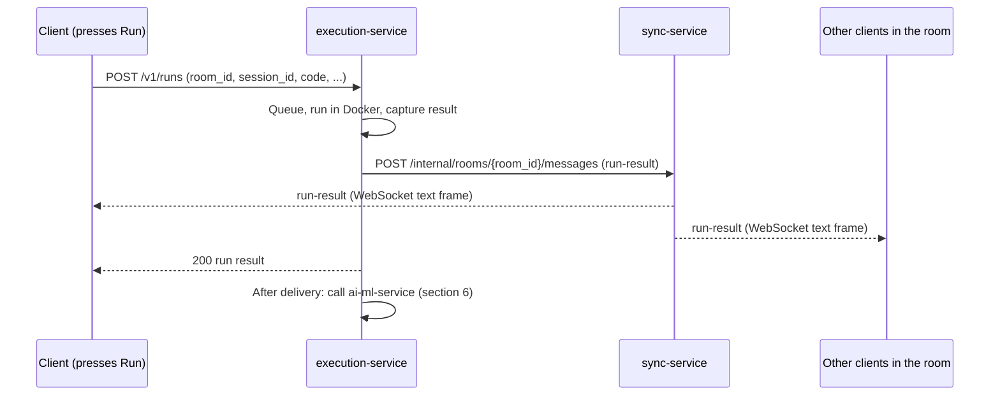

# Service Contracts (T-06)

**Version:** v0 (draft, "expect changes")
**Issue:** T-06 · #9
**Branch:** `feature/T-06-service-contracts`
**Author:** Yash Oza (Category D, PR1: sections 1 to 6)
**Next:** Femina Rathod (PR2: section 7, error shapes and examples), then v1 (section 8, owner token)
**Related:** `docs/ai-ml-contract.md` (T-07, execution-service to ai-ml-service)

This document fixes the endpoint paths, ports and field names the four services and the client share, so every category builds against the same shapes. v0 covers what the scaffolds and T-11 need first. Field names are meant to hold from here on. Until v1 is published, a field may still be renamed if every consumer is told in #dev and the change is logged under "Changes". **After v1, never rename a field without telling every consumer and logging it under "Changes".**

| Section | Status in v0 |
|---|---|
| 1. Services, ports, health | Decided |
| 2. Conventions | Decided |
| 3. Client and sync-service | Decided |
| 4. Client and execution-service (run request and result) | Decided |
| 5. Delivering a run result to the whole room (FR4.5) | Decided |
| 6. Ordering rule (NFR9) | Decided |
| 7. Error shapes | Reserved for Femina (PR2) |
| 8. Owner token (FR9.5, T-10) | Reserved for v1, after T-05 |
| 9. Open items | Listed |

---

## 1. Services, ports and health

Ports and health paths are adopted from the T-08 integration stack (`docker-compose.yml`, `.env.example`). They were provisional there and are **final from this document on**.

| Service | Folder | Port | Health path | Reached by |
|---|---|---|---|---|
| client | `client/` | 3000 | `/` | the browser |
| sync-service | `sync-service/` | 8081 | `/actuator/health` | browser (WebSocket), execution-service (internal endpoint, section 5) |
| execution-service | `execution-service/` | 8082 | `/actuator/health` | browser (run request), ai-ml-service is called by it |
| ai-ml-service | `ai-ml-service/` | 8000 | `/health` | execution-service only (see T-07) |

- Inside the Docker Compose network, services reach each other by service name (for example `http://sync-service:8081`). From the browser and from local runs, use `localhost`.
- The two Spring Boot services must include Spring Boot Actuator, so `/actuator/health` returns HTTP 200 and the T-08 smoke test can check them.
- The browser talks to sync-service and execution-service **directly**. There is no gateway.
- If the client uses Vite, its dev server defaults to port 5173. T-01 must set `server.port` and `preview.port` to 3000 in the Vite config, ideally with `strictPort: true` so it fails instead of silently picking another port. Otherwise CORS (`CLIENT_ORIGIN`) and the T-08 smoke test, which checks `/` on port 3000, break.

### Shared settings (environment variables)

No secrets are committed (NFR10). Real values live in each person's local, git-ignored `.env`; the names and safe defaults go in `.env.example`.

| Variable | Used by | Default | Purpose |
|---|---|---|---|
| `CLIENT_ORIGIN` | sync-service, execution-service | `http://localhost:3000` | Browser origin allowed by CORS (execution-service) and by the WebSocket origin check (sync-service). |
| `SYNC_SERVICE_INTERNAL_URL` | execution-service | `http://sync-service:8081` | Where execution-service sends results to broadcast (section 5). |
| `INTERNAL_API_TOKEN` | sync-service, execution-service | none (set locally) | Shared secret on the internal endpoint (section 5). Never committed. |

### Client settings (browser build)

| Variable | Default | Purpose |
|---|---|---|
| `VITE_SYNC_WS_URL` | `ws://localhost:8081/ws/rooms` | Base of the sync WebSocket URL. The client appends `/{room_id}?session_id=...` (section 3.1). |
| `VITE_EXECUTION_API_URL` | `http://localhost:8082` | Base URL of execution-service. The client calls `POST {value}/v1/runs` (section 4.1). |

These names assume Vite, where only `VITE_`-prefixed variables reach the browser. If T-01 uses another build tool, the meaning stays the same and this table is updated. Everything in a client build is visible to anyone who opens the site, so **never put `INTERNAL_API_TOKEN`, an API key or any other secret in a client variable.**

---

## 2. Conventions

- All JSON field names are `snake_case`, matching `docs/ai-ml-contract.md` (T-07).
- `request_id`: a UUID v4 generated **by the client** for each run. It is echoed unchanged in the run result, in the broadcast message, and (by execution-service) in the call to ai-ml-service, so one id follows a run end to end.
- `room_id`: see section 3.2. `session_id`: see section 3.3.
- `language`: exactly one of `cpp`, `python`, `c`, `java`, `javascript` (DR1). These are the same identifiers T-07 uses.
- Time is in milliseconds (`*_ms`), memory in megabytes (`*_mb`), both JSON numbers.
- HTTP request bodies and responses are `application/json`, UTF-8. A run request body is limited to 1 MiB.
- execution-service sends CORS headers allowing `CLIENT_ORIGIN`. sync-service rejects a WebSocket handshake whose `Origin` is not `CLIENT_ORIGIN`.
- The limits quoted in this document (5 s wall time, 128 MB, 1 MB output and so on) come from NFR4 and are **configuration**, not part of the contract (DR3). Clients must not hard-code them.

---

## 3. Client and sync-service

sync-service is a WebSocket relay (T-02). It never reads or changes Yjs data.

### 3.1 Connection URL

```
ws://localhost:8081/ws/rooms/{room_id}?session_id={session_id}
```

- The room id is a **path segment**. The session id is a **query parameter**, because browsers cannot set custom headers on a WebSocket.
- The owner token (v1, section 8) will **not** be sent in the URL, so it never lands in logs.
- This shape works with the `y-websocket` client. It opens `serverUrl + '/' + roomName + '?' + params`, so `new WebsocketProvider('ws://localhost:8081/ws/rooms', room_id, ydoc, { params: { session_id } })` produces exactly this URL. Checked against the y-websocket 3.1.0 source and a test relay. Het and Niranjan confirm it in the real client during review.

### 3.2 Room id

- The room id is an opaque string of 1 to 64 characters from `A-Z a-z 0-9 _ -`.
- The shareable join link (US-01) contains exactly this value, in the page route below.
- **Page route:** the link opens the client at `/room/{room_id}`, for example `http://localhost:3000/room/room-demo-01`. T-01 reads the room id from this path and US-01 builds the link. Changing the route needs a T-06 update first.
- In v0 the relay creates a room the first time someone connects to it. No REST call is needed to create a room. If T-05 or T-10 needs server-created rooms, that changes in v1.
- A malformed room id closes the connection with code `4400` (section 3.6).

### 3.3 Session id (stable per browser)

- The **client** generates the session id once (a UUID v4, for example `crypto.randomUUID()`), stores it in the browser (`localStorage`, key `collab_session_id`), and **reuses it on every connection and every reconnect**. The server never generates or replaces it.
- The client sends the same value as `session_id` in the WebSocket URL and in every run request.
- The relay keeps the session id with each connection (T-02). Several tabs of one browser share one session id and may all be connected.
- This is what FR9.6 (Sprint 2) uses to block a removed user. Known limit: a user who clears browser storage gets a new session id. FR9.6 already accepts this and adds "regenerate the link" for the owner.
- `crypto.randomUUID()` exists only in secure contexts (HTTPS or localhost). If the page is opened over plain HTTP on a LAN address, the client falls back to a UUID v4 built from `crypto.getRandomValues`. Either way the value must be a valid UUID v4.
- The session id is **not** the owner token. Ownership (FR9.5) is a separate token, see section 8.

### 3.4 Frames

| Frame type | Direction | Content |
|---|---|---|
| **Binary** | both | Yjs sync and awareness messages in the `y-websocket` framing. The relay only looks at the first byte (section 3.5, rule 1). |
| **Text** | server to client | JSON control messages (section 3.5). |

Display name and colour (FR14, FR3) travel inside the Yjs awareness state. The relay never reads them.

The client sends no text frames in v0. A run goes over HTTP (section 4).

### 3.5 Relay rules

1. A binary frame from one connection is forwarded **unchanged** to every **other** connection in the same room. It is not echoed back to the sender, with one exception: an **awareness frame (first byte `1`) is also sent back to the sender.** The `y-websocket` client closes the connection and reconnects when it receives no message for 30 seconds, and a lone user would otherwise receive none. Tested with y-websocket 3.1.0: without the echo a lone client reconnected after about 30 seconds; with it, it stayed connected.
2. The relay stores nothing: no document, no history.
3. The largest accepted binary frame is **1 MiB**; a larger one closes the connection with code `1009`. Spring's default buffer for WebSocket messages is much smaller (about 8 KB as far as I know), so T-02 must raise it.
4. Text frames from the server may be up to **4 MiB** (a run result carries stdout and stderr).
5. WebSocket ping and pong frames are answered normally. Reconnect with exponential backoff is the client's job (FR11.1).
6. After connecting, the client sends one binary frame containing the single byte `3` (query awareness). The relay forwards it like any other frame, and every peer answers with its full awareness state. Without it, a person who joins late sees existing cursors only after about 16 seconds; with it, after about 100 milliseconds (tested with y-websocket 3.1.0). This supports FR3 (Sprint 2).

### 3.6 Server to client text messages

Every text message is a JSON object with a `type`.

#### `run-result`

Sent to **every** connection in the room when a run finishes (section 5). It carries the run result defined in section 4.2, plus `type`.

```json
{
  "type": "run-result",
  "request_id": "0b9d2f3e-7a41-4c58-9e1b-5d3c8a6f2e10",
  "room_id": "room-demo-01",
  "language": "cpp",
  "stdout": "hello\n",
  "stderr": "",
  "exit_code": 0,
  "execution_time_ms": 312,
  "peak_memory_mb": 4.1,
  "timed_out": false,
  "oom_killed": false,
  "failure_kind": null,
  "output_truncated": false,
  "message": null
}
```

The client that pressed Run receives this message too. A client shows a run only once per `request_id`: it may also receive the same result from its own HTTP response (section 4.2), and whichever arrives first is shown.

#### Reserved for Sprint 3

`anomaly-warning` (FR8.2) and `ai-explanation` (FR13.2) are reserved type names for the separate follow-up messages that arrive **after** the run result (NFR9). Their fields are defined in Sprint 3 from the T-07 responses.

#### Close codes

| Code | Meaning |
|---|---|
| `4400` | Malformed room id, or `session_id` missing or not a UUID. |
| `4403` | Reserved: the session was removed from this room (FR9.6, Sprint 2). |
| `1009` | Binary frame larger than 1 MiB. |

### 3.7 Example

```
ws://localhost:8081/ws/rooms/room-demo-01?session_id=7c1e4a52-3b0d-4f6a-9a2e-8d5f1b6c3e90
```

---

## 4. Client and execution-service

### 4.1 Run request

```
POST http://localhost:8082/v1/runs
Content-Type: application/json
```

| Field | Type | Required | Notes |
|---|---|---|---|
| `request_id` | string (UUID v4) | Yes | Generated by the client. |
| `room_id` | string | Yes | The room the result is delivered to. |
| `session_id` | string (UUID v4) | Yes | The same stable id as in section 3.3. It lets Sprint 2 enforce read-only guests (FR9.4) without renaming anything. |
| `language` | string | Yes | One of the five ids in section 2 (DR1). |
| `code` | string | Yes | Source code to run (FR4.1). |
| `stdin` | string | No | Defaults to `""` (FR4.1). |

```json
{
  "request_id": "0b9d2f3e-7a41-4c58-9e1b-5d3c8a6f2e10",
  "room_id": "room-demo-01",
  "session_id": "7c1e4a52-3b0d-4f6a-9a2e-8d5f1b6c3e90",
  "language": "cpp",
  "code": "#include <iostream>\nint main() {\n    std::cout << \"hello\" << std::endl;\n    return 0;\n}",
  "stdin": ""
}
```

### 4.2 Run result

The call returns **HTTP 200 with the run result** once the run has finished. This includes failed runs: a compile error, a non-zero exit, a timeout and an out-of-memory kill are all **results, not errors**, because FR4.2 requires stdout and stderr to be shown for failed runs, and FR4.5 requires every participant to see them. Real errors (queue full, unsupported language, invalid request) are section 7.

The client should allow at least 30 seconds for this call, because the call waits in the queue (FR16) and for the compile stage (NFR4.5) and run stage (NFR4.1).

| Field | Type | Notes |
|---|---|---|
| `request_id` | string | Echoed from the request. |
| `room_id` | string | Echoed from the request. |
| `language` | string | Echoed from the request. |
| `stdout` | string | Always present, may be `""` (FR4.2). |
| `stderr` | string | Always present, may be `""` (FR4.2). |
| `exit_code` | integer | Exit code of the process (FR4.4). |
| `execution_time_ms` | number | Wall-clock time measured by execution-service (FR4.3, FR6). |
| `peak_memory_mb` | number | Peak memory in megabytes (FR4.3, FR6). |
| `timed_out` | boolean | `true` if killed by the wall-time limit (NFR4.1). |
| `oom_killed` | boolean | `true` if killed by the memory limit (NFR4.2). |
| `failure_kind` | `"compile_error"` \| `"non_zero_exit"` \| `"timeout"` \| `null` | `null` when the run succeeded. Same values as T-07. |
| `output_truncated` | boolean | `true` if stdout or stderr was cut at the output cap (NFR4.4). |
| `message` | string \| `null` | A short sentence the UI shows beside the output, for example `"Time limit exceeded"` or `"Memory limit exceeded"` (NFR4.2). `null` when there is nothing to say. |

The field names for time, memory, exit code, `timed_out`, `oom_killed` and `failure_kind` are the same as in `docs/ai-ml-contract.md`, so execution-service passes them through to ai-ml-service without translating.

**Success** (also the example in section 3.6):

```json
{
  "request_id": "0b9d2f3e-7a41-4c58-9e1b-5d3c8a6f2e10",
  "room_id": "room-demo-01",
  "language": "cpp",
  "stdout": "hello\n",
  "stderr": "",
  "exit_code": 0,
  "execution_time_ms": 312,
  "peak_memory_mb": 4.1,
  "timed_out": false,
  "oom_killed": false,
  "failure_kind": null,
  "output_truncated": false,
  "message": null
}
```

**Compile error**:

```json
{
  "request_id": "5e8a1c47-92d3-4b6f-a0c1-3f7d2b9e4a18",
  "room_id": "room-demo-01",
  "language": "cpp",
  "stdout": "",
  "stderr": "main.cpp:3:5: error: 'x' was not declared in this scope\n",
  "exit_code": 1,
  "execution_time_ms": 0,
  "peak_memory_mb": 61.2,
  "timed_out": false,
  "oom_killed": false,
  "failure_kind": "compile_error",
  "output_truncated": false,
  "message": null
}
```

**Timeout**:

```json
{
  "request_id": "a3c9e7d1-4f28-4a65-b1d0-6e2f8c5b9a37",
  "room_id": "room-demo-01",
  "language": "python",
  "stdout": "",
  "stderr": "",
  "exit_code": 137,
  "execution_time_ms": 5000,
  "peak_memory_mb": 9.8,
  "timed_out": true,
  "oom_killed": false,
  "failure_kind": "timeout",
  "output_truncated": false,
  "message": "Time limit exceeded"
}
```

**Out of memory**: `oom_killed` is `true`, `exit_code` is the kill code (for example `137`), `failure_kind` is `"non_zero_exit"` and `message` is `"Memory limit exceeded"`.

---

## 5. Delivering a run result to everyone in the room (FR4.5)

### Decision

**execution-service delivers the result to the room through sync-service.** When a run finishes, execution-service sends the run result to sync-service's internal endpoint, and sync-service forwards it as a `run-result` text frame (section 3.6) to every connection in that room. The caller also gets the same result in its HTTP response (section 4.2).



### Why this one

- A client cannot fake a result, because only execution-service can call the internal endpoint.
- Everyone gets the result even if the person who pressed Run closes the tab or loses connection.
- The result reaches everyone over the connection they already have, so no second live connection is needed.
- It matches `docs/ai-ml-contract.md` section 6, which already assumes execution-service sends the result through sync-service.
- Rejected: **the pressing client rebroadcasts the result** (it can be faked and is lost if that tab closes), and **every client listens to execution-service directly** (it needs a second live connection and room tracking in execution-service).

### Internal endpoint (execution-service to sync-service only)

```
POST {SYNC_SERVICE_INTERNAL_URL}/internal/rooms/{room_id}/messages
X-Internal-Token: <INTERNAL_API_TOKEN>
Content-Type: application/json
```

- The body is the exact text frame to broadcast (for example the `run-result` object, including `"type"`). sync-service checks that `type` is a non-empty string and the body is at most 4 MiB, and forwards it **to every connection in the room, including the caller's**.
- The browser can reach port 8081 too, so this endpoint is protected by the shared secret. A missing or wrong `X-Internal-Token` returns `401` and broadcasts nothing. The secret is read from the environment and is never committed (NFR10).

Response `200`:

```json
{
  "room_id": "room-demo-01",
  "delivered": 3
}
```

`delivered` is the number of connections the message was sent to. A room with no connections returns `200` with `"delivered": 0`; that is not an error. A malformed body returns `400` and a bad token returns `401`, both with the T-07 error envelope (details in section 7).

---

## 6. Ordering rule (NFR9)

The ai-ml-service is never in the critical path of a run result. This repeats `docs/ai-ml-contract.md` section 6 so both contracts say the same thing:

1. execution-service runs the code and captures the result.
2. It sends the result to the room (section 5), then returns the HTTP response.
3. **Only after that** it calls ai-ml-service (`POST /v1/anomaly`, and `/v1/review` or `/v1/explain` when the user asked and has consented).
4. Anything ai-ml-service returns reaches the room as a **separate** follow-up message (`anomaly-warning`, `ai-explanation`, section 3.6), never inside the run result.

If ai-ml-service is slow, down or returns an error, the run result is not affected.

---

## 7. Error shapes (Femina, PR2)

Reserved. The base is the error envelope in `docs/ai-ml-contract.md` section 5:

```json
{
  "request_id": "<uuid from the request, or null>",
  "error": {
    "code": "SOME_CODE",
    "message": "Human-readable text",
    "retry_after_seconds": null
  }
}
```

PR2 adds codes, HTTP statuses, message text and one full JSON example for each of:

- Queue full: "busy, try again" (FR16).
- Unsupported language.
- Invalid or oversized run request.
- Internal-endpoint errors (`400`, `401`) from section 5.

Timeout and memory-limit-exceeded are **not** errors here; they are run results (section 4.2).

---

## 8. Owner token (v1)

Reserved for v1, after T-05 decides where owner state lives (FR9.5, T-10). Decided already: the owner token is **not** sent in the WebSocket URL, and it is separate from the session id in section 3.3.

---

## 9. Open items

| # | Item | Owner | Needed by |
|---|---|---|---|
| 1 | Error shapes (section 7) | Femina | v0 PR2 |
| 2 | Owner-token section (section 8) | Yash, after T-05 | v1 |
| 3 | An empty room keeps no document, because the relay stores nothing (section 3.5). A person who joins after everyone has left gets a blank document unless a client still has a local copy (`y-indexeddb`, FR11.2). Decide whether v1 needs server-side state. | T-02 owners and Category A | v1 review |
| 4 | Room creation: who creates a room and when (section 3.2). | T-05 and T-10 | v1 |
| 5 | Whether `execution_time_ms` includes the compile stage (for example the `0` in the compile error example). The field name does not change either way. | Jay (B) | v1 |
| 6 | Whether the 1 MB output cap (NFR4.4) applies per stream or combined. It affects the 4 MiB text frame limit in section 3.5. | Jay (B) | v1 |
| 7 | Read-only guest enforcement on Run (FR9.4, Sprint 2) uses `session_id`, which the run request already carries. | Sprint 2 | Sprint 2 |
| 8 | Fields of `anomaly-warning` and `ai-explanation` (section 3.6). | Category C | Sprint 3 |
| 9 | Confirm the page route `/room/{room_id}` (section 3.2) and the client variable names (section 1) in the real client. | Het, Chandan, Niranjan | v1 review |

---

## 10. Review confirmations (needed before v1)

Each person confirms their own section in a PR comment: "I can implement my part from this document alone."

- [ ] **Het (A):** section 3 (connection, frames, session id, route), the client variables in section 1, and the client side of sections 4 and 5.
- [ ] **Chandan (A, US-01):** the page route in section 3.2.
- [ ] **Jay (B):** section 4 (run request and result) and the execution side of section 5.
- [ ] **Prince (C):** sections 2 and 6, and that the result fields match `docs/ai-ml-contract.md`.
- [ ] **Yash and Femina (D):** sections 1, 5, 7 and 8.

---

## Changes

| Version | Date | Change |
|---|---|---|
| v0 (revised) | Oct 2026 | After review by the T-01 owner: client port note and client variable names (section 1), page route `/room/{room_id}` (3.2), secure-context note for the session id (3.3), awareness-frame echo and query-awareness frame (3.5, found by testing y-websocket 3.1.0), and clearer wording of the field-name rule. |
| v0 | Oct 2026 | First draft: ports and health (adopted from T-08), conventions, sync connection and session id, run request and result, FR4.5 delivery, ordering rule. Error shapes and owner token reserved. |
